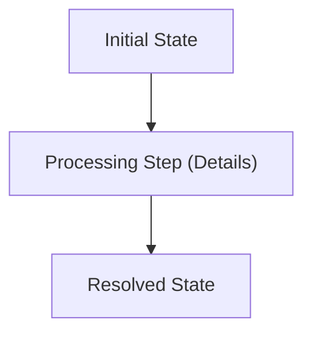

# Chat History - ace-run (research.21.gem)

- **TIMESTAMP:** 2026-10-18 10:42:20 EDT
- **MODEL:** agy/gemini-3.8-flash-high
- **AGENT:** research.21.gem
- **PROMPT:** `~/.sase/multi_prompts/202610/gh_sase_org__sase-multiprompt-261018_102801.md`

## Prompt

%id(gem, clan=research.21)
%m:agy/gemini-3.8-flash-high %q(1.5x, w=0.25)
#gh:gh_sase-org__sase 
You are researcher gem in a 4-researcher swarm.
The other researchers, `research.21.cdx`, `research.21.cld`, `research.21.grk`, are independently investigating the same request and will write their own self-named reports ending in `__cdx.md` and `__cld.md` and `__grk.md`. Your report will end in `__gem.md`.

Conduct your research independently and form your own conclusions. Do NOT attempt to
locate, open, read, or otherwise consult the other researcher's report from this swarm,
even if it becomes available before you finish. Do not obtain that peer's findings
indirectly through its chat transcript, summaries, or requests to the peer. You may
independently use the same external sources, shared input material, and unrelated prior
research. You may check filenames or file existence to avoid overwriting your own
output, but do not inspect the peer's report contents. If you encounter its filename,
leave the report alone. The lead researcher will read every report and synthesize their
findings after you have all finished.

I would like to start instructing the `#research_swarm` macro swarm's image agent to
consider whether or not the research file would benefit from one or more mermaid
diagrams to visually illustrate certain concepts.

- If so, it should not modify the lead researcher's report or create its own report.
- Instead, we need a way for the image agent to create the appropriate mermaid diagrams
  and specify which parts of the research file they correspond with. Think hard about
  the best way to do this.
- The linker agent should then be responsible for integrating these mermaid diagrams (if
  the image agent chose to create any) into the final document.

Can you do some research with the goal of helping me decide the best way to implement
this? Also, critique this plan in general. Is this a good idea? Would you take a
different approach? Make any adjustments to the requirements that you think are
justified but clearly call these out. End your analysis with a recommended solution. 
Write this research to a new markdown file under the $(sase repo path research --ensure)/$(date +%Y%m)/ directory.
Choose a descriptive filename stem yourself, but the filename MUST end with the
`__gem` suffix, i.e. `<stem>__gem.md` (double underscore before the
suffix). Create the report without overwrite: if the exact file already exists, pick a
different stem instead of replacing it.


After the write succeeds, register the report as a durable snapshot:

sase artifact create -p "<absolute-report-path>" -l "research:<repo-relative-report-path>"

Use the report's actual absolute path and its path relative to the research repo root
(for example
`research:202609/topic__a.md`),
including any subdirectory the steps above put it in. Do not derive the label from
the current month, the clock, or a guessed name.
Do not pass `--move`; the source stays in the research repo for later reorganization. If
registration itself fails, report that failure — do not report the research task as
fully complete.

## Response

# Research Report: Mermaid Diagram Generation & Linker Integration in `#research_swarm`

**Author:** Researcher `gem` (`research.21.gem`)  
**Artifact Snapshot:** `research:202610/research_swarm_mermaid_diagrams__gem.md`  
**File Location:** [`/home/bryan/.local/state/sase/workspaces/sase-org/sase/sase_17/sase/repos/research/202610/research_swarm_mermaid_diagrams__gem.md`](file:///home/bryan/.local/state/sase/workspaces/sase-org/sase/sase_17/sase/repos/research/202610/research_swarm_mermaid_diagrams__gem.md)

---

## Executive Summary & Bottom Line

The plan to instruct the `#research_swarm` image agent to consider and author inline Mermaid diagrams—leaving integration to the linker agent—is **a strong, high-leverage improvement** for research readability, but requires concrete architectural safeguards:

1. **Mermaid is natively supported in both target surfaces:** `bob highlights create` compiles Mermaid diagrams into vector/raster figures via headless Chrome + `mermaid.js` for Pandoc $\to$ XeLaTeX PDFs, while GitHub renders ```` ```mermaid ```` code blocks as interactive SVG in Markdown.
2. **The hand-off protocol must use a companion Markdown file (`<name>__diagrams.md`), not JSON or diffs:** Markdown avoids LLM multi-line JSON escaping failures. The double underscore suffix (`__diagrams.md`) is automatically excluded from triggering the `research-highlights` file-hook, preventing spurious PDF generation.
3. **Placement must use semantic anchor landmarks:** The linker actively restructures sections, merges prose, and eliminates tables; rigid line numbers or heading paths will break. The companion file must pair each diagram with a quoted anchor passage from `__final.md`.
4. **Decouple diagrams from raster infographic generation:** The image agent only runs when `image=true` (which defaults to `false` in standard `#research_swarm::` / `rs` dispatches). Gating text diagrams behind a raster PNG generator forces users to pay for heavy `@image` models and 1.5 MB PNGs just to get text flowcharts. We recommend broadening the role to a visual pass or introducing an explicit/inherited `diagrams` parameter.
5. **Enforce PDF-safe Mermaid constraints:** The linker must ensure diagrams prefer top-down orientation (`flowchart TD`), quote labels containing punctuation (`id["Step (Details)"]`), avoid raw HTML tags, and remain capped at 1–3 diagrams per report to avoid PDF page-margin scale clipping.

---

## Detailed Critique of the Plan

### What Works
- **Strict Immutability:** Requiring the image agent neither to edit the lead's report (`<name>__final.md`) nor author its own report protects SASE's synthesis baseline.
- **Pipeline Alignment:** The pipeline order naturally flows from Lead (`.final`) $\to$ Visuals (`.image`) $\to$ Publisher (`.linker`).
- **Editorial Cleanliness:** The linker agent's role is preserved as an editor and publisher rather than a technical illustrator.

### Friction Points & Risks
1. **The `image=false` Default:** Most research dispatches use default `rs`, skipping `.image`. Technical diagrams will never appear unless `image=true` or an independent visual flag is provided.
2. **The Restructuring Collision:** Because the linker actively rewrites and reorganizes headings, any image-agent placement instructions based on heading numbers or line numbers will fail. Placement must use quoted landmark text.
3. **Agent Cognitive Overload:** Combining full-page raster infographic design (Python/matplotlib/PIL/headless Chrome) with deep technical reading across a 500-line report in a single turn risks output truncation or hasty Mermaid syntax.
4. **PDF Scaling Fragility:** Wide `flowchart LR` diagrams with more than 3–4 horizontal steps cause `bob-cli` to emit scale warnings and shrink text below legible sizes in standard PDF page margins.

---

## The Recommended Hand-Off Contract: `<name>__diagrams.md`

The image agent should write `<name>/<name>__diagrams.md` using the following schema:

````markdown
# Visual Diagrams for <topic>

## Diagram 1: [Descriptive Title]
- **Target Section / Topic:** [Section heading from __final.md]
- **Anchor Passage:** [1-2 sentences quoted from __final.md near intended insertion point]
- **Placement:** [Directly after anchor passage | Preceding section breakdown]
- **Caption:** [Figure 1: Concise 1-sentence caption]


````

If no diagrams are needed, the image agent skips writing this file.

---

## Recommended Adjustments to the Requirements

| Original Requirement | Recommended Adjustment | Rationale |
| :--- | :--- | :--- |
| **Image agent considers Mermaid diagrams** | **Broaden to "Visuals" & add `diagrams` input** | Allows diagrams without forcing raster infographic PNG creation or heavy `@image` runs. |
| **Do not modify `__final.md` or create own report** | **Keep as hard invariant** | Preserves lead's immutable synthesis baseline. |
| **Specify which parts diagrams correspond with** | **Use semantic anchor quotes in `<name>__diagrams.md`** | Prevents broken insertions when the linker reorganizes headings. |
| **Linker agent integrates diagrams into final doc** | **Linker validates Mermaid syntax and captions** | Enforces top-down flow (`TD`), quotes on punctuated labels, and clean PDF figures. |

---

## Action Items & File Artifacts

1. **Research Report Written:**
   - Path: [`/home/bryan/.local/state/sase/workspaces/sase-org/sase/sase_17/sase/repos/research/202610/research_swarm_mermaid_diagrams__gem.md`](file:///home/bryan/.local/state/sase/workspaces/sase-org/sase/sase_17/sase/repos/research/202610/research_swarm_mermaid_diagrams__gem.md)
2. **Artifact Registered:**
   - Command: `sase artifact create -p "/home/bryan/.local/state/sase/workspaces/sase-org/sase/sase_17/sase/repos/research/202610/research_swarm_mermaid_diagrams__gem.md" -l "research:202610/research_swarm_mermaid_diagrams__gem.md"`
   - Result ID: `explicit:6aac95fba3a000fe3f8b5a58` (`ref: file:explicit:6aac95fba3a000fe3f8b5a58`)
3. **Turn Finalizer Submitted:**
   - Manifest submitted and accepted for repository `sdd:research` (`repo-736e4b0000d3`).
