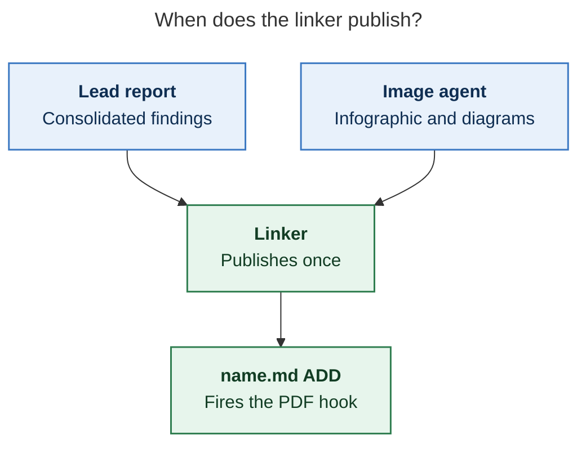
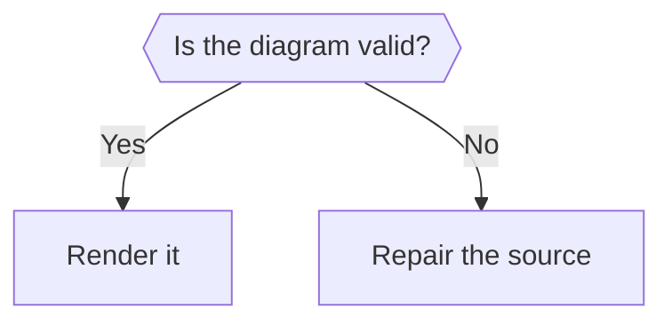
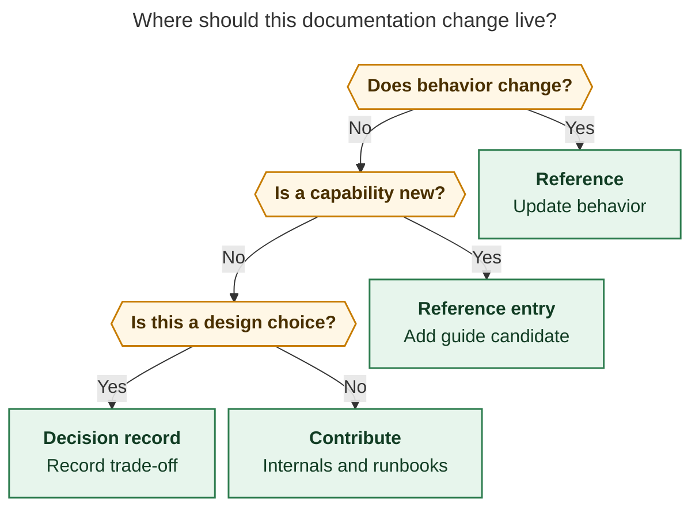
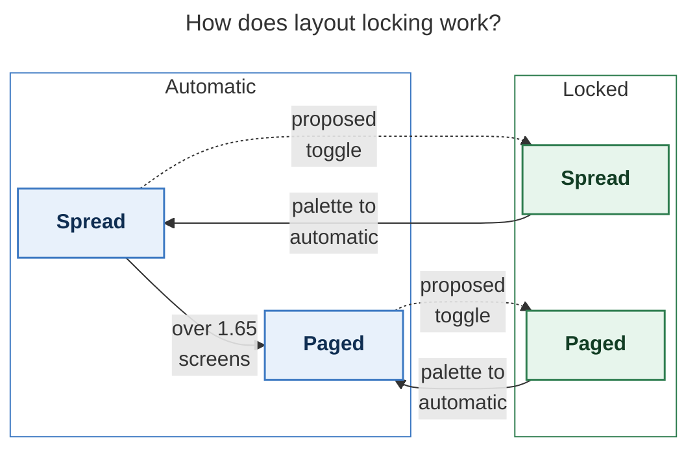

# Chat History - ace-run (research.2b.image)

- **TIMESTAMP:** 2026-10-23 16:39:42 EDT
- **MODEL:** codex/gpt-6-astra
- **AGENT:** research.2b.image
- **PROMPT:** `~/.sase/multi_prompts/202610/gh_sase_org__sase-multiprompt-261023_155629.md`

## Prompt

%id(image, clan=research.2b) %m:gpt-6-astra
%wait:research.2b.final %q(1.5x, w=0.25) #gh:gh_sase-org__sase 
%macros_enabled:false
# Previous Continuation

This fork uses versioned continuation replay. Blocks are stable, parent-first projections of exact continuation nodes; any historical source without recoverable node provenance is represented as an opaque legacy boundary.

- **Projection version:** `1`
- **Ordered nodes:** `1`

## Continuation Block `block:v1:8d218b4b85cbda847f3fb01754e589ea`

- **Node:** `agent-delta:20261023155635:52b2c73798b7ebd2`
- **Kind:** `agent_delta`
- **Parents:** (none)
- **Content:** `local:continuation/records/agent_delta/agent-delta:20261023155635:52b2c73798b7ebd2.json`

### User

**Protected user instruction.** Carry this request unless an explicit attributed update supersedes it.

%clan(research.2b, tribe=research, summary=[[[bold]RESEARCH PROMPT:[/bold] I am working on the blog post for sase (see the ~/bob/sase_blog_contents.md file for the
rough draft I have now), but am experiencing some writer's block. I really want to boil
this blog post down to a set of actionable tasks in Obsidian (with perhaps a spike /
planning task in there somewhere that produces more tasks), but don't have a great
strategy in mind. Can you do some research with the goal of helping me split this blog
post up into tasks? End your analysis with a recommended strategy.]]) %id:research.2b.final %m:@xlarge
%wait:research.2b.cdx %wait:research.2b.cld %wait:research.2b.grk %wait:research.2b.mus %wait:research.2b.gem %q(1.5x, w=0.25)
#gh:gh_sase-org__sase 
You are the lead researcher: 5 independent researchers have reported on the request
below, and you will add your own research and merge every perspective into one
consolidated report.

SASE derives your plan's links from the artifacts you read this turn; use
`sase artifact read` for context you actually used.

Research request:

I am working on the blog post for sase (see the ~/bob/sase_blog_contents.md file for the
rough draft I have now), but am experiencing some writer's block. I really want to boil
this blog post down to a set of actionable tasks in Obsidian (with perhaps a spike /
planning task in there somewhere that produces more tasks), but don't have a great
strategy in mind. Can you do some research with the goal of helping me split this blog
post up into tasks? End your analysis with a recommended strategy.

When you author or carry over Mermaid diagrams, load `/mermaid_diagrams` before
drafting, even when no image or diagrams companion runs. The skill has the shared
figure-selection, styling, and PDF-render review rules. If the provider skill is not
deployed, verify the edited plugin's guide with `sase macro show skill/mermaid_diagrams --format raw` (or
`sase macro show /mermaid_diagrams --format raw`) and use the form this host supports.
This guidance does not enable a companion diagrams agent.

The researchers' registered reports:


- wait_name={{ a.wait_name }} label={{ a.label }} source_path={{ a.source_path }} path={{ a.path }} ref={{ a.ref }}


Month directory (create it if missing):

$(sase repo path research --ensure)/$(date +%Y%m)

Steps:

1. From the registered reports above, identify exactly one report per expected suffix
   in cdx, cld, grk, mus, gem, belonging to this
   dispatch's `research.2b.cdx`, `research.2b.cld`, `research.2b.grk`, `research.2b.mus`, `research.2b.gem` dependencies, matching by `wait_name` and the canonical research
   label's existing `__<suffix>.md` suffix. Never reassign suffixes from list order.
   Open the research repo with `/sase_repo`, then read each report through its canonical
   research reference (or the `ref` field's `file:<id>` reference if the original has
   moved) using `sase artifact read`. Do not read predecessor chat transcripts. If the
   records above do not identify exactly one report per expected suffix, stop and report
   the missing or ambiguous input instead of guessing.
2. Research the request yourself, prioritizing gaps, weak evidence, and disagreements
   between the reports.
3. Pick a descriptive stem `<name>` that collides with nothing in the month directory
   (do NOT end the name with `_consolidated` or `_<YYYYmmdd>` or anything similar unless
   it relates to the research topic), create `<month-dir>/<name>/`, and move each report
   inside it as `<name>__<suffix>.md`, preserving its existing suffix. Each report's
   `source_path` is provenance for where it lives in your own opened research checkout;
   resolve its canonical repo-relative path there before moving it. Never modify the
   other agents' checkouts or the stored snapshot recorded at `ref` — only the copy in
   your own checkout moves. Preserve every file and never overwrite: on any collision,
   pick a different stem first.
4. Write the consolidated report to `<name>/<name>__final.md`: merge the strongest findings
   from every report above and your own research, resolve conflicts, cut duplication,
   and add missing critical context without unnecessary length.

   Do not create `<name>/<name>.md`, not even as a placeholder, because the linker
   agent `research.2b.linker` publishes it from your report.

5. After the write succeeds, register the consolidated report as a durable snapshot so
   the linker agent, `research.2b.linker`, can find it:

   sase artifact create -p "<absolute-report-path>" -l "research:<repo-relative-report-path>"

   Use the consolidated report's actual absolute path and its path relative to the
   research repo root, for example `research:202609/<name>/<name>__final.md`. Register
   only the consolidated report, and do not pass `--move`. If registration fails,
   report that failure; do not report the task as fully complete.

Final layout:

```text
<month-dir>/<name>/
├── <name>__cdx.md
├── <name>__cld.md
├── <name>__grk.md
├── <name>__mus.md
├── <name>__gem.md
└── <name>__final.md
```

### Assistant

I've read four of the five reports; now reading the large cld report, then doing my own checks of the vault.

Verified the draft and project note myself. Now checking Bryan's annotations on the earlier outline to settle the main disagreement between reports (keep 7 abstractions vs. cut to 4).

Prior research confirms a key pattern (≈15 blog research reports since May; outline re-decided several times). Now spot-checking cld's Pomodoro ledger claim, the `bob` task tooling, and repo stats.

Loading the Mermaid style guide before drafting the one diagram in the final report.

Spot-checks confirm cld's ledger numbers exactly (45 of 520 minutes on writing). Two quick verifications left, then I'll write the consolidated report.

Reports moved. Now drafting and test-rendering the one figure (task flow) before writing the final report.

The figure is too tall (57.6% fit, below the 75% floor). Merging nodes and widening label wrap.

Figure renders at 90% fit. One last fact check (README pronunciation claim from cld), then writing the final report.

Writing the consolidated report now.

Report written (≈5.5k words incl. tables and paste block). Registering it as a durable artifact.

Registration succeeded. Now the final declaration.

The research is finished. The consolidated report is at `202610/sase_blog_writers_block_task_plan/sase_blog_writers_block_task_plan__final.md` in the research repo, with the five researcher reports moved alongside it. It is registered as `research:202610/sase_blog_writers_block_task_plan/sase_blog_writers_block_task_plan__final.md`, and the host commits it after this turn. I made no changes to your vault; every task change below is a proposal.

**Why you're stuck:** the problem is how the tasks are cut, not your writing. *Write introduction!* and *Finish full v1 draft* are whole projects, not next actions. Since 10-16, 45 of your 520 BLOG/WRITE minutes went to writing and 450 went to reading. 265 of those reading minutes went to two PyPI-area refs wired in as `dependsOn` prerequisites of the intro, so reading became a gate on writing. I recounted the daily notes and got the same numbers as one of the researchers.

**Two things none of the reports caught:**
- **Three non-writing tasks are about to land in your Ready list.** The Gas Town link task, the post-blog review and the podcast-listen task are only blocked by future scheduled dates (10-24, 10-25 and 10-26). On those days `bob task reconcile` moves them to Ready, including a podcast pass on a post that has no body yet.
- **Whether to cut to four sections is still your call.** Two reports would rewrite the article to the October outline's four sections. But you put "?" on its "The Other Four" (the sections it moves to later posts). You also added the 7-heading structure on 10-15 and didn't change it after finishing the outline on 10-18. My report recommends leaving that decision with you rather than an agent.

**Recommended strategy:**
1. **Today, about 5 minutes:**
   - Mark *Write introduction!* done as intro v0.
   - In the same edit, re-point `^v1-draft` to the new `^w1-review` task (the first wave review). Otherwise closing the intro unblocks the whole-post task.
   - Give the three date-rolled tasks real dependencies.
   - Paste the ready-made task block from §5.7 of the report.
2. **Spike, two Pomodoros, hard stop:**
   - Write the promise sentence.
   - Edit four pre-filled "cards" (before SASE / what SASE generalized it into / one real screenshot or file / one lesson).
   - Write one rough claim sentence under every heading.
3. **Wave 1:** write first drafts of the four sections all five reports and your own annotations agree on (Agent CLIs, the TUI section, Gates, Xprompts). Each is one Pomodoro, at least 150 words, dictated, with no editing. End each with a `NEXT:` line.
4. **Wave review:** this is the planning task that keeps producing tasks. Snapshot the draft, annotate it the way you annotate refs, then decide the other five headings using real word counts. Create at most four tasks for the next wave.
5. **Repeat until no heading is blank.** Then v1 closes, which also unblocks `sase_pre_blog`. After that: revise, write the intro last, then do the publish-day chores (counts, links, listen pass).
6. **Agents only handle facts, counts, the Gas Town term map and media.** They never write prose for the post, and no more research on the post's shape before v1. This was at least the 15th blog research report since May.

The report also covers which points the researchers disagreed on and how I resolved each, corrections to their individual reports, and an effort estimate. It contains one test-rendered Mermaid figure that fits the PDF page at 90%.

---

%macros_enabled:true
# New Query

 Generate an infographic that illustrates the main points made in this research markdown
file. Write the image to `<stem>_infographic.png` in the same directory, where
`<stem>` is the source file's stem with any trailing `__final` removed (so
`topic__final.md` becomes `topic_infographic.png`; other stems are unchanged).
Create it without overwrite. If it already exists, stop and report the collision.


The lead researcher's registered report:


- wait_name={{ a.wait_name }} label={{ a.label }} source_path={{ a.source_path }} path={{ a.path }} ref={{ a.ref }}


Answer named reader questions with a few validated Mermaid figures for the lead's
research report, writing them to a companion manifest for the swarm linker to place.
The linker is the only publisher: you propose, it places or omits.

## 1. Scope and source

- Never edit the report, never write a report of your own, and create no other file in
  the research checkout (`$(sase repo path research --ensure)`). Keep scratch files in a
  fresh `mktemp -d` directory outside it.
- Read the report once with `sase artifact read` on the registered lead entry listed
  above (its `ref`, or its `research:` label), redirecting the output to a scratch copy.
  Never work from memory or the forked conversation alone.
- If no registered lead report is listed, propose nothing and set `status: failed` with
  that reason (step 8).
- If this prompt also asked for an infographic, finish it first. It is the overview,
  and its panels are candidate hints for your figures, not the frame (step 2).

## 2. Find candidates

The infographic, when this prompt asked for one, comes first: it is the overview.
Its panels are candidate hints, not the frame. Each panel suggests where a reader
question might need a picture, but no figure has to open a panel, and a strong
candidate can come straight from a report section the infographic never touched.

Before deciding anything, write a candidate list in your scratch directory. Cover
each `##` section of the report, and each infographic panel when one exists:

- For each section or panel, name the reader question a picture answers faster than prose.
  Also record the report passages that hold the answer, and the diagram type that fits,
  per the guide's "Choose the type from the content's shape" section. With no
  infographic in this prompt, use each report section that describes a mechanism
  instead.
- Add any mechanism the report explains at length that the infographic left out
  entirely.

Pictures earn their place by showing order, branching, state, ownership, or before
versus after.

## 3. Decide

Judge every candidate, then propose each one that passes, best first, within the cap below.
Zero is right when no reader question survives: zero figures for a survey is a success.
Never reach zero just because the infographic already covers a topic.

A candidate passes when all of these hold:

- it answers a named reader question, and a reader would grasp that answer faster
  from the picture than from the prose;
- it shows order, branching, state, ownership, or before versus after: a flow, a
  state lifecycle, an exchange between actors over time, a dependency structure, a
  phased plan, or a today-versus-proposed pair;
- every box, arrow, and label restates something the report says;
- it does not repeat a Mermaid diagram already in the report, a table, or a short list
  that already shows every step, branch, and condition the diagram would draw. Never turn a table into a diagram.

Reject anything one sentence already explains, short linear chains, refresh or
recompute fan-ins, and repeats of an existing diagram, table, or list.

Rank passing candidates in this order: what the bottom line depends on first, then
today versus proposed, then failure and fallback paths, then drill-downs. Prefer
candidates that answer different reader questions over two views of one question.
When a candidate is too big for one figure, scope it to its most decision-relevant
part, such as the go/no-go rule or the failure path, and scope the caption to that
part. Do not drop the candidate.

Propose at most three diagrams for most reports. A complex report may warrant up to five:
one that explains four or more distinct mechanisms in separate `##` sections, such as an architecture, a protocol, a migration, or a multi-phase plan.
Propose a fourth or fifth diagram only when it passes every test above, answers a reader question no higher-ranked proposal covers, and anchors in a `##` section that holds no other proposal (step 6).
Five is a ceiling, not a target: never lower the bar, split one diagram into two, or add one to reach a count.
A passing candidate the cap leaves out is reported as over the cap (step 8).

## 4. Draw

Draw every diagram by the Mermaid diagram guide below, which governs this step: its
"Make the figure stand alone" section for titles, labels, and edges, its "Fit the PDF
page" section for size, and its "Style with the tested palette" section for colour.
Labels may gloss report terms in plain words but add no facts, and a proposed design
stays marked proposed. Add no actors, steps, numbers, orderings, or causal arrows the
report does not state: trace every box and edge to a sentence in the report.
Conditional wording stays conditional.

## 5. Validate

Put every diagram in a scratch Markdown file with a short paragraph before each one.
Set up the short scratch `TMPDIR`, PDF config, and CLI once by following the guide's
"Render, look, and revise" recipe exactly. Keep the selected CLI and any Puppeteer
flags for every check, record its version, and treat an unavailable smoke render as an
environment failure rather than a bad diagram. Render, look at, and revise each figure
as the guide says: at most two look rounds, then drop the figure.

Run the batch check with the PDF-mirroring config:

```sh
<mmdc> -c <scratch>/pdf.json -i <scratch>/check.md -o <scratch>/check_render.md
```

The check passes only when the command exits 0, its output says
`Found N mermaid charts in Markdown input` for your N, and
`<scratch>/check_render-1.svg` through `-N.svg` all exist. `mmdc` stops at the first
failing diagram and prints `Parse error on line …` with an excerpt. Fix, simplify, or
drop that diagram and rerun; stop after five rounds. These parse-fix rounds are
distinct from the guide's two visual revision rounds.

Measure each `check_render-K.svg` with the guide's measure command. Fail any figure
below 0.75 fit scale: revise it within the look rounds or drop it. If no form is
usable, propose nothing and set `status: failed` with the reason (step 8).

## 6. Anchor

For each kept diagram, choose an `anchor`: 5-20 words copied verbatim from _one line_ of
a body paragraph or list item in the report. Headings, table rows, code blocks, and
existing Mermaid fences never qualify. Confirm `grep -cF -- '<anchor>' <scratch-copy>`
prints `1`; if no unique anchor exists, drop the diagram.
Anchor each figure in the passage whose question it answers, not in the bottom line or
a summary that condenses it.
If a fourth or fifth diagram's anchor shares a `##` section with another proposal's anchor, drop that diagram (step 3).

## 7. Write the manifest

Write `<stem>.diagrams.md` beside the report, without overwrite, where `<stem>` is the
report's stem with any trailing `__final` removed, following the `#research/image` stem
rule (so `topic__final.md` becomes `topic.diagrams.md`). If it already exists, stop
diagram work, register nothing, and set `status: failed` naming the collision (step 8).
Write no file when no diagram survived.

Keep all metadata in the body, never in frontmatter: `sase artifact read` strips YAML
frontmatter. Use no local paths and no `file:` refs; the research repo is public.

````markdown
# Diagram proposals: <report title>

Proposals for the swarm linker, not a report. Each diagram restates only what the source
report says.

```yaml
source: research:<YYYYMM>/<name>/<name>__final.md
producer: <this agent's name>
check: "mmdc 12.0.0 with the PDF-mirroring config rendered 1 of 1 Mermaid diagrams"
```

## publication-order

```yaml
anchor: |-
  the linker publishes the canonical report only after every companion finishes.
question: |-
  When does the linker publish?
illustrates: |-
  The linker waits for every companion agent because the PDF hook fires once, on the
  ADD of name.md.
caption: The linker publishes once, after the lead and image agents finish.
review: "360x438 px, fit 100%; question and visual checks passed; 0 revisions"
```


````

- `source` is the report's `research:` label, `producer` is your agent name, and `check`
  records the CLI version and chart count from the passing run, plus that the
  PDF-mirroring config was used.
- Each `## <id>` is a unique slug of lowercase letters, digits, and hyphens; the linker
  publishes the diagram under the anchor `figure-<id>`. `anchor` is a YAML literal block,
  so backticks and quotes copy exactly. `question` is the reader question the figure
  answers. `illustrates` is one sentence in the report's own terms stating the point
  the diagram makes and what the figure lets a reader see; the linker also builds the figure's in-text reference sentence from it.
  `caption` is the takeaway assertion, at most about 25 words, with no figure number.
  `review` is your audit note: the measured size and fit scale, how the question and look checks went, and the revision rounds;
  the linker never copies `question` or `review` into the report.
- Each `mermaid` fence is byte-identical to the source that passed the check; rerun the
  check after any edit.

## 8. Register and report

- When a manifest exists, register it without `--move`:
  `sase artifact create -p "<abs-path>" -l "diagrams:<YYYYMM>/<name>/<stem>.diagrams.md"`.
  The `diagrams:` label keeps it out of every `research:` listing.
- Then always set the `diagrams` variable, including when you proposed nothing. A missing
  variable means unknown or failed, never "considered and declined". It never carries
  Mermaid bodies. On `ready` and `none`, `considered` is how many candidates
  you judged. `failed` may omit it:

  ```sh
  sase var set diagrams --json --value '{"status": "ready", "count": 2, "considered": 4, "manifest": "<YYYYMM>/<name>/<stem>.diagrams.md", "source_ref": "<lead ref>"}'
  sase var set diagrams --json --value '{"status": "none", "count": 0, "considered": 3, "reason": "Survey of five naming options; no reader question needs a picture."}'
  sase var set diagrams --json --value '{"status": "failed", "count": 0, "reason": "Mermaid CLI (mmdc) unavailable on this host"}'
  ```

- A diagram failure never fails this agent. Finish normally so the linker can publish.
  In the final response, list every candidate with its verdict and its reader question:
  proposed, rejected with a reason, or over the cap. A `none` reason names the candidates considered and why each one
  failed.

The Mermaid diagram guide below governs steps 2–5:

# Mermaid diagram craft

Use these rules to decide whether to draw, choose a diagram type, and check a render.
A figure earns space by making a relationship easier to see than prose.

## Know the one thing the figure says

- Write the reader question first, because a figure without a question has no test of usefulness.
- Write one sentence that answers it, because that becomes the caption.
- Gather source passages for every node and relation, because a tidy picture can still invent a claim.
- Draw when the answer depends on order, branching, state, ownership, or before and after, because those relationships benefit from spatial form.
- Use prose when one sentence answers the question fully, because a diagram should earn its reading time.
- Rank candidates by how much the report's conclusion depends on each answer, because the central reasoning matters more than a detailed side path.
- Keep a candidate list before choosing figures, because comparing alternatives improves selection.
- Let a survey report have zero figures when no reader question needs a picture, because the cap is not a quota.

## Choose the type from the content's shape

- Use `flowchart TD` for a decision or routing rule, because labelled answers show the branches directly.
- Draw decision questions as short hexagons and put each answer on its edge, because the branch meaning stays close to the choice.
- Use `stateDiagram-v2` with `state "Readable name" as ID` for modes or lifecycle, because readable labels should not depend on CamelCase identifiers.
- Use one flowchart subgraph per mode when each mode contains meaningful internal layouts, because grouping makes membership visible.
- Give real mode, owner, and phase subgraphs `fill:none` and a stroke that matches their class, because a transparent boundary groups content without hiding it.
- Use `sequenceDiagram` with at most four participants and `autonumber` for actors over time, because a small cast keeps handoffs trackable.
- Use two subgraphs with reused node names for today's design versus a proposal, because shared names make changed relationships easy to compare.
- Use `flowchart TB` with one subgraph per owner for ownership or layers, because the boundary is part of the claim.
- Use `classDiagram` and `erDiagram` when the source describes real structure, because their notation implies more than a casual association.
- Use `quadrantChart` only when the source itself supplies two axes and item coordinates, because invented coordinates imply unsupported measurements.
- Prefer a list or table when it answers the question, because a picture should add a visible relationship.
- Stay with established flowchart, state, sequence, class, ER, and quadrant families while GitHub's Mermaid version is unverified. Do not use timeline, pie, mindmap, or newer shape syntax, because those families or syntax are outside the tested menu.
- Do not invent structure or add mandatory start and end nodes, because every visible relationship must come from the source.

## Make the figure stand alone

- Treat the figure, its in-figure title, and its caption as one unit, because readers may encounter it away from surrounding paragraphs.
- Add frontmatter `title:` as a question or claim, because the title names the subject at the point of use.
- Add optional invisible `accTitle:` and `accDescr:` frontmatter when they improve screen-reader context, because accessible names can add context without adding visible clutter.
- Quote node labels, because punctuation and reserved words should not change the diagram grammar.
- Make labels a bold name plus a short gloss in a backtick Markdown string, because the name scans quickly and the gloss supplies context.
- Aim for eight words or fewer per node label, because long labels enlarge the diagram.
- Keep decision questions to about five words, because compact questions fit hexagons cleanly.
- Avoid `end` as a node ID, because Mermaid treats it as syntax in some flowcharts.
- Label every non-obvious edge with a verb or condition, because an unlabelled arrow can mean order, dependency, or data flow.
- Use one arrow meaning throughout and state whether converging arrows mean “all” or “any”, because readers need a consistent way to follow the logic.
- Expand abbreviations and project terms in a label or caption, because the diagram should not require insider knowledge.
- Give the caption the one-sentence takeaway, because the title names the subject while the caption states what the reader should learn.
- Mark proposed, optional, and failure paths in words and with a compatible line style, because colour or shape alone may not carry the distinction.
- Name only entities and relationships supported by source passages, because visual structure can make an inference look like a fact.
- Keep each box useful to the reader's question, because empty chooser and sink nodes add steps without adding meaning.

## Fit the PDF page

- Aim for a natural SVG size near 650 × 700 px, because that leaves room around a figure at full size.
- Keep the fit scale at or above 75%, because smaller labels become hard to read in the Highlights PDF.
- Measure the root SVG and calculate `min(1, 652.8 / width, 892.8 / height)`, because the PDF fits a 652.8 × 892.8 px text box.
- Tighten `flowchart.rankSpacing`, `flowchart.nodeSpacing`, and optionally `wrappingWidth: 260` before removing supported content, because spacing can improve fit without losing the claim.
- Keep decision text short, because long text inside a hexagon or diamond wraps at the 200 px default and makes the shape grow quickly.
- Split two distinct reader questions into two figures rather than shrinking labels, because readable type matters more than a one-page count.
- Try Mermaid's default layout first and `layout: dagre` when routing adds awkward jogs, because neither layout is best for every graph.

Use the Python measurement command at the end of the render recipe on each SVG. It
reads only root width and height, falls back to the root `viewBox` when either is
missing or nonnumeric, rejects unusable dimensions, and exits unsuccessfully below the
75% floor.

## Style with the tested palette

- Use `classDef`, `class`, and `style` for fills, strokes, and text colour, because those are honored by the research PDF render.
- Choose no more than three semantic colour classes in one figure, because a small palette keeps colour meaningful.
- Copy these fixed fill / stroke / text triples, because they were checked with the PDF theme and remain legible in light and dark GitHub themes.

```text
classDef focus fill:#E8F1FB,stroke:#3B78C2,stroke-width:1.5px,color:#0F2E52
classDef decision fill:#FFF7E6,stroke:#C77C02,stroke-width:1.5px,color:#4A3000
classDef outcome fill:#E7F5EC,stroke:#2E7D4F,stroke-width:1.5px,color:#123D24
classDef risk fill:#FDECEC,stroke:#C0392B,stroke-width:1.5px,color:#5F1414
classDef muted fill:#F3F4F6,stroke:#6B7280,stroke-width:1.5px,color:#1F2937
classDef proposed stroke-dasharray:5 3
```

For a proposed node that also has a palette role, give it both classes on separate
lines:

```text
class NODE muted
class NODE proposed
```

- Apply at most three semantic colour classes per figure, because unused hues weaken the meaning of the palette.
- Stack a palette class and `proposed` with two `class` lines, because comma-separated classes silently apply nothing and chained `:::` classes do not parse.
- Use `-.->` for proposed or optional paths and at most one `==>` for the main path, because line weight should reinforce reading order.
- Let labels and line styles carry essential meaning as well as colour, because readers should not have to distinguish hues alone.
- Use `<br/>` for a deliberate line break and backtick Markdown labels for bold names, because both render correctly in the strict PDF configuration.
- Keep theme directives, `click`, icons, emoji, and index-based `linkStyle` out of figures, because the PDF locks theme settings and edge indices can shift with subgraphs.
- Use plain HTML-free labels apart from `<br/>`, because strict rendering sanitizes other markup.

## Render, look, and revise

- Render SVG and PNG with the PDF-mirroring configuration below, because Mermaid defaults can differ from the document readers see.
- Use a short scratch path as `TMPDIR`, because browser socket paths can exceed platform limits.
- Select and smoke-test the CLI once, then keep the successful command and flags, because switching renderers mid-review changes the evidence.
- Record the selected Mermaid CLI version, because the renderer affects output.
- Render both formats with the same PDF config, because the image being reviewed must match the measured SVG.
- Treat a browser-start failure as an environment failure, because it says nothing about diagram quality.
- Open the PNG and answer the reader question from the image alone. Check labels, arrowheads, crossings, reading direction, and measured fit, then trace every entity and relation to a source passage.
- If the runtime cannot view images, disclose that limit and rely on measured dimensions and source checks, because parsing alone does not prove visual quality.
- Revise at most twice and then drop a figure that still fails, because extra rounds often polish a picture that should not be there.
- Bound PNG export and retry once only after a Puppeteer connection failure, because that export can stall without a diagram defect.

Run this recipe from a directory containing `figure.mmd`. It writes the PDF-mirroring
config inline, tries the pinned CLI before a global install, and retries a browser
sandbox-start failure once with Puppeteer's no-sandbox flag. If neither CLI form works,
record an environment failure and do not judge the diagram.

```bash
scratch=$(mktemp -d /tmp/mmd.XXXXXX)
export TMPDIR="$scratch"
cat >"$scratch/pdf.json" <<'JSON'
{
  "securityLevel": "strict",
  "theme": "neutral",
  "fontFamily": "DejaVu Sans",
  "themeVariables": {
    "fontFamily": "DejaVu Sans",
    "noteBkgColor": "#f8f9fa",
    "noteTextColor": "#24292e",
    "noteBorderColor": "#9ca3af",
    "dropShadow": "none"
  },
  "themeCSS": "* { filter: none !important; }",
  "secure": [
    "secure", "securityLevel", "startOnLoad", "maxTextSize",
    "suppressErrorRendering", "maxEdges", "theme", "themeCSS",
    "themeVariables", "fontFamily"
  ],
  "flowchart": { "useMaxWidth": false },
  "sequence": { "useMaxWidth": false },
  "state": { "useMaxWidth": false },
  "class": { "useMaxWidth": false },
  "er": { "useMaxWidth": false },
  "quadrantChart": { "useMaxWidth": false }
}
JSON
printf 'flowchart TD\n  PROBE["ok"]\n' >"$scratch/probe.mmd"
cat >"$scratch/puppeteer.json" <<'JSON'
{"args":["--no-sandbox"]}
JSON

try_cli() {
  candidate=("$@")
  rm -f "$scratch/probe.svg"
  if "${candidate[@]}" -c "$scratch/pdf.json" -i "$scratch/probe.mmd" -o "$scratch/probe.svg" \
      && test -s "$scratch/probe.svg"; then
    MMDC=("${candidate[@]}")
    return 0
  fi
  rm -f "$scratch/probe.svg"
  if "${candidate[@]}" -p "$scratch/puppeteer.json" -c "$scratch/pdf.json" \
      -i "$scratch/probe.mmd" -o "$scratch/probe.svg" && test -s "$scratch/probe.svg"; then
    MMDC=("${candidate[@]}" -p "$scratch/puppeteer.json")
    return 0
  fi
  return 1
}

if ! try_cli npx -y -p @mermaid-js/mermaid-cli@12.0.0 mmdc; then
  if ! try_cli mmdc; then
    echo "No Mermaid CLI produced a smoke-test SVG; render unavailable on this host." >&2
    exit 2
  fi
fi
"${MMDC[@]}" --version
"${MMDC[@]}" -c "$scratch/pdf.json" -i figure.mmd -o "$scratch/figure.svg"
if ! timeout 90s "${MMDC[@]}" -c "$scratch/pdf.json" -i figure.mmd \
    -o "$scratch/figure.png" -s 1.5 -b white >"$scratch/png.log" 2>&1; then
  if grep -Eqi 'ConnectionClosedError|connection closed|connectionclosed' "$scratch/png.log"; then
    timeout 90s "${MMDC[@]}" -c "$scratch/pdf.json" -i figure.mmd \
      -o "$scratch/figure.png" -s 1.5 -b white >"$scratch/png-retry.log" 2>&1 || {
      cat "$scratch/png-retry.log" >&2
      exit 1
    }
  else
    cat "$scratch/png.log" >&2
    exit 1
  fi
fi
python3 - "$scratch/figure.svg" <<'PY'
from math import isfinite
from pathlib import Path
import re
import sys
from xml.etree import ElementTree as ET


def positive_number(value: str | None) -> float | None:
    if value is None:
        return None
    match = re.fullmatch(
        r"\s*([0-9]+(?:\.[0-9]+)?(?:[eE][+-]?[0-9]+)?)\s*(?:px)?\s*", value
    )
    if not match:
        return None
    number = float(match.group(1))
    return number if isfinite(number) and number > 0 else None


svg = ET.parse(Path(sys.argv[1])).getroot()
width = positive_number(svg.get("width"))
height = positive_number(svg.get("height"))
view_box = svg.get("viewBox")
if view_box:
    values = re.split(r"[\s,]+", view_box.strip())
    if len(values) == 4:
        width = width or positive_number(values[2])
        height = height or positive_number(values[3])
if width is None or height is None:
    raise SystemExit("FAIL: SVG has no usable positive pixel dimensions or viewBox")

scale = min(1.0, 652.8 / width, 892.8 / height)
result = f"{width:g}×{height:g} px, fit {scale * 100:.1f}%"
if not isfinite(scale) or scale <= 0:
    raise SystemExit("FAIL: SVG fit scale is unusable")
if scale < 0.75:
    print(f"FAIL: {result} (below 75%)")
    raise SystemExit(1)
print(result)
PY
```

The secure list, neutral theme, DejaVu Sans font, and `useMaxWidth: false` options mirror
the Highlights renderer. A frontmatter theme override should remain neutral under this
config. A deliberately broken diagram must still make the chosen CLI exit nonzero.





The raw block keeps Mermaid's double-brace hexagon intact through Jinja expansion.

## Worked examples

Each source below was rendered with the recipe above. The SVG links show the rendered
result; the measured dimensions and fit scale make each example checkable.

### Route a documentation change

**Reader question:** Where should a documentation change live?

**Source statement:** Behavior changes go to Reference; new capabilities get a Reference
entry and a guide candidate; design choices get a decision record; internals and runbooks
belong in Contribute.

**Caption:** Route documentation by the kind of change so user behavior, design choices,
and implementation guidance each have a clear home.


Rendered size: 721.7 × 736 px; fit scale: 90.4%.





### Show automatic and locked layouts

**Reader question:** What changes when a layout is locked?

**Source statement:** Automatic mode switches from spread to paged above 1.65 screens;
P can choose a wider layout and lock it; the palette returns either locked layout to
automatic mode. A proposed toggle would hold the automatic layout currently selected.

**Caption:** Automatic mode follows content height; P can lock a wider layout, and the
palette returns either locked layout to automatic mode. The proposed toggle would hold
whichever automatic layout is selected.


Rendered size: 793.2 × 266 px; fit scale: 82.3%.





## Response

I’ll read the registered report, create the infographic without overwriting any existing file, then assess which additional diagrams would help. I’m using the repository, artifact, image-generation, and Mermaid guidance for this work.


The report’s central recommendation is a bounded spike followed by small writing waves, with each review creating the next tasks. The infographic will make that workflow prominent. The report already has a Mermaid diagram of the wave loop, so I’ll avoid duplicating it in the companion.


The infographic draft is complete. I’m correcting two small visual details—the reading/writing comparison and a garbled caption—before saving it. For the companion, I’m checking whether the dependency changes add useful information beyond the report’s existing diagram and tables.


The infographic is saved and registered. I assessed 13 diagram candidates; none passes the report’s non-duplication rule. The wave loop is already illustrated, and the remaining mechanisms are fully covered by short lists or tables. I’ll record `diagrams.status = none` so the linker can distinguish that decision from missing work.


The final PNG is valid, and the source report is unchanged. I’m using `sase_final` to declare the infographic addition for the host to commit.


Created [sase_blog_writers_block_task_plan_infographic.png](/home/bryan/.local/state/sase/workspaces/sase-org/sase/sase_10/sase/repos/research/202610/sase_blog_writers_block_task_plan/sase_blog_writers_block_task_plan_infographic.png) without overwrite. Visually checked and registered as `file:explicit:7057c47722c81e8f467d27c5`. The report is unchanged.

Used built-in image generation; [prompt and corrections](/tmp/sase-visual.iM0sFW/image-prompt.md).

Recorded `diagrams.status = none`, with 13 candidates considered. No companion manifest was created.

| Reader question | Verdict |
|---|---|
| Where do the next writing tasks come from? | Rejected: duplicates existing Figure 1. |
| Where should reading dependencies sit? | Rejected: one sentence fully explains it. |
| What should gate the date-rolled chores? | Rejected: duplicates dependency tables. |
| What happens if intro closes before v1 is rewired? | Rejected: the short list already explains the failure condition. |
| Who decides which headings stay, and when? | Rejected: fully covered by the scope table. |
| What makes a writing task actionable? | Rejected: the four-part test is already concise. |
| What happens when the spike runs out of time? | Rejected: outputs and fallback are explicitly listed. |
| Can the four drafts proceed independently? | Rejected: repeats existing dependencies and wave diagram. |
| Which work belongs to authors versus agents? | Rejected: the ownership rule and table suffice. |
| What does v1 unlock versus the release gate? | Rejected: would reproduce the task tables. |
| What changes when drafting stalls? | Rejected: both recovery paths fit one table row. |
| Which evidence was verified or estimated? | Rejected: categories need no mechanism diagram. |
| Where did the evidence come from? | Rejected: bibliography, without a diagram-worthy relationship. |
