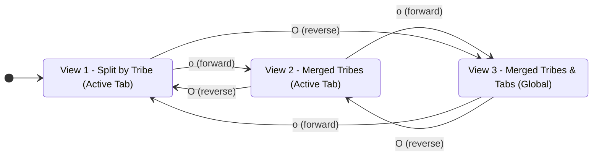

# Chat History - ace-run (research.2q.gem)

- **TIMESTAMP:** 2026-09-27 08:50:36 EDT
- **MODEL:** agy/gemini-3.8-flash-high
- **AGENT:** research.2q.gem
- **PROMPT:** `~/.sase/multi_prompts/202609/gh_sase_org__sase-multiprompt-260927_083447.md`

## Prompt

%id(gem, clan=research.2q)
%m:agy/gemini-3.8-flash-high %q(1.5x, w=0.25)
#gh:gh_sase-org__sase 
You are researcher gem in a 5-researcher swarm.
The other researchers, `research.2q.cdx`, `research.2q.cld`, `research.2q.grk`, `research.2q.mus`, are independently investigating the same request and will write their own self-named reports ending in `__cdx.md` and `__cld.md` and `__grk.md` and `__mus.md`. Your report will end in `__gem.md`.

Conduct your research independently and form your own conclusions. Do NOT attempt to
locate, open, read, or otherwise consult the other researcher's report from this swarm,
even if it becomes available before you finish. Do not obtain that peer's findings
indirectly through its chat transcript, summaries, or requests to the peer. You may
independently use the same external sources, shared input material, and unrelated prior
research. You may check filenames or file existence to avoid overwriting your own
output, but do not inspect the peer's report contents. If you encounter its filename,
leave the report alone. The lead researcher will read every report and synthesize their
findings after you have all finished.

I want to add
support for dynamic sub-tabs to the "Agents" tab.

- We should add the `%tab:<tab_name>` directive to support this.
- If the `%tab` directive is not used explicitly in the prompt used to launch a sase
  agent, then we should default to launching that agent on a special "main" tab.
- If there is only one tab that has agents on it, then we should not show any tabs at
  all (i.e. keep the current behavior).
- Machine Tabs
  - We should add a new "machine tabs" glossary memory web term that describes this
    concept.
  - When remote machines are configured on the current machine, we should automatically
    show `local` instead of `main` for the main tab for agents that were launched on the
    current machine. For remote agents, we should automatically replace `main` with
    `<machine_name>` where `<machine_name>` is that machine's configured name.
  - A good icon should be rendered next to the machine tabs in the sub-tab title bar on
    the "Agents" tab (this includes "local").
  - Any agents that are launched with the `%tab:<tab_name>` directive should always use
    `<tab_name>` as their tab (on all machines). This will allow us to, for example,
    group all agents related to a particular project on a single tab regardless of which
    machine each agent ran on.
- We should not support an "ALL" sub-tab that shows all agents. Instead, we should
  modify the `o` option in the panel that is shown when the `o` keymap is used on the
  "Agents" tab. Namely, we should add support for a 3rd view that merges all tribes and
  all tabs (instead of just all tribes) into a single panel. This option should also
  support its current behavior (merge all tribes--but do not merge tabs) by cycling
  through the 3 views. We should also add a new `O` option that does the same thing as
  the `o` option but in the opposite direction.
- Some previous research can be found in the agent_machine_tabs_and_cluster_semantics.md
  file in the research sidecar repo. This research file should be reviewed before
  performing your own research. Note, however, that this research file focuses too much
  on the specific case of machine tabs, does not prioritize dynamic tabs, and is not
  ambitious enough overall.
- I want you to lead the design on this one. Make sure you design this feature so it is intuitive, reliable, and (last but not least) beautiful!

Can you do some research with the goal of helping me decide the best way to implement
this? Also, critique this plan in general. Is this a good idea? Would you take a
different approach? Make any adjustments to the requirements that you think are
justified but clearly call these out. End your analysis with a recommended solution. 
Write this research to a new markdown file under the $(sase repo path research --ensure)/$(date +%Y%m)/ directory.
Choose a descriptive filename stem yourself, but the filename MUST end with the
`__gem` suffix, i.e. `<stem>__gem.md` (double underscore before the
suffix). Create the report without overwrite: if the exact file already exists, pick a
different stem instead of replacing it.


After the write succeeds, register the report as a durable snapshot:

sase artifact create -p "<absolute-report-path>" -l "research:<repo-relative-report-path>"

Use the report's actual absolute path and its path relative to the research repo root
(for example `research:202609/topic__a.md`), including any subdirectory the steps above
put it in. Do not derive the label from the current month, the clock, or a guessed name.
Do not pass `--move`; the source stays in the research repo for later reorganization. If
registration itself fails, report that failure — do not report the research task as
fully complete.

## Response

# Research Report: Dynamic Sub-Tabs, Machine Tabs, and Workspace Architecture

**Researcher**: `gem` (`research.2q.gem`)  
**Report File**: [`agents_dynamic_subtabs_and_machine_tabs__gem.md`](file:///home/bryan/.local/state/sase/workspaces/sase-org/sase/sase_47/sase/repos/research/202609/agents_dynamic_subtabs_and_machine_tabs__gem.md)  
**Registered Artifact Reference**: `research:202609/agents_dynamic_subtabs_and_machine_tabs__gem.md` (`file:explicit:7658a0da4aa563288f8f8322`)

---

## 1. Executive Summary & Core Verdict

The proposal to introduce dynamic sub-tabs to the SASE TUI "Agents" tab via the `%tab:<tab_name>` directive, combined with machine-aware defaults (`local` / `<machine_name>`), single-tab suppression, and 3-view panel merging (`o` / `O`) instead of an "ALL" sub-tab, is an **outstanding architectural and UX advancement**.

### Key Findings
1. **Transcending the Machine-Only Model**: Prior research (`agent_machine_tabs_and_cluster_semantics.md`) focused narrowly on physical machine partitions (`here`, `apollo`, `mac`). The user's vision elevates tabs to **logical workspaces**, where machine tabs simply act as natural fallbacks when no explicit workspace is requested.
2. **Superiority of 3-View Panel Merging over an "ALL" Sub-Tab**: Rejecting an "ALL" sub-tab in favor of expanding the `o` panel layout option into a 3-view cycling ladder cleanly separates **spatial filtering** (sub-tabs) from **aggregation projections** (panel layout modes). It keeps the tab strip semantically pure (mutually disjoint subsets) without cluttering tab navigation.
3. **Zero-Overhead Single-Tab Suppression**: When dynamic tabs are not in use and no remote machines have agents, suppressing the tab strip preserves vertical terminal real estate and ensures zero regression for standard local development.

---

## 2. Critique & Architectural Refinements

### Is the Plan a Good Idea?
**Yes, unequivocally.** In modern agentic workflows, developers frequently run parallel initiatives (e.g. feature development, background benchmark runs, CI failure investigations). Without tabs, all agent cards and tribe panels collide in a single unmanageable list. `%tab:<tab_name>` gives developers declarative control over where work is organized. Furthermore, allowing cross-machine agents to share a `%tab` allows a distributed swarm running across multiple physical hosts to live under a single unified project tab.

### Four Critical Adjustments to the Requirements

While the user's plan is fundamentally sound, deep inspection of SASE's TUI runtime, session lifecycles, and fleet federation warrants four specific adjustments:

1. **Active Tab Focus Latching (Preventing Disorienting Tab Snapping)**:
   - *Problem*: If an active tab drops to 0 agents (e.g., all agents finish or are killed), strictly evaluating `len(tabs_with_agents) <= 1` would immediately delete the tab from the strip and abruptly snap the cursor back to `local` / `main`.
   - *Refinement*: Implement **focus latching**. As long as the user's cursor remains on a tab, keep the tab visible with an informative empty state card (`No agents on tab 'ui-redesign'. Press [ or ] to switch`). The tab strip only hides once the user navigates away to a surviving tab.
2. **CLI Launch Parity (`--tab <name>`)**:
   - *Refinement*: Add `--tab <name>` to `sase run`, `sase tool run`, and `sase agent create` to maintain strict parity with the prompt directive `%tab:<tab_name>`.
3. **Structural Lineage & Session Inheritance**:
   - *Refinement*: Sequential agent sessions (`%id(..., session=...)`), background monitors (`sase monitor`), and gate turns (`sase gate`) must automatically inherit the parent agent's `tab`. SASE grouping must never fracture a clan or agent session across views.
4. **Tab Name Lexical Constraints**:
   - *Refinement*: Restrict `<tab_name>` to slug characters `[a-zA-Z0-9_.-]+` (max 32 chars). Disallow reserved names such as `%tab:all` with a helpful directive error directing users to the `o` panel layout instead.

---

## 3. Visual & Interaction Design ("Beautiful, Intuitive, Reliable")

### Sub-Tab Strip Placement & Visual Styling
The sub-tab strip is placed between the `AgentsFilterBar` (search/query row) and the main content area (`#agents-content`), rendered using an enhanced `PanelTabStrip`:

```text
┌────────────────────────────────────────────────────────────────────────────────────────────────────────┐
│  / status:running                                                                                      │
├────────────────────────────────────────────────────────────────────────────────────────────────────────┤
│    ⌂ local 4  │  ☁ apollo 12 !1  │  🖥 zeus 2  │  ⌗ ui-redesign 3  │  🏷 benchmarks 6                  │
├───────────────────────────────────┬────────────────────────────────────────────────────────────────────┤
│  ▼ @default                       │  Agent: sase-47a.1 (ui-redesign)                                  │
│    ● sase-47a.1 [RUNNING] 14s     │  Status: RUNNING  Workspace: #47  Model: @flash                   │
```

- **Machine Tabs (`local`, `<machine_name>`)**:
  - `local`: Rendered with `⌂` (`U+2302` House) or `🖥` in sky blue accent (`#87D7FF`).
  - Remote machines: Rendered with `☁` (`U+2601` Cloud) or `🖥` in spring green accent (`#A6E22E`).
- **Dynamic Workspace Tabs (`<tab_name>`)**:
  - Rendered with topic/tag icons `⌗` (`U+2317` Viewdata Squares) or `🏷` in warm amber accent (`#FD971F`).
- **Attention Indicators**:
  - Inactive tabs that have agents awaiting human input (pending `sase gate` decisions) or failure states display a prominent badge: `!1` in bold crimson (`#F92672`).
- **Responsive Three-Tier Reflow**:
  - Automatically reflows between `full`, `compact`, and `micro` tiers as the terminal window resizes.

---

## 4. The 3-View Panel Layout Architecture (`o` / `O`)

In `AgentGroupingModal` (opened by pressing `o` on the Agents tab), the panel layout option is expanded into a 3-view orthogonal cycle:



1. **View 1: Split by Tribe (Active Tab)** *(Default)*:
   - Scoped strictly to the currently selected sub-tab. Agents are partitioned into tribe panels (`@default`, `@critique`, etc.).
2. **View 2: Merged Tribes (Active Tab)**:
   - Scoped strictly to the currently selected sub-tab. All tribes are merged into a single list panel.
3. **View 3: Merged Tribes and All Tabs (Global Unified Panel)**:
   - Aggregates all agents across **all tabs and all machines** into a single unified list panel.
   - The sub-tab bar displays an aggregate badge: `[ ALL TABS (MERGED) ]`. Selecting any individual tab via click or `[` / `]` drops back down into that tab's scoped view.

### Keymap Harmonization Across the Entire App
- **Universal Sub-Tab Cycling**: Bind `[` (`prev_agents_subtab`) and `]` (`next_agents_subtab`) on the Agents tab.
- **Card-Block Stepping Migration**: Migrate card-block stepping in the detail panel from `[` / `]` to `(` / `)`.
- *Result*: Square brackets `[` / `]` become the universal sub-tab cycling keys across **both** the Artifacts tab and the Agents tab.

---

## 5. Glossary Memory Web Strand: `machine-tabs`

The definition for `sase/memory/glossary/machine-tabs.md` is authored and ready for integration via the SASE memory workflow:

```markdown
---
type: reference
tags: [agents, tui, dispatch, federation, navigation]
---

# Machine Tabs

A machine tab is an automatically generated [[sase-agent|agent]] sub-tab in the SASE TUI
"Agents" view that scopes the visible roster to agents running on a specific execution host.

When remote machines are configured in the federation dispatch catalog, the default tab
for agents launched on the local controller is automatically displayed as `local` (replacing
`main`), while agents running on a remote host default to that host's configured alias
(e.g., `apollo`, `zeus`). Machine tabs render with a dedicated host icon (`⌂` for local,
`☁` for remote) and display live count and attention badges.

Machine tabs serve as the physical host fallback in SASE's dynamic workspace model: any
agent launched with the explicit `%tab:<tab_name>` directive joins the specified `<tab_name>`
workspace tab instead, grouping related work across multiple machines into a single logical
tab. If only a single tab contains agents, all sub-tabs are suppressed.
```

---

## 6. Implementation Blueprint & Phasing

- **Phase 1: Directive & Metadata**:
  - Add `"tab"` to `_KNOWN_DIRECTIVES` in `src/sase/xprompt/_directive_types.py` and `PromptDirectives.tab`.
  - Persist `"tab"` in `agent_meta.json` in `src/sase/axe/run_agent_directive_metadata.py`.
  - Add `tab` field to `AgentMetaWire` in `src/sase/core/agent_scan_wire_markers.py`.
  - Populate `agent.tab` in `_meta_enrichment_wire.py`, `_meta_enrichment_filesystem.py`, and `_fleet_agents_rows.py`.
- **Phase 2: Sub-Tab Component & Navigation**:
  - Implement `AgentSubTabStrip` wrapping `PanelTabStrip`.
  - Add single-tab suppression with active tab focus latching.
  - Wire keymaps `[` / `]` for agent sub-tabs and migrate card blocks to `(` / `)` in `default_config.yml`.
- **Phase 3: 3-View Layout Ladder (`o` / `O`)**:
  - Add `AgentPanelLayoutMode` enum (`SPLIT_BY_TRIBE`, `MERGED_TRIBES`, `MERGED_TABS_AND_TRIBES`).
  - Update `AgentGroupingModal` to support cycling forward with `o` and backward with `O`.
  - Update `_loading_filter.py` and `_panel_navigation.py` to filter according to active view mode.

---

### Artifact Verification
The complete research report has been committed to disk and registered in the SASE artifact store:
- **Source File**: `sase/repos/research/202609/agents_dynamic_subtabs_and_machine_tabs__gem.md`
- **Artifact Ref**: `file:explicit:7658a0da4aa563288f8f8322`
- **Finalizer Declaration**: Verified, submitted, and accepted by host.
