# Chat History - ace-run (research.2s.gem)

- **TIMESTAMP:** 2026-09-27 16:04:34 EDT
- **MODEL:** agy/gemini-3.8-flash-high
- **AGENT:** research.2s.gem
- **PROMPT:** `~/.sase/multi_prompts/202609/gh_sase_org__sase-multiprompt-260927_154958.md`

## Prompt

%id(gem, clan=research.2s)
%m:agy/gemini-3.8-flash-high %q(1.5x, w=0.25)
#gh:gh_sase-org__sase 
You are researcher gem in a 5-researcher swarm.
The other researchers, `research.2s.cdx`, `research.2s.cld`, `research.2s.grk`, `research.2s.mus`, are independently investigating the same request and will write their own self-named reports ending in `__cdx.md` and `__cld.md` and `__grk.md` and `__mus.md`. Your report will end in `__gem.md`.

Conduct your research independently and form your own conclusions. Do NOT attempt to
locate, open, read, or otherwise consult the other researcher's report from this swarm,
even if it becomes available before you finish. Do not obtain that peer's findings
indirectly through its chat transcript, summaries, or requests to the peer. You may
independently use the same external sources, shared input material, and unrelated prior
research. You may check filenames or file existence to avoid overwriting your own
output, but do not inspect the peer's report contents. If you encounter its filename,
leave the report alone. The lead researcher will read every report and synthesize their
findings after you have all finished.

I'm going to
implement goals for sase soon, but am worried this might be a very large epic that is
hard to verify. Can you do some research with the goal of helping me split this up into
multiple, distinct, and verifiable epics? If a single epic is more appropriate, say so!
See the sase_goals_design.md file in the research sidecar repo for context before
performing your own research. End your analysis with a recommended solution. 
Write this research to a new markdown file under the $(sase repo path research --ensure)/$(date +%Y%m)/ directory.
Choose a descriptive filename stem yourself, but the filename MUST end with the
`__gem` suffix, i.e. `<stem>__gem.md` (double underscore before the
suffix). Create the report without overwrite: if the exact file already exists, pick a
different stem instead of replacing it.

After the write succeeds, register the report as a durable snapshot:

sase artifact create -p "<absolute-report-path>" -l "research:<repo-relative-report-path>"

Use the report's actual absolute path and its path relative to the research repo root
(for example `research:202609/topic__a.md`), including any subdirectory the steps above
put it in. Do not derive the label from the current month, the clock, or a guessed name.
Do not pass `--move`; the source stays in the research repo for later reorganization. If
registration itself fails, report that failure — do not report the research task as
fully complete.

## Response

# Research Report: SASE Goals Epic Decomposition & Roadmap

**Researcher:** `research.2s.gem`  
**Report File:** [`sase_goals_epic_decomposition__gem.md`](file:///home/bryan/.local/state/sase/workspaces/sase-org/sase/sase_51/sase/repos/research/202609/sase_goals_epic_decomposition__gem.md)  
**Registered Artifact:** `research:202609/sase_goals_epic_decomposition__gem.md` (`file:explicit:e37d4c65cce33c7b6f340d8c`)

---

## 1. Core Verdict: Single Epic vs. Multi-Epic

### Recommendation: Strongly Reject a Single Epic
**Do NOT implement SASE Goals as a single epic.** A monolithic epic would be a critical planning failure that will almost certainly stall or enter recursive landing loops.

Goals touches six distinct architectural domains across two repositories:
1. Low-level storage and distributed concurrency in [`sase-core`](file:///home/bryan/.local/state/sase/workspaces/sase-org/sase/sase_51/sase/repos/sase-core) (Rust crate, git-based append-only events, `live/` markers, projection).
2. Host launch resolution and metadata propagation (`sase turn`/`axe`, prompt preprocessing, directive completion, `/sase_goal` skill).
3. Turn completion and evidence protocol (`builtin@goal` finalizer, host candidate gathering, symbolic token resolution for `@commit`/`@reply`, receipt embedding).
4. Attention routing and interaction gates (`GoalVerify` gate, `JumpToGoal` notifications, Verify/Reject/Drop branches, acknowledgement flows).
5. Textual TUI visualization and navigation (top-level Goals tab, Review/Running/Idle lanes, 30s review card, Agents-tab chips and FINAL Goal card, numbered rail jumps).
6. Notification cutover and feature flag retirement (silencing `JumpToAgent(done)` successes, idle nudges, telemetry, and flag cleanup).

### Lessons from SASE's Stalled and Cascading Epics
Historical evidence in the SASE bead and research archives demonstrates why monolithic epics fail:
- **`sase-zm` (14 phases, 0 closed):** Attempted to solve command capacity, monitoring, admission control, and execution profiles in one massive epic. It stalled for weeks until it was superseded and broken into the 8-epic `sase_tool` roadmap.
- **`sase-11e` (Depth 4+ cascade: `.8` → `.8.6` → `.8.6.5` → `.8.6.5.4`):** Stalled in landing audits (`bd/land_epic`) because acceptance criteria were open-ended, and cross-repo dependency bumps (`sase-core-rs` PyPI floor and `sase-core-revision.txt`) blocked the land agent's full verification gate (`just check-full`), causing automatic child-epic runaway under `%auto`.
- **`sase-19i` (Depth 7 cascade up to `.7.3.3.3.3.3`):** Performance budgets (<50ms open budget) were tangled with live TUI widget rendering and broad-query filtering.

Attempting Goals in one epic will trigger all three failure modes: a cross-repo pin deadlock, an unpassable 12-point acceptance matrix in `bd/land_epic`, and repository-wide blast radius on active agent turns if `builtin@goal` is made `required` prematurely.

---

## 2. The Recommended Multi-Epic Solution

We recommend partitioning Goals into **four small preparatory tasks** followed by **five distinct, sequential, and independently verifiable epics**, all protected by a temporary `beta` feature flag (`goals`, default off):

```mermaid
flowchart TD
    subgraph Prep ["Preparatory Standalone Tasks"]
        P1["Persist parent lineage in child metadata"]
        P2["Fix JumpToAgent reveal path"]
        P3["Add %goal directive & tab completion"]
        P4["Register goals beta feature flag"]
    end

    subgraph E1 ["Epic 1: Goal Storage Substrate & Fast CLI"]
        E1_1["Rust sase-core::goal domain & wire types"]
        E1_2["Event ledger, reducer & live/ markers"]
        E1_3["Conflict-free rebase & local projection"]
        E1_4["Fast CLI: sase goal list, show, doctor"]
    end

    subgraph E2 ["Epic 2: Launch Binding & Agent Intake"]
        E2_1["Host launch resolution ladder (8 sources)"]
        E2_2["Metadata goal_id propagation & lineage"]
        E2_3["Prompt intake block injection for drafts"]
        E2_4["sase goal name/adopt CLI & /sase_goal skill"]
        E2_5["Plan propose hook integration"]
    end

    subgraph E3 ["Epic 3: Finalizer, Evidence & GoalVerify Gate"]
        E3_1["builtin@goal finalizer obligation & schema"]
        E3_2["Host candidate evidence gathering & token resolution"]
        E3_3["Eligibility engine & receipt embedding"]
        E3_4["GoalVerify gate creation & JumpToGoal router"]
        E3_5["CLI verification commands & dual-run notifications"]
    end

    subgraph E4 ["Epic 4: Goals TUI Surface & Navigation Mesh"]
        E4_1["Top-level Goals tab & Review/Running/Idle lanes"]
        E4_2["30-second Review card & card renderer"]
        E4_3["Agents tab chips, FINAL Goal card & by-goal grouping"]
        E4_4["Numbered rail jumps (1-9) & reveal-path integration"]
        E4_5["Top-bar inbox badge (inbox: ⌖N) & keymaps"]
    end

    subgraph E5 ["Epic 5: Attention Cutover & Flag Deprecation"]
        E5_1["Silence JumpToAgent(done) under goals flag"]
        E5_2["Answer-only claim auto-acknowledgement flow"]
        E5_3["Idle aging nudges & hygiene tooling"]
        E5_4["Multi-day production soak on athena/apollo"]
        E5_5["Retire goals flag: delete Off branches & land unconditional"]
    end

    Prep --> E1
    E1 --> E2
    E2 --> E3
    E3 --> E4
    E4 --> E5
```

### Epic Overview & Verification Boundaries

| Sequence | Epic / Unit | Core Domain | Primary Deliverables | Verification Surface | Blast Radius if Broken |
| :--- | :--- | :--- | :--- | :--- | :--- |
| **Prep** | Standalone Tasks | Metadata & Navigation Fixes | Parent lineage persistence, reveal-path `JumpToAgent` fix, `%goal` directive, `goals` beta flag | Unit tests & existing CLI | Zero (isolated fixes) |
| **Epic 1** | **E1: Goal Storage Substrate & Fast CLI** | `sase-core` (Rust) & CLI | Event ledger, reducer, `live/` markers, conflict-free rebase, local projection, fast CLI (`sase goal list/show/doctor`) | Rust unit tests, concurrent rebase test, CLI latency benchmarks (<30ms p50) | Zero (storage dormant, CLI only) |
| **Epic 2** | **E2: Launch Binding & Agent Intake** | Host Launch Pipeline & Skills | Binding ladder (plan, clan, session, parent, routine, draft), `goal_id` in metadata, prompt intake block, `/sase_goal` skill | Launch matrix across all 8 shapes, swarm draft sharing test, draft CAS naming | Low (intake only, fallback to excerpt) |
| **Epic 3** | **E3: Finalizer, Evidence & `GoalVerify` Gate** | Turn Lifecycle & Gates | Required `builtin@goal` finalizer, candidate evidence gathering, token resolution, `GoalVerify` gate, dual-run notifications | Finalizer mock tests, token validation, CLI verify/reject, dual notification verification | Medium (runs in dual mode with legacy pings) |
| **Epic 4** | **E4: Goals TUI Surface & Navigation Mesh** | Textual TUI & Widgets | Top-level Goals tab, Review/Running/Idle lanes, 30s review card, Agent chip, FINAL deck Goal card, *by goal* grouping, numbered jumps | TUI screenshots, golden tests, paint budget benchmarks (<16ms), layout tests | Zero to agents (UI rendering only) |
| **Epic 5** | **E5: Attention Cutover & Flag Deprecation** | Notification Routing & Rollout | Silencing success pings, answer acknowledgement flow, idle nudges, multi-day soak on athena/apollo, flag removal | End-to-end user verification, soak metrics, flag deletion test checklist | Controlled (final cutover after proven soak) |

---

## 3. Detailed Epic Specifications

### Preparatory Tasks (No Epic Required)
- **Task P.1:** Persist `parent_agent_name` and `parent_goal_id` in child `agent_meta.json`.
- **Task P.2:** Route `handle_jump_to_agent` through `reveal_agent_navigation_target` so jumps expand collapsed groups and clear active filters.
- **Task P.3:** Add `goal` to `_KNOWN_DIRECTIVES` in [`src/sase/xprompt/_directive_types.py`](file:///home/bryan/.local/state/sase/workspaces/sase-org/sase/sase_51/src/sase/xprompt/_directive_types.py) and enable tab-completion over active goals.
- **Task P.4:** Create beta flag: `sase flag new goals -k beta`.

### Epic 1: Goal Storage Substrate, Ledger & Core CLI
- **Scope:** `sase-core::goal` crate; immutable event ledger under `goals/items/<id>/events/<ulid>.json`; `live/<id>` markers for unsettled goals; reducer; conflict-free git rebase engine; `goals-hot.json` projection; fast CLI (`sase goal list`, `sase goal show`, `sase goal doctor`, `sase goal new/edit`). Bump `sase-core-revision.txt`.
- **Verification:**
  1. Concurrency rebase test: two clones committing events concurrently rebase cleanly without conflict.
  2. Latency benchmark: `sase goal list` p50 < 30ms, p95 < 50ms at 1,000 unsettled goals.
  3. Scaling proof: 100,000 settled goals increase hot-list latency by $\le 10\%$; file-open tracing confirms settled goal directories are never opened.

### Epic 2: Host Launch Binding, Lineage & Agent Intake
- **Scope:** Rust launch resolution ladder (explicit `%goal`, session, plan `goal_id`, clan swarm, parent, bead, routine standing, draft fallback); stamping `goal_id` in `agent_meta.json`; draft intake block injection; `/sase_goal` skill (`list`, `show`, `name`, `adopt`); plan propose naming hook.
- **Verification:**
  1. Universal binding invariant: 100% of LLM launches have `goal_id` before provider process starts.
  2. Swarm draft sharing: 5-member swarm shares 1 draft; first `name` wins, siblings get `already named` (exit 0).
  3. Privacy: Adopted draft never publishes its prompt excerpt to git.

### Epic 3: Finalizer, Evidence Protocol & `GoalVerify` Gate
- **Scope:** `builtin@goal` finalizer (ordered after `builtin@commit`); host candidate evidence gathering (`@commit`, created artifacts, plan, receipts, `@reply`); agent payload schema (`keep_open` vs `claim`, `evidence`, `check`, `gaps`); host eligibility check (`can_claim` by role and liveness); symbolic token resolution; receipt embedding; `GoalVerify` interaction gate; settlement CLI (`sase goal verify`, `sase goal reject -l`, `sase goal drop`). **Dual-run notification mode** (both `GoalVerify` and `done` pings fire).
- **Verification:**
  1. Evidence validation: `@commit` rejected if commit deferred; missing artifacts block claim.
  2. Role eligibility: Phase workers cannot claim; land agents can.
  3. Gate lifecycle: Verify settles goal to `done`; reject with `-l` relaunches with feedback; gate dismissal does not settle goal.

### Epic 4: Goals TUI Surface & Navigation Mesh
- **Scope:** Top-level Goals tab (position 2 in `TAB_ORDER`); Review, Running, Idle lanes; 30-second Review card (*You asked → Outcome → Claim → Check it → Evidence → Gaps → Agents → Timeline*); keybindings (`v`, `r`, `x`, `l`, `a`, `p`, `h`); Agents tab header goal chip, FINAL deck Goal card, *by goal* grouping; numbered rail jumps (1–9); top-bar inbox badge `inbox: ⌖N`.
- **Verification:**
  1. Performance: Projection refresh < 2ms at $n=100$; highlight paint budget < 16ms.
  2. TUI snapshots: Golden screenshot comparisons across 80x24, 120x40, 200x60 terminals.
  3. Jumps: Bidirectional jump between Goals tab and Agents tab with group reveal.

### Epic 5: Attention Cutover, Answer Acknowledgement & Flag Retirement
- **Scope:** Suppressing `JumpToAgent(done)` success notifications under `goals` flag; answer-only auto-acknowledgement flow (`done · acknowledged` on opening reply with undo window); idle aging nudges; 7-day soak on athena/apollo/mac; flag retirement (`sase flag close goals`, deleting disabled branches, making Goals unconditional).
- **Verification:**
  1. Attention silence: Successful turns produce zero pings; claims produce loud gates; errors/questions stay loud.
  2. Soak proof: 7 consecutive days of multi-agent runs with zero missed notifications and flat latency.
  3. Flag deletion: All disabled branches removed cleanly; `tools/check_feature_flags` passes.

---

## 4. Execution Guardrails & Immediate Action Plan

### Anti-Stall Guardrails (Preventing `sase-11e` Recursion)
1. **Hard Phase Ceiling:** Max 5 implementation phases per epic. If an epic exceeds 5 phases, split it before approval.
2. **Freeze Acceptance Criteria:** Every plan must end with an explicit, numbered checklist of commands and expected outputs. Land agents must judge completion strictly against that list—open-ended clauses ("audit all callers") are forbidden.
3. **Decouple External Waits:** Cross-repo package publishing and pin bumps must be managed between epics, never as an in-progress phase blocker.
4. **Prevent Lander `%auto` Runaway:** If a land agent audit fails, do not allow an automatic child-epic loop. Inspect the note, address the gap, or log it as a standalone task bead.

### Recommended Immediate First Moves
1. **Land Preparatory Tasks Today:** Implement Tasks P.1, P.2, P.3, and run `sase flag new goals -k beta`.
2. **Author Epic 1 Plan (`sase_goals_e1_storage`):** Scope strictly to `sase-core::goal`, ledger events, reducer, `live/` markers, and the fast CLI.
3. **Execute and Land E1:** Complete phases, bump `sase-core-revision.txt`, verify latency budgets, and land onto master.
4. **Proceed Sequentially:** Execute E2 → E3 → E4 → E5, verifying each layer independently before proceeding.

---

*The full, unabridged research document is available at [`sase_goals_epic_decomposition__gem.md`](file:///home/bryan/.local/state/sase/workspaces/sase-org/sase/sase_51/sase/repos/research/202609/sase_goals_epic_decomposition__gem.md) and registered as artifact `research:202609/sase_goals_epic_decomposition__gem.md`.*
