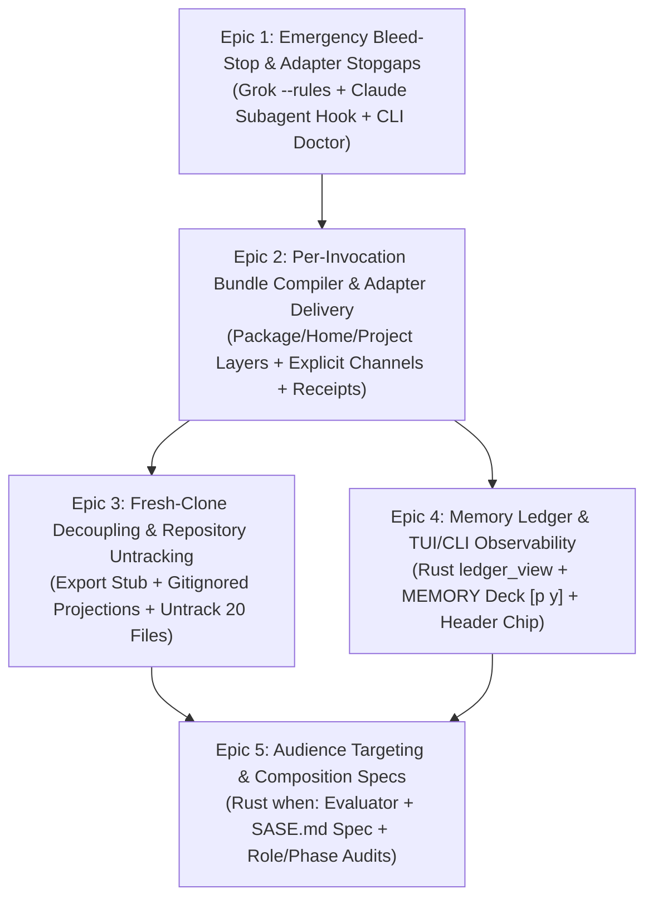

# Chat History - ace-run (research.3p.gem)

- **TIMESTAMP:** 2026-10-05 14:30:36 EDT
- **MODEL:** agy/gemini-3.8-flash-high
- **AGENT:** research.3p.gem
- **PROMPT:** `~/.sase/multi_prompts/202610/gh_sase_org__sase-multiprompt-261005_141626.md`

## Prompt

Your previous attempt hit a model context limit or transient provider failure. Any file edits, new tests, and other on-disk changes you made are preserved. Before making additional changes, run `git status` and `git diff` to see what is already in place, then continue implementing the plan from wherever you left off. Do not re-apply edits that are already present.

%id(gem, clan=research.3p)
%m:agy/gemini-3.8-flash-high %q(1.5x, w=0.25)
#gh:gh_sase-org__sase 
You are researcher gem in a 5-researcher swarm.
The other researchers, `research.3p.cdx`, `research.3p.cld`, `research.3p.grk`, `research.3p.mus`, are independently investigating the same request and will write their own self-named reports ending in `__cdx.md` and `__cld.md` and `__grk.md` and `__mus.md`. Your report will end in `__gem.md`.

Conduct your research independently and form your own conclusions. Do NOT attempt to
locate, open, read, or otherwise consult the other researcher's report from this swarm,
even if it becomes available before you finish. Do not obtain that peer's findings
indirectly through its chat transcript, summaries, or requests to the peer. You may
independently use the same external sources, shared input material, and unrelated prior
research. You may check filenames or file existence to avoid overwriting your own
output, but do not inspect the peer's report contents. If you encounter its filename,
leave the report alone. The lead researcher will read every report and synthesize their
findings after you have all finished.

I would like to migrate all existing agent instruction files to use sase's memory files
dynamically to contruct instructions for each sase agent right before launching that
agent.

- I've already done some research on this. Review the sase_md_instruction_delivery.md,
  instruction_bundles_provider_parity_and_memory_ledger.md, and
  fresh_clone_bootstrap_and_native_subagent_instructions.md files in the research
  sidecar repo for context before performing your own research. I agree with all of the
  recommendations made in these research files for the most part, but you should call
  out any issues that you are able to identify.
- I think I want to split this work up into multiple epics with clear completion/exit
  criteria and verifiable results that are easy for me to confirm, but I'm not sure how
  this work should be split up or if it is even advisable to split this work up at all.

Can you do some research with the goal of helping me decide the best way to split this
work up (if at all)? End your analysis with a recommended set of epics (with clear
completion/exit criteria and verifiable results) or justification for why you don't
think that I should split up this work. 
Write this research to a new markdown file under the $(sase repo path research --ensure)/$(date +%Y%m)/ directory.
Choose a descriptive filename stem yourself, but the filename MUST end with the
`__gem` suffix, i.e. `<stem>__gem.md` (double underscore before the
suffix). Create the report without overwrite: if the exact file already exists, pick a
different stem instead of replacing it.

After the write succeeds, register the report as a durable snapshot:

sase artifact create -p "<absolute-report-path>" -l "research:<repo-relative-report-path>"

Use the report's actual absolute path and its path relative to the research repo root
(for example `research:202609/topic__a.md`), including any subdirectory the steps above
put it in. Do not derive the label from the current month, the clock, or a guessed name.
Do not pass `--move`; the source stays in the research repo for later reorganization. If
registration itself fails, report that failure — do not report the research task as
fully complete.

## Response

# Research Report Summary: Agent Instruction Migration Epic Decomposition

**Author:** Researcher `research.3p.gem` (Gemini 3.8 Flash)  
**Registered Artifact:** `file:explicit:080de4d00c56f9694c2712a1`  
**Artifact Label:** `research:202610/agent_instruction_migration_epic_decomposition__gem.md`  
**Report File:** `/home/bryan/.local/state/sase/workspaces/sase-org/sase/sase_13/sase/repos/research/202610/agent_instruction_migration_epic_decomposition__gem.md`

---

## Executive Verdict: Split into Five Decoupled Epics

You should **strongly split this work into multiple epics** rather than executing it as a single monolithic overhaul.

### Why a Monolithic Epic Fails
1. **Self-Hosting Fragility:** SASE agents develop SASE inside ephemeral `sase_<N>` workspace clones. Modifying prompt construction, instruction delivery, and finalizer contract enforcement in a single massive PR risks breaking the very prompt delivery contract (`/sase_final`, memory routing, and single-turn protocol) that subsequent implementation and verification agents rely on.
2. **Divergent Technical Layers:** The work spans five distinct domains:
   - External vendor CLI process flags, hooks, and envelopes (Python).
   - Bundle compilation, layering, and section deduplication (Python).
   - Git repository tracking, `.gitignore`, and fresh-clone bootstrapping (Git/CI).
   - Core data models, schema validation, and join ledgers (`sase-core` in Rust, requiring PyO3 bindings and CI pin bumps).
   - Textual TUI reactive deck widgets (`p` `y`) and identity header chips (Python/Textual).
3. **Active Production Regressions:** Grok has received zero instructions in SASE workspaces since 2026-09-10; Claude subagents are actively submitting parent turn finalizations. Delaying these fixes behind TUI decks or Rust schema work wastes weeks and thousands of tokens.
4. **Independent Verifiability:** A monolithic initiative cannot cleanly isolate whether a behavioral change was caused by the compiler, adapter envelope, repo untracking, or audience filter.

---

## Critical Issues & Tensions Identified in Prior Research

1. **Codex `AGENTS.md` Suppression Contradiction:**
   - *Issue:* Report 1 claimed Codex *cannot* suppress project `AGENTS.md` (calling this the "decisive fact" behind R7 untracking). Report 3 discovered `-c project_doc_max_bytes=0` suppresses it.
   - *Resolution:* Relying permanently on an undocumented vendor flag is dangerous. Untracking the 20 generated instruction files remains essential to eliminate git churn (111 commits in 60 days) and guarantee multi-provider uniformity, rather than relying solely on `-c project_doc_max_bytes=0`.
2. **Provider Subagent Asymmetry:**
   - *Issue:* Report 3 provided a solution for Claude subagents (`--append-subagent-system-prompt-file` and PreToolUse hook), but other providers (Grok, Muse, Antigravity) have no equivalent subagent channels.
   - *Resolution:* Epics must not promise universal "subagent parity." Subagent delivery is provider-asymmetric: deliver dedicated subagent bundles where vendor channels exist, enforce root-only tool locks mechanically, and record honest receipt statuses (`subagent: unconfigurable` or `subagent: inherited`).
3. **The "Build the Meter Before the Engine" Ordering Trap:**
   - *Issue:* Report 2 proposed building the entire memory ledger, reverse index, Rust `ledger_view`, and 4-tier Textual TUI deck (`p` `y`) in Phase 0 in "observed mode."
   - *Resolution:* Building complex Textual UI widgets for broken legacy formats stalls compiler work. Observability must be split: lightweight JSON receipts and a simple CLI diagnostic (`sase doctor instructions`) in early epics, deferring the full Textual TUI deck and Rust join engine to a dedicated observability epic.
4. **Fresh-Clone Bootstrap Fragility:**
   - *Issue:* Expecting an LLM to reliably parse and execute a multi-step self-bootstrap text clause (*"If missing, run `just agent-instructions`, then read the file"*) in an interactive session is fragile.
   - *Resolution:* Mechanical loading is the primary path (`@import` in `CLAUDE.md`, `AGENTS.override.md` for Codex, pre-populated by `just install`); the text clause in the committed `AGENTS.md` stub is strictly a tertiary safety net.

---

## Recommended Set of Epics

---

### Epic 1: Emergency Bleed-Stop & Provider Adapter Parity
- **Slug:** `inst-fix-stopgaps`
- **Objective:** Immediately repair active harms in production provider sessions without waiting for compiler or TUI redesign.
- **Scope:**
  1. Grok Root Instructions: Pass current project instructions + home layer via `--rules <text>` in `grok.py`, keeping workspaces untrusted.
  2. Claude Subagent Lockout: Add PreToolUse hook on `agent_id != None` blocking `sase final`, `sase stitch create`, or declaration tools.
  3. Claude Subagent Delivery: Pass trimmed helper directive via `--append-subagent-system-prompt-file`.
  4. Diagnostic Baseline: Implement `sase doctor instructions --quick` inspecting session logs across Claude, Codex, Grok, Muse.
  5. Deprecate generating `OPENCODE.md` (never read) and `QWEN.md` (causes double loads).
- **Completion & Exit Criteria:**
  - `grok inspect` reports `Project trusted: no`, while Grok session logs (`prompt_context.json`) show non-empty instruction context.
  - Grok final-declaration compliance on non-research turns recovers toward 60% baseline.
  - Zero Claude subagents successfully execute `sase final` across 100 consecutive subagent spawns.
  - `sase doctor instructions --quick` runs cleanly and reports baseline counts.

---

### Epic 2: Per-Invocation Bundle Compiler & Explicit Adapter Delivery
- **Slug:** `inst-bundle-engine`
- **Objective:** Replace static file reliance with dynamic, memory-compiled instruction bundles assembled immediately before `provider.invoke`, delivered exclusively through explicit adapter channels.
- **Scope:**
  1. Bundle Compiler (`src/sase/instructions/bundle.py`): Composes Package Base, Plugins, Home Memory (`~/sase/memory`), and Project Memory (`sase/memory`), deduplicated by section ID. Retires `sase/memory/sase.md` into package base.
  2. Explicit Delivery Envelopes: Claude (`--append-system-prompt-file` + `claudeMdExcludes`), Codex (shadow `$CODEX_HOME/AGENTS.md`), Grok (`--rules`), Muse & Antigravity (prompt prefix).
  3. Integration into `_invoke.py` and finalizer recovery paths (`declaration_recovery.py`, `commit_repair_conflict.py`).
  4. Provenance Artifacts: `$SASE_ARTIFACTS_DIR/instructions/instructions.md` and `instructions.json` (receipt v1); export `SASE_INSTRUCTIONS_FILE`; record bundle SHA in `agent_meta.json`.
  5. Gated behind per-provider feature flags (`instructions_delivery_claude`, etc.) with LKG fallback on error.
- **Completion & Exit Criteria:**
  - Session records verify bundle hash appears **exactly once** (`✓1×`) across all providers with zero duplicate SASE contract sections.
  - ~790 duplicate tokens on Claude and Codex eliminated.
  - Muse and Grok sessions reliably receive the home layer (`~/sase/memory`).
  - `$SASE_ARTIFACTS_DIR/instructions/instructions.json` written for 100% of turns with valid section digests.
  - Agent final declaration success rate meets or exceeds existing baselines.

---

### Epic 3: Fresh-Clone Decoupling & Repository Churn Elimination
- **Slug:** `inst-fresh-clone-decouple`
- **Objective:** Untrack generated instruction files to eliminate the 111-commit churn, while establishing a clean onboarding experience for fresh clones and interactive developers.
- **Scope:**
  1. Committed Root Export Stub (`AGENTS.md`): Lean, human- and agent-friendly stub (enforced ≤80 lines, ~1.5k tokens) containing orientation, build/test commands, core conventions (`gotchas`, `rust_core_backend_boundary`), and the bootstrap clause.
  2. Committed Claude Import Shim: 2-line root `CLAUDE.md` importing `@AGENTS.md` and `@.sase/instructions/claude.md`.
  3. Interactive Projection Sync: `sase instructions sync` (and `just agent-instructions`) compiling `mode: interactive` projections into gitignored `.sase/instructions/claude.md`, root `AGENTS.override.md`, and `.sase/instructions/agents.md`.
  4. Untrack and gitignore 20 generated instruction files across the repo; convert nested directory instructions into path-scoped reference notes (`paths: [src/sase/ace/**]`).
  5. CI Drift Gate: `sase instructions export --check` in `just check` / CI.
- **Completion & Exit Criteria:**
  - `git status` in any SASE workspace is never dirtied by instruction generation; editing a memory note produces 0 diffs in `AGENTS.md`.
  - Fresh clone test: In a clean clone with no `.sase` directory, running `claude`, `codex`, or `grok` loads only the lean stub without encountering `/sase_final` obligations.
  - Running `just install` populates `.sase/instructions/claude.md` and `AGENTS.override.md`, immediately providing full interactive instructions natively.
  - CI passes with all 20 legacy files untracked.

---

### Epic 4: Memory Ledger & SASE TUI / CLI Observability
- **Slug:** `inst-memory-ledger-tui`
- **Objective:** Provide real-time observability into what each agent was told, what it actually loaded, and what memory it pulled, visible across Textual TUI and CLI.
- **Scope:**
  1. Core Join Engine (`crates/sase_core/src/instructions/ledger.rs`): Implements `ledger_view` in Rust joining intended receipt, observed session record, pulled reads (`memory_reads.jsonl`), and git history. Exposes PyO3 bindings and bumps `sase-core-revision.txt`.
  2. Reverse Index: Append-only `~/.sase/projects/
/instruction_receipts.jsonl`.
  3. TUI Level 1 & 2: Header chip (`✓1×`, `‼2×`, `∅`, `⟲ lkg`, `◌`) in `_identity_header_compact.py` and upgraded Context card MEMORY lane.
  4. TUI Level 3: New `MEMORY` deck (`p` `y`) with Receipt card, Ledger card (symbol-coded rows: `●` inlined, `◇` offered, `◆` read, `○` withheld, `⊘` foreign, `↻` changed since), and Bundle card.
  5. TUI Level 4 & CLI: Memory pane "Seen by" view; CLI `sase instructions show <agent>` and `sase instructions render --as <facts> [--diff]`.
- **Completion & Exit Criteria:**
  - Identity header chip updates in real time with 0 perceptible latency.
  - Pressing `p` `y` in TUI opens MEMORY deck in <50ms with live Receipt, Ledger, and Bundle cards matching session artifacts.
  - Selecting hint `[n]` on a ledger row opens memory pager pinned to the exact git blob the agent saw.
  - `sase instructions show <agent>` outputs byte-accurate ledger data matching TUI display.
  - Synthetic delivery anomalies trigger immediate red indicators (`‼2×` or `∅`) in TUI.

---

### Epic 5: Audience Targeting, Composition Specs, & Budget Enforcement
- **Slug:** `inst-audience-composition`
- **Objective:** Enable targeted, role- and lifecycle-specific instruction bundles using declarative composition specifications, protected by strict pre-flight token budgets and matrix validation.
- **Scope:**
  1. Launch-Fact Schema & Evaluator (`crates/sase_core/src/instructions/when.rs`): Closed schema in Rust (`role`, `provider`, `phase_worker`, `tribe`, `macros`, `commit_method`, `vcs`, `host`, `flags`) with declarative `when:` map evaluation.
  2. Composition Spec Parser (`SASE.md`): Optional project `SASE.md` layout spec and note frontmatter `when:` filters.
  3. CI Pre-Flight Matrix Validator (`sase instructions check --matrix`): Enforces router ratchet (≤100 lines / ≤1,600 tokens for project layer) per audience and guarantees R9 hard rules cannot be hidden.
  4. Initial Audiences:
     - Lean monitor/gate turns (contract only; saves ~1,800 tokens on 12.5% of runs).
     - Phase workers (strict rule: record `PROPOSED FOLLOW-UP:` notes on phase bead; no new beads).
     - Dedicated Claude subagent render (retains repo rules; strips `/sase_final`).
     - Research vs Code tribe decision density.
  5. Runtime error handling: LKG bundle cache.
- **Completion & Exit Criteria:**
  - `sase instructions check --matrix` executes in CI, asserting all reachable audience renders satisfy token ratchets and hard-rule invariants.
  - Monitor and gate bundles measured ~40% smaller than root coder bundles (~1,800 tokens saved).
  - Phase workers exhibit 0 rogue task bead creations across 50 simulated phase executions.
  - Claude subagents consistently receive dedicated helper bundles without `/sase_final`.
  - Syntax errors in `when:` frontmatter fail loudly during `just check` rather than at agent launch.

---

## What NOT to Build (Explicit Anti-Goals)

1. **Reject `%tag` or Free-Form Prompt Tagging:** `%t` already aliases `%tribe`. All audience targeting must be driven by closed, host-verified launch facts.
2. **Defer `traits:` and Prompt Escape Hatches (`%trait:`):** In accordance with `decisions:corpus-before-mechanism`, do not build trait machinery until a concrete memory section demonstrably requires a label that launch facts cannot supply.
3. **Reject Monolithic `SASE.md` Prose Stores:** A single markdown file holding all prose would undo SASE modular memory notes, audited reads, web strands, and frontmatter routing. `SASE.md` must remain strictly an optional *composition layout spec*.
4. **Reject Model-Tier Instruction Degradation:** Smaller models need clearer constraints than frontier models. Degrading hard rules or conventions for lower-tier models leads to elevated finalizer failures.
5. **Reject Runtime Path Sniffing:** Inferring instructions based on working directory paths is brittle. Subsystem conventions belong in path-scoped reference triggers (`paths: [...]`) read on demand.

---

## Verification & Audit Playbook for Acceptance

| Epic | Verification Command | Expected Pass Criteria |
| :--- | :--- | :--- |
| **Epic 1** | `sase doctor instructions` | Grok receives >0 instructions; Claude subagent declarations = 0 |
| **Epic 2** | `sase doctor instructions` `cat $SASE_ARTIFACTS_DIR/instructions/instructions.json` | All providers report `✓1×`; bundle hash matches session log; duplicate tokens = 0 |
| **Epic 3** | `git status --porcelain` `sase instructions export --check` `just agent-instructions` | 0 dirty instruction files; exit code 0 (no stub drift); generates gitignored projections |
| **Epic 4** | `sase instructions show <agent>` TUI keystroke `p` `y` | Outputs matching ledger view; deck opens in <50ms with live Receipt, Ledger, and Bundle cards |
| **Epic 5** | `sase instructions check --matrix` | All audience permutations pass budgets; R9 hard rules preserved |

The complete, unabridged research report is preserved in the research sidecar repository and registered as a durable artifact snapshot (`file:explicit:080de4d00c56f9694c2712a1`).
