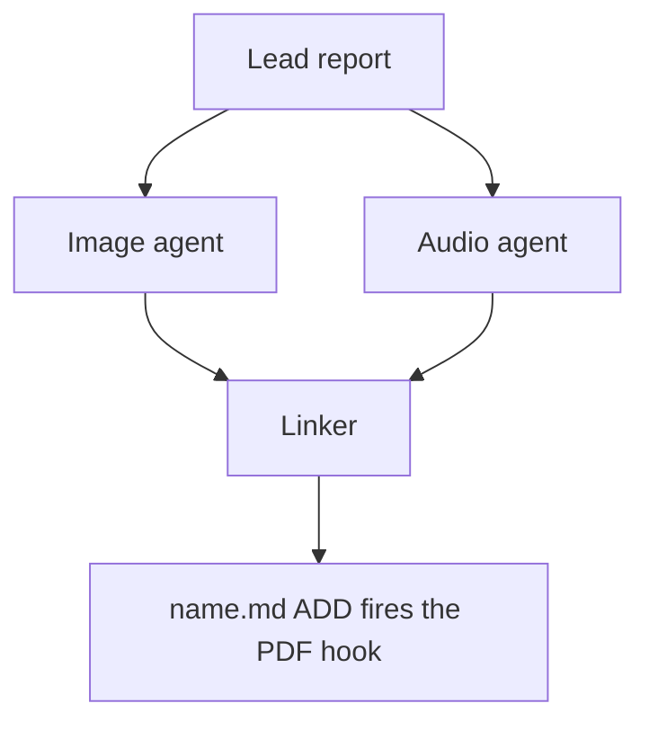

# Chat History - ace-run (research.4v.image)

- **TIMESTAMP:** 2026-10-19 08:18:53 EDT
- **MODEL:** codex/gpt-6-astra
- **AGENT:** research.4v.image
- **PROMPT:** `~/.sase/multi_prompts/202610/gh_sase_org__sase-multiprompt-261019_071316.md`

## Prompt

%id(image, clan=research.4v) %m:gpt-6-astra
%wait:research.4v.final %q(1.5x, w=0.25) #gh:gh_sase-org__sase 
%macros_enabled:false
# Previous Continuation

This fork uses versioned continuation replay. Blocks are stable, parent-first projections of exact continuation nodes; any historical source without recoverable node provenance is represented as an opaque legacy boundary.

- **Projection version:** `1`
- **Ordered nodes:** `1`

## Continuation Block `block:v1:16f4089ec01a31212c27d9f249eec433`

- **Node:** `agent-delta:20261019071321:9f4d9ccae40e4daa`
- **Kind:** `agent_delta`
- **Parents:** (none)
- **Content:** `local:continuation/records/agent_delta/agent-delta:20261019071321:9f4d9ccae40e4daa.json`

### User

**Protected user instruction.** Carry this request unless an explicit attributed update supersedes it.

%clan(research.4v, tribe=research, summary=[[[bold]RESEARCH PROMPT:[/bold] I would like to add pi (see the https://github.com/earendil-works/pi GitHub repo for
context) as a new, fully supported sase LLM provider. Can you do some research with the
goal of helping me decide the best way to implement this? I believe there is another
research file in the research sidecar repo related to pi that you should review if you
can find it. End your analysis with a recommended solution.]]) %id:research.4v.final %m:@xlarge
%wait:research.4v.cdx %wait:research.4v.cld %wait:research.4v.grk %wait:research.4v.mus %wait:research.4v.gem %q(1.5x, w=0.25)
#gh:gh_sase-org__sase 
You are the lead researcher: 5 independent researchers have reported on the request
below, and you will add your own research and merge every perspective into one
consolidated report.

SASE derives your plan's links from the artifacts you read this turn; use
`sase artifact read` for context you actually used.

Research request:

I would like to add pi (see the https://github.com/earendil-works/pi GitHub repo for
context) as a new, fully supported sase LLM provider. Can you do some research with the
goal of helping me decide the best way to implement this? I believe there is another
research file in the research sidecar repo related to pi that you should review if you
can find it. End your analysis with a recommended solution.

The researchers' registered reports:


- wait_name={{ a.wait_name }} label={{ a.label }} source_path={{ a.source_path }} path={{ a.path }} ref={{ a.ref }}


Month directory (create it if missing):

$(sase repo path research --ensure)/$(date +%Y%m)

Steps:

1. From the registered reports above, identify exactly one report per expected suffix
   in cdx, cld, grk, mus, gem, belonging to this
   dispatch's `research.4v.cdx`, `research.4v.cld`, `research.4v.grk`, `research.4v.mus`, `research.4v.gem` dependencies, matching by `wait_name` and the canonical research
   label's existing `__<suffix>.md` suffix. Never reassign suffixes from list order.
   Open the research repo with `/sase_repo`, then read each report through its canonical
   research reference (or the `ref` field's `file:<id>` reference if the original has
   moved) using `sase artifact read`. Do not read predecessor chat transcripts. If the
   records above do not identify exactly one report per expected suffix, stop and report
   the missing or ambiguous input instead of guessing.
2. Research the request yourself, prioritizing gaps, weak evidence, and disagreements
   between the reports.
3. Pick a descriptive stem `<name>` that collides with nothing in the month directory
   (do NOT end the name with `_consolidated` or `_<YYYYmmdd>` or anything similar unless
   it relates to the research topic), create `<month-dir>/<name>/`, and move each report
   inside it as `<name>__<suffix>.md`, preserving its existing suffix. Each report's
   `source_path` is provenance for where it lives in your own opened research checkout;
   resolve its canonical repo-relative path there before moving it. Never modify the
   other agents' checkouts or the stored snapshot recorded at `ref` — only the copy in
   your own checkout moves. Preserve every file and never overwrite: on any collision,
   pick a different stem first.
4. Write the consolidated report to `<name>/<name>__final.md`: merge the strongest findings
   from every report above and your own research, resolve conflicts, cut duplication,
   and add missing critical context without unnecessary length.

   Do not create `<name>/<name>.md`, not even as a placeholder, because the linker
   agent `research.4v.linker` publishes it from your report.

5. After the write succeeds, register the consolidated report as a durable snapshot so
   the linker agent, `research.4v.linker`, can find it:

   sase artifact create -p "<absolute-report-path>" -l "research:<repo-relative-report-path>"

   Use the consolidated report's actual absolute path and its path relative to the
   research repo root, for example `research:202609/<name>/<name>__final.md`. Register
   only the consolidated report, and do not pass `--move`. If registration fails,
   report that failure; do not report the task as fully complete.

Final layout:

```text
<month-dir>/<name>/
├── <name>__cdx.md
├── <name>__cld.md
├── <name>__grk.md
├── <name>__mus.md
├── <name>__gem.md
└── <name>__final.md
```

### Assistant

Now let me read the five reports via `sase artifact read`.

Verifying the disputed pi claims in source now (sessions, prompt input, extension failure, exit codes), then I'll check the SASE side.

Now verifying the SASE side: hook surface, instruction delivery and suppression precedent, flags, models manifest, and provider-disable keying.

Evidence gathering is essentially done. One last check on install-metadata manager types, then I'll move the reports and write the consolidated report.

Now creating the consolidated directory and moving the five reports.

All five reports are moved into `202610/pi_sase_provider_design/`. Writing the consolidated report now.

Report written. Quick verification of two claims I carried over from researchers (missing-path-as-literal-text and `--name`).

Both confirmed. Registering the consolidated report as a durable artifact.

Registration succeeded. Now submitting the final declaration.

I've written the consolidated report on adding pi as a SASE provider and registered it as `research:202610/pi_sase_provider_design/pi_sase_provider_design__final.md` (`file:explicit:4767edfd1745d6b9662d5c5f`). I matched each of the five reports to its suffix and moved them into `202610/pi_sase_provider_design/` with their suffixes unchanged. The research repo commit was declared and runs when this turn ends.

## Recommended solution
Build pi as a provider inside the SASE repo, with no Rust (sase-core) change, in three phases:
- **Phase 0 (about half a day):** install pi and record real output samples to test against. Nothing has been run live yet. pi isn't installed on athena, and athena's Node (v22.14) is below pi's minimum (22.19). Installing it is a global install, so you'd run it yourself or approve it.
- **Phase 1:** a basic provider that runs `pi --mode json` once per SASE turn.
- **Phase 2:** a small pi extension bundled with SASE that enforces SASE's rules mechanically.

The key design points:

- **Never trust pi's exit code.** In this mode pi exits 0 even when the model errors, aborts or runs out of output. Success has to be read from its event stream (it signals true completion with an `agent_settled` event).
- **Deliver SASE's instructions explicitly.** Left alone, pi loads both the workspace `AGENTS.md` and `~/AGENTS.md`, and on athena both contain the final-declaration rules, so they'd load twice. The fix:
  - pass SASE's instruction file with `--append-system-prompt`;
  - turn off pi's own discovery with `-nc`, only in SASE-managed projects (the same rule Codex follows);
  - re-add the user's own pi instruction files that this drops.
  The earlier pi research said pi's own loading was enough; that's out of date.
- **Send the prompt on stdin.** Passing it as an argument hits Linux's size limit, and pi's `@file` syntax wraps the prompt in `<file>` tags.
- **Never resume with `--session`.** pi runs a reopened session's tools in the directory it was created in, so resuming from a different numbered workspace would edit the old clone. Continuing within one SASE turn reuses the same session id, which is safe; continuing across workspaces uses `--fork`.
- **Keep the user's pi intact:** their default model (via a `pi-default` tier), extensions, MCP, tools and project trust settings.
- **Hold back for now:** no autodetect, no size-alias pools, and no automatic disable when a usage limit is hit.

Two things I found that the five reports missed:
- **Shared subscriptions.** pi can sign in to the same Anthropic, OpenAI Codex, xAI and Meta (Muse) subscriptions SASE's own providers use. SASE tracks quotas and disables per provider name, so it can't see pi and, say, `claude` drawing on one subscription.
- **pi only works within a turn.** Codex is a better model than Claude for suppressing instruction files.

## How the disagreements came out
I settled each one by reading the code it depends on (§10 of the report has the full table):
- **Instruction loading:** mus said pi's own loading was enough; that's wrong.
- **Prompt input:** grk proposed `@file` and gem the argument list; stdin it is.
- **Session continuation:** the earlier research and gem said `--session`; it's never used.
- **Rust:** cdx wanted the event parser in sase-core; v1 stays in Python, since every existing provider's parser is Python and nothing outside the host reads pi's raw output.
- **Sunset flag:** grk proposed one; it isn't needed, because pi has no old behavior to keep reachable.
- **Extension load failures:** cdx thought they were only warnings; they stop the run, so a broken extension fails closed.
- **gem's specifics:** its model list is stale, its usage counting double-counts, and its autodetect priority and quota patterns go against how Grok and Muse are set up.

## Decisions for you
1. **Default tier:** let pi pick the user's default model (recommended), or have SASE choose specific models.
2. **User extensions in SASE runs:** load them (recommended), or load none.
3. **First backend:** if you plan to send pi through a subscription you already use with `claude` or `codex`, the shared-quota problem matters from day one.
4. **OpenCode:** pi now covers the same multi-vendor role, so it may be worth considering retiring OpenCode once pi has real usage.

---

%macros_enabled:true
# New Query

 Generate an infographic that illustrates the main points made in this research markdown
file. Write the image to `<stem>_infographic.png` in the same directory, where
`<stem>` is the source file's stem with any trailing `__final` removed (so
`topic__final.md` becomes `topic_infographic.png`; other stems are unchanged).
Create it without overwrite. If it already exists, stop and report the collision.


The lead researcher's registered report:


- wait_name={{ a.wait_name }} label={{ a.label }} source_path={{ a.source_path }} path={{ a.path }} ref={{ a.ref }}


Decide whether Mermaid diagrams would help a reader understand the lead's research
report and, if so, write them to a companion manifest for the swarm linker to place.
The linker is the only publisher: you propose, it places or omits.

## 1. Scope and source

- Never edit the report, never write a report of your own, and create no other file in
  the research checkout (`$(sase repo path research --ensure)`). Keep scratch files in a
  fresh `mktemp -d` directory outside it.
- Read the report once with `sase artifact read` on the registered lead entry listed
  above (its `ref`, or its `research:` label), redirecting the output to a scratch copy.
  Never work from memory or the forked conversation alone.
- If no registered lead report is listed, propose nothing and set `status: failed` with
  that reason (step 7).
- If this prompt also asked for an infographic, finish it first and do not repeat what
  it shows.

## 2. Decide

Zero is a normal outcome, and the usual one for surveys and recommendation lists.
Propose a diagram only when all of these hold:

- the report describes three or more connected parts: a flow, a state lifecycle, an
  exchange between actors over time, a dependency structure, or a phased plan;
- a reader would grasp it faster from the picture than from the prose;
- every box, arrow, and label restates something the report says;
- it does not repeat the infographic, a Mermaid diagram already in the report, a table,
  or a short list. Never turn a table into a diagram.

Propose at most three. Add no actors, steps, numbers, orderings, or causal arrows the
report does not state. Conditional wording stays conditional, and a proposed design
stays distinct from an implemented one.

## 3. Draw

Size each diagram for a PDF column about 650 px wide and at most about half a page tall.

- Types: `flowchart` (prefer `TD`; use `LR` only for a chain of five or fewer short
  nodes), `sequenceDiagram` (at most four participants), `stateDiagram-v2`,
  `classDiagram`, `erDiagram`.
- No init directives, `click`, `style`, `classDef`, HTML, or icons.
- At most four boxes side by side and about five ranks. In `TD` flows avoid decision
  diamonds and put the condition on a labelled edge instead.
- Labels of about four words or fewer, in the report's terms. Quote every label
  (`A["Lead report"]`, `-->|"on failure"|`). Never use `end` as a node id.

## 4. Validate

Put every diagram in a scratch Markdown file with a short paragraph before each one,
then render it:

```sh
bob ref create <scratch>/check.md -o <scratch>/check_render.pdf -n -P <parent>
```

- `-n` is `--no-audio`, not a dry run. Writing `-o` outside the library leaves no vault
  state, and the output PDF stem must differ from the Markdown stem.
- `-P` is required and must name an existing Bob area or project note. Use the SASE
  project's display name, the value the Highlights hook passes (`display_name` in
  `sase project current --json`). If bob rejects it, rerun with any note listed by
  `bob capture-targets`; the parent does not affect the check.
- Every diagram must render (`diagrams: rendered N of N Mermaid diagrams`) with no
  `warning:` lines. Fix, simplify, or drop failing diagrams, and stop after three rounds.
- If bob is missing or the check cannot run, propose nothing and set `status: failed`
  with the reason (step 7).

## 5. Anchor

For each kept diagram, choose an `anchor`: 5-20 words copied verbatim from _one line_ of
a body paragraph or list item in the report. Headings, table rows, code blocks, and
existing Mermaid fences never qualify. Confirm `grep -cF -- '<anchor>' <scratch-copy>`
prints `1`; if no unique anchor exists, drop the diagram.

## 6. Write the manifest

Write `<stem>.diagrams.md` beside the report, without overwrite, where `<stem>` is the
report's stem with any trailing `__final` removed, following the `#research/image` stem
rule (so `topic__final.md` becomes `topic.diagrams.md`). If it already exists, stop
diagram work, register nothing, and set `status: failed` naming the collision (step 7).
Write no file when no diagram survived.

Keep all metadata in the body, never in frontmatter: `sase artifact read` strips YAML
frontmatter. Use no local paths and no `file:` refs; the research repo is public.

````markdown
# Diagram proposals: <report title>

Proposals for the swarm linker, not a report. Each diagram restates only what the source
report says.

```yaml
source: research:<YYYYMM>/<name>/<name>__final.md
producer: <this agent's name>
check: "diagrams: rendered 1 of 1 Mermaid diagrams"
```

## publication-order

```yaml
anchor: |-
  so the link must be in the linker's first commit.
illustrates: |-
  The linker waits for every companion agent because the PDF hook fires once, on the
  ADD of name.md.
caption: The linker publishes once, after every companion finishes.
```


````

- `source` is the report's `research:` label, `producer` is your agent name, and `check`
  is bob's `diagrams:` line.
- Each `## <id>` is a unique lowercase slug. `anchor` is a YAML literal block, so
  backticks and quotes copy exactly. `illustrates` is one sentence in the report's own
  terms stating the point the diagram makes. `caption` is at most about 15 words and has
  no figure number.
- Each `mermaid` fence is byte-identical to the source that passed the check; rerun the
  check after any edit.

## 7. Register and report

- When a manifest exists, register it without `--move`:
  `sase artifact create -p "<abs-path>" -l "diagrams:<YYYYMM>/<name>/<stem>.diagrams.md"`.
  The `diagrams:` label keeps it out of every `research:` listing.
- Then always set the `diagrams` variable, including when you proposed nothing. A missing
  variable means unknown or failed, never "considered and declined". It never carries
  Mermaid bodies:

  ```sh
  sase var set diagrams --json --value '{"status": "ready", "count": 2, "manifest": "<YYYYMM>/<name>/<stem>.diagrams.md", "source_ref": "<lead ref>"}'
  sase var set diagrams --json --value '{"status": "none", "count": 0, "reason": "Survey of options; no flow to draw."}'
  sase var set diagrams --json --value '{"status": "failed", "count": 0, "reason": "bob render check unavailable on this host"}'
  ```

- A diagram failure never fails this agent. Finish normally so the linker can publish,
  and mention the outcome in your final response.


## Response

I’ll read the registered report, create the infographic beside it without overwriting any file, then check whether a Mermaid diagram would add anything useful. I’m using the imagegen, SASE repo, artifact-memory, output-variable, and finalization skills for this work.


The report recommends a three-phase rollout built around JSON events, explicit instructions, and safe session handling. I’ll make those the infographic’s focus and clearly label it as a proposed design that still needs live validation.


The infographic is generated and checked against the report. It covers the rollout, three correctness rules, configuration preservation, and quota cautions. I won’t propose Mermaid diagrams: the useful flows are already illustrated, and the remaining candidates would repeat tables or short lists.


Created and registered [pi_sase_provider_design_infographic.png](/home/bryan/.local/state/sase/workspaces/sase-org/sase/sase_16/sase/repos/research/202610/pi_sase_provider_design/pi_sase_provider_design_infographic.png) without overwrite, using built-in imagegen ([prompt](/tmp/pi-research-visuals.SL0RgR/infographic-prompt.txt)).

No Mermaid proposals: they would duplicate the infographic or existing lists and tables. Set `diagrams.status` to `none`.
