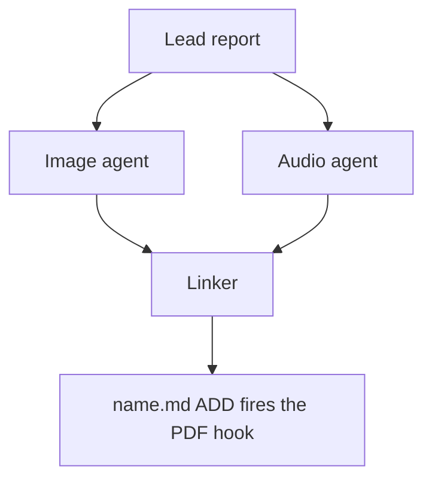

# Chat History - ace-run (research.4w.image)

- **TIMESTAMP:** 2026-10-19 08:33:57 EDT
- **MODEL:** codex/gpt-6-astra
- **AGENT:** research.4w.image
- **PROMPT:** `~/.sase/multi_prompts/202610/gh_sase_org__sase-multiprompt-261019_071704.md`

## Prompt

%id(image, clan=research.4w) %m:gpt-6-astra
%wait:research.4w.final %q(1.5x, w=0.25) #gh:gh_sase-org__sase 
%macros_enabled:false
# Previous Continuation

This fork uses versioned continuation replay. Blocks are stable, parent-first projections of exact continuation nodes; any historical source without recoverable node provenance is represented as an opaque legacy boundary.

- **Projection version:** `1`
- **Ordered nodes:** `1`

## Continuation Block `block:v1:d728af9013c3fb3413b81f487f8eaf73`

- **Node:** `agent-delta:20261019071710:34c20e893f037a88`
- **Kind:** `agent_delta`
- **Parents:** (none)
- **Content:** `local:continuation/records/agent_delta/agent-delta:20261019071710:34c20e893f037a88.json`

### User

**Protected user instruction.** Carry this request unless an explicit attributed update supersedes it.

%clan(research.4w, tribe=research, summary=[[[bold]RESEARCH PROMPT:[/bold] I would like to add hermes (see the https://github.com/nousresearch/hermes-agent GitHub repo for
context) as a new, fully supported sase LLM provider. Can you do some research with the
goal of helping me decide the best way to implement this? I believe there is another
research file in the research sidecar repo related to hermes that you should review if you
can find it. End your analysis with a recommended solution.]]) %id:research.4w.final %m:@xlarge
%wait:research.4w.cdx %wait:research.4w.cld %wait:research.4w.grk %wait:research.4w.mus %wait:research.4w.gem %q(1.5x, w=0.25)
#gh:gh_sase-org__sase 
You are the lead researcher: 5 independent researchers have reported on the request
below, and you will add your own research and merge every perspective into one
consolidated report.

SASE derives your plan's links from the artifacts you read this turn; use
`sase artifact read` for context you actually used.

Research request:

I would like to add hermes (see the https://github.com/nousresearch/hermes-agent GitHub repo for
context) as a new, fully supported sase LLM provider. Can you do some research with the
goal of helping me decide the best way to implement this? I believe there is another
research file in the research sidecar repo related to hermes that you should review if you
can find it. End your analysis with a recommended solution.

The researchers' registered reports:


- wait_name={{ a.wait_name }} label={{ a.label }} source_path={{ a.source_path }} path={{ a.path }} ref={{ a.ref }}


Month directory (create it if missing):

$(sase repo path research --ensure)/$(date +%Y%m)

Steps:

1. From the registered reports above, identify exactly one report per expected suffix
   in cdx, cld, grk, mus, gem, belonging to this
   dispatch's `research.4w.cdx`, `research.4w.cld`, `research.4w.grk`, `research.4w.mus`, `research.4w.gem` dependencies, matching by `wait_name` and the canonical research
   label's existing `__<suffix>.md` suffix. Never reassign suffixes from list order.
   Open the research repo with `/sase_repo`, then read each report through its canonical
   research reference (or the `ref` field's `file:<id>` reference if the original has
   moved) using `sase artifact read`. Do not read predecessor chat transcripts. If the
   records above do not identify exactly one report per expected suffix, stop and report
   the missing or ambiguous input instead of guessing.
2. Research the request yourself, prioritizing gaps, weak evidence, and disagreements
   between the reports.
3. Pick a descriptive stem `<name>` that collides with nothing in the month directory
   (do NOT end the name with `_consolidated` or `_<YYYYmmdd>` or anything similar unless
   it relates to the research topic), create `<month-dir>/<name>/`, and move each report
   inside it as `<name>__<suffix>.md`, preserving its existing suffix. Each report's
   `source_path` is provenance for where it lives in your own opened research checkout;
   resolve its canonical repo-relative path there before moving it. Never modify the
   other agents' checkouts or the stored snapshot recorded at `ref` — only the copy in
   your own checkout moves. Preserve every file and never overwrite: on any collision,
   pick a different stem first.
4. Write the consolidated report to `<name>/<name>__final.md`: merge the strongest findings
   from every report above and your own research, resolve conflicts, cut duplication,
   and add missing critical context without unnecessary length.

   Do not create `<name>/<name>.md`, not even as a placeholder, because the linker
   agent `research.4w.linker` publishes it from your report.

5. After the write succeeds, register the consolidated report as a durable snapshot so
   the linker agent, `research.4w.linker`, can find it:

   sase artifact create -p "<absolute-report-path>" -l "research:<repo-relative-report-path>"

   Use the consolidated report's actual absolute path and its path relative to the
   research repo root, for example `research:202609/<name>/<name>__final.md`. Register
   only the consolidated report, and do not pass `--move`. If registration fails,
   report that failure; do not report the task as fully complete.

Final layout:

```text
<month-dir>/<name>/
├── <name>__cdx.md
├── <name>__cld.md
├── <name>__grk.md
├── <name>__mus.md
├── <name>__gem.md
└── <name>__final.md
```

### Assistant

Reading the five reports now; the artifact reader needs to run from the primary workspace root.

Confirming which Hermes releases actually contain the gateway-backed chat path; the stable/main split is the key fact for the recommendation.

Main (canary) does route stream-json through the gateway; v0.22.2 stable does not. Now checking signal handling and whether main has a private or isolated runtime mode.

Hermes facts are settled. Now resolving the last disagreements on the SASE side: whether a sunset flag is needed and how skills get deployed.

Hermes facts are done; the last one found is that its terminal tool strips `GH_TOKEN`/`GITHUB_TOKEN` from commands it runs. Now reviewing the earlier Hermes research the user mentioned.

All facts are verified. Next I'm creating the consolidation directory and moving the five reports into it.

Reports are moved. Before writing, I'm spot-checking the SASE file paths the reports list, so the final touch-list only names files that exist.

One more disagreement to settle: whether `--source tool` turns off Hermes's one-shot footprint protections.

Everything I needed is verified. Writing the consolidated report now.

Checking that the internal anchors and relative links in the report all resolve.

All links resolve. Registering the consolidated report as an artifact.

Registered. Now submitting the final declaration.

I wrote the consolidated report at `202610/hermes_agent_sase_provider/hermes_agent_sase_provider__final.md` and registered it as `file:explicit:3326c0dcf26d6963a9d42704` for the linker. The five reports were moved next to it as `hermes_agent_sase_provider__{cdx,cld,grk,mus,gem}.md`. The research repo is declared for commit, which the host does after this turn.

**Recommendation:** add `hermes` as a bundled, opt-in-only provider (short name `hrm`), like Grok and Muse.
- **Command:** it drives Hermes's public `hermes chat --oneshot --query-file - --format stream-json` command.
- **Isolation:** every run happens inside a Hermes profile directory that SASE owns, one per workspace, cloned from a `sase` profile you create once.

**The fact that decides the design:** I checked this in the Hermes source and git history, because the reports disagreed.
- **Current stable (`v0.22.2`):** runs the agent inside the CLI process.
- **`main`:** sends every chat turn to a shared background daemon. Ctrl-C there just detaches and the turn keeps running. The daemon also inherits the environment of whichever agent started it, so other agents' tools would see the wrong SASE identity variables.
- **`v0.22.1`:** was released from `main` by mistake, and `v0.22.2` was re-cut to undo it. The next stable release will very likely bring the daemon back.

Three reports (grk, mus, gem) assume a clean subprocess, which only holds until the next upgrade. With a SASE-owned profile per workspace, the same adapter works on both: on `main` each agent gets its own daemon, which SASE stops when the turn ends.

**Other disagreements I settled:**
- **Packaging:** bundle it rather than ship a separate package. Full support means editing lists that only exist in SASE core (directives, effort levels, doctor, verifier).
- **Instructions:** deliver them through Hermes's system-prompt environment variable, `HERMES_EPHEMERAL_SYSTEM_PROMPT` (about 120 KiB limit), and fall back to prefixing the prompt when they're too big.
- **No sunset flag:** the `sase_flags` memory reserves those for keeping an old behaviour reachable, and there's no old Hermes behaviour.
- **Don't pass `--source tool`:** on `main` it silently turns off Hermes's one-shot safety limits.
- **Skills:** deploy to a SASE-owned directory. The default path would write into your personal Hermes profile.

I also found a gotcha none of the reports raised: Hermes strips `GH_TOKEN` and `GITHUB_TOKEN` from every shell command it runs. If your SASE workflows rely on those for `gh`, the SASE profile needs to pass them through.

**Next step:** do a short trial run before building, against stable and a `main` build. It needs to confirm that SASE's environment reaches Hermes's tools, that stopping the daemon cancels the turn, and that nothing keeps touching the workspace after the turn ends. Nobody, me included, ran a real Hermes conversation, so those lifecycle points are inferred from the code. If the trial fails, keep the rest of the design but swap the transport for cdx's small companion command that runs Hermes's agent loop directly. Asking Hermes upstream for a supervised one-shot mode would make most of the profile machinery unnecessary.

Value is narrower than "any model". Claude through Hermes bills only Max extra-usage credits, and Codex through it probably draws on the same quota SASE's `codex` provider already uses. The real gains are Nous Portal, OpenRouter, and local models.

---

%macros_enabled:true
# New Query

 Generate an infographic that illustrates the main points made in this research markdown
file. Write the image to `<stem>_infographic.png` in the same directory, where
`<stem>` is the source file's stem with any trailing `__final` removed (so
`topic__final.md` becomes `topic_infographic.png`; other stems are unchanged).
Create it without overwrite. If it already exists, stop and report the collision.


The lead researcher's registered report:


- wait_name={{ a.wait_name }} label={{ a.label }} source_path={{ a.source_path }} path={{ a.path }} ref={{ a.ref }}


Decide whether Mermaid diagrams would help a reader understand the lead's research
report and, if so, write them to a companion manifest for the swarm linker to place.
The linker is the only publisher: you propose, it places or omits.

## 1. Scope and source

- Never edit the report, never write a report of your own, and create no other file in
  the research checkout (`$(sase repo path research --ensure)`). Keep scratch files in a
  fresh `mktemp -d` directory outside it.
- Read the report once with `sase artifact read` on the registered lead entry listed
  above (its `ref`, or its `research:` label), redirecting the output to a scratch copy.
  Never work from memory or the forked conversation alone.
- If no registered lead report is listed, propose nothing and set `status: failed` with
  that reason (step 7).
- If this prompt also asked for an infographic, finish it first and do not repeat what
  it shows.

## 2. Decide

Zero is a normal outcome, and the usual one for surveys and recommendation lists.
Propose a diagram only when all of these hold:

- the report describes three or more connected parts: a flow, a state lifecycle, an
  exchange between actors over time, a dependency structure, or a phased plan;
- a reader would grasp it faster from the picture than from the prose;
- every box, arrow, and label restates something the report says;
- it does not repeat the infographic, a Mermaid diagram already in the report, a table,
  or a short list. Never turn a table into a diagram.

Propose at most three. Add no actors, steps, numbers, orderings, or causal arrows the
report does not state. Conditional wording stays conditional, and a proposed design
stays distinct from an implemented one.

## 3. Draw

Size each diagram for a PDF column about 650 px wide and at most about half a page tall.

- Types: `flowchart` (prefer `TD`; use `LR` only for a chain of five or fewer short
  nodes), `sequenceDiagram` (at most four participants), `stateDiagram-v2`,
  `classDiagram`, `erDiagram`.
- No init directives, `click`, `style`, `classDef`, HTML, or icons.
- At most four boxes side by side and about five ranks. In `TD` flows avoid decision
  diamonds and put the condition on a labelled edge instead.
- Labels of about four words or fewer, in the report's terms. Quote every label
  (`A["Lead report"]`, `-->|"on failure"|`). Never use `end` as a node id.

## 4. Validate

Put every diagram in a scratch Markdown file with a short paragraph before each one,
then render it:

```sh
bob ref create <scratch>/check.md -o <scratch>/check_render.pdf -n -P <parent>
```

- `-n` is `--no-audio`, not a dry run. Writing `-o` outside the library leaves no vault
  state, and the output PDF stem must differ from the Markdown stem.
- `-P` is required and must name an existing Bob area or project note. Use the SASE
  project's display name, the value the Highlights hook passes (`display_name` in
  `sase project current --json`). If bob rejects it, rerun with any note listed by
  `bob capture-targets`; the parent does not affect the check.
- Every diagram must render (`diagrams: rendered N of N Mermaid diagrams`) with no
  `warning:` lines. Fix, simplify, or drop failing diagrams, and stop after three rounds.
- If bob is missing or the check cannot run, propose nothing and set `status: failed`
  with the reason (step 7).

## 5. Anchor

For each kept diagram, choose an `anchor`: 5-20 words copied verbatim from _one line_ of
a body paragraph or list item in the report. Headings, table rows, code blocks, and
existing Mermaid fences never qualify. Confirm `grep -cF -- '<anchor>' <scratch-copy>`
prints `1`; if no unique anchor exists, drop the diagram.

## 6. Write the manifest

Write `<stem>.diagrams.md` beside the report, without overwrite, where `<stem>` is the
report's stem with any trailing `__final` removed, following the `#research/image` stem
rule (so `topic__final.md` becomes `topic.diagrams.md`). If it already exists, stop
diagram work, register nothing, and set `status: failed` naming the collision (step 7).
Write no file when no diagram survived.

Keep all metadata in the body, never in frontmatter: `sase artifact read` strips YAML
frontmatter. Use no local paths and no `file:` refs; the research repo is public.

````markdown
# Diagram proposals: <report title>

Proposals for the swarm linker, not a report. Each diagram restates only what the source
report says.

```yaml
source: research:<YYYYMM>/<name>/<name>__final.md
producer: <this agent's name>
check: "diagrams: rendered 1 of 1 Mermaid diagrams"
```

## publication-order

```yaml
anchor: |-
  so the link must be in the linker's first commit.
illustrates: |-
  The linker waits for every companion agent because the PDF hook fires once, on the
  ADD of name.md.
caption: The linker publishes once, after every companion finishes.
```


````

- `source` is the report's `research:` label, `producer` is your agent name, and `check`
  is bob's `diagrams:` line.
- Each `## <id>` is a unique lowercase slug. `anchor` is a YAML literal block, so
  backticks and quotes copy exactly. `illustrates` is one sentence in the report's own
  terms stating the point the diagram makes. `caption` is at most about 15 words and has
  no figure number.
- Each `mermaid` fence is byte-identical to the source that passed the check; rerun the
  check after any edit.

## 7. Register and report

- When a manifest exists, register it without `--move`:
  `sase artifact create -p "<abs-path>" -l "diagrams:<YYYYMM>/<name>/<stem>.diagrams.md"`.
  The `diagrams:` label keeps it out of every `research:` listing.
- Then always set the `diagrams` variable, including when you proposed nothing. A missing
  variable means unknown or failed, never "considered and declined". It never carries
  Mermaid bodies:

  ```sh
  sase var set diagrams --json --value '{"status": "ready", "count": 2, "manifest": "<YYYYMM>/<name>/<stem>.diagrams.md", "source_ref": "<lead ref>"}'
  sase var set diagrams --json --value '{"status": "none", "count": 0, "reason": "Survey of options; no flow to draw."}'
  sase var set diagrams --json --value '{"status": "failed", "count": 0, "reason": "bob render check unavailable on this host"}'
  ```

- A diagram failure never fails this agent. Finish normally so the linker can publish,
  and mention the outcome in your final response.


## Response

I’ll read the registered report and create the infographic, then check whether a Mermaid diagram would add anything useful. I’m using the SASE repository and artifact workflow, plus the image-generation skill.


The infographic and diagram manifest paths are both available. I’m reading the registered snapshot so the visual reflects the report’s exact findings and caveats.


The report’s key finding is that stable Hermes runs inside the CLI, while the examined `main` build sends work to a daemon. I’ll make that distinction central, alongside the proposed isolation design, useful model routes, and the live tests required before building it.


The infographic is saved and checked. It covers the runtime split, isolation design, and trial’s fallback decision, so I won’t propose a Mermaid diagram that repeats them. I’ll record that outcome for the linker.


The PNG is registered, and the report is unchanged. I’m using `sase_final` to declare the new image for the host’s commit.


Created [hermes_agent_sase_provider_infographic.png](/home/bryan/.local/state/sase/workspaces/sase-org/sase/sase_14/sase/repos/research/202610/hermes_agent_sase_provider/hermes_agent_sase_provider_infographic.png) without overwrite and registered it.

Used built-in image generation ([prompt](/tmp/hermes-infographic.nxPIqr/generation-prompt.txt)). The report is unchanged.

Mermaid outcome: `none`—additional diagrams would duplicate the infographic. Recorded for the linker.
