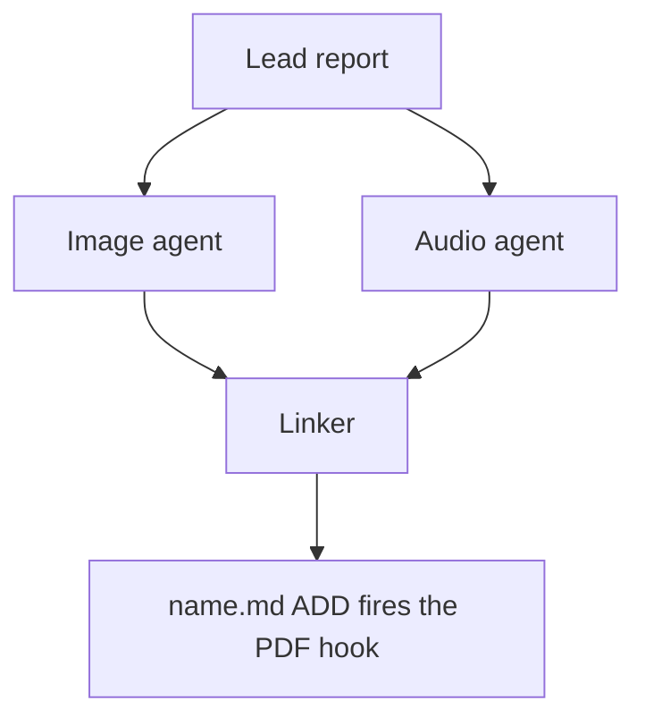

# Chat History - ace-run (research.4x.image)

- **TIMESTAMP:** 2026-10-19 09:06:45 EDT
- **MODEL:** codex/gpt-6-astra
- **AGENT:** research.4x.image
- **PROMPT:** `~/.sase/multi_prompts/202610/gh_sase_org__sase-multiprompt-261019_075815.md`

## Prompt

%id(image, clan=research.4x) %m:gpt-6-astra
%wait:research.4x.final %q(1.5x, w=0.25) #gh:gh_sase-org__sase 
%macros_enabled:false
# Previous Continuation

This fork uses versioned continuation replay. Blocks are stable, parent-first projections of exact continuation nodes; any historical source without recoverable node provenance is represented as an opaque legacy boundary.

- **Projection version:** `1`
- **Ordered nodes:** `1`

## Continuation Block `block:v1:0c8077b0bfff2f9e3e469522e82c5c86`

- **Node:** `agent-delta:20261019075820:d6b879352968e1c2`
- **Kind:** `agent_delta`
- **Parents:** (none)
- **Content:** `local:continuation/records/agent_delta/agent-delta:20261019075820:d6b879352968e1c2.json`

### User

**Protected user instruction.** Carry this request unless an explicit attributed update supersedes it.

%clan(research.4x, tribe=research, summary=[[[bold]RESEARCH PROMPT:[/bold] We currently show the selected sase agent's instruction bundle in the file deck.

- I would like to start showing the agent's instruction bundle in a new memory deck
  instead.
- This deck would also include cards for other types of memory (and maybe macros?) that
  the agent used.
- Think hard about what other cards/blocks should be included and whether or not these
  cards actually belong in a different existing deck (the record deck maybe?).

Can you do some research with the goal of helping me decide the best way to implement
this? Also, critique this plan in general. Is this a good idea? Would you take a
different approach? Make any adjustments to the requirements that you think are
justified but clearly call these out. End your analysis with a recommended solution.]]) %id:research.4x.final %m:@xlarge
%wait:research.4x.cdx %wait:research.4x.cld %wait:research.4x.grk %wait:research.4x.mus %wait:research.4x.gem %q(1.5x, w=0.25)
#gh:gh_sase-org__sase 
You are the lead researcher: 5 independent researchers have reported on the request
below, and you will add your own research and merge every perspective into one
consolidated report.

SASE derives your plan's links from the artifacts you read this turn; use
`sase artifact read` for context you actually used.

Research request:

We currently show the selected sase agent's instruction bundle in the file deck.

- I would like to start showing the agent's instruction bundle in a new memory deck
  instead.
- This deck would also include cards for other types of memory (and maybe macros?) that
  the agent used.
- Think hard about what other cards/blocks should be included and whether or not these
  cards actually belong in a different existing deck (the record deck maybe?).

Can you do some research with the goal of helping me decide the best way to implement
this? Also, critique this plan in general. Is this a good idea? Would you take a
different approach? Make any adjustments to the requirements that you think are
justified but clearly call these out. End your analysis with a recommended solution.

The researchers' registered reports:


- wait_name={{ a.wait_name }} label={{ a.label }} source_path={{ a.source_path }} path={{ a.path }} ref={{ a.ref }}


Month directory (create it if missing):

$(sase repo path research --ensure)/$(date +%Y%m)

Steps:

1. From the registered reports above, identify exactly one report per expected suffix
   in cdx, cld, grk, mus, gem, belonging to this
   dispatch's `research.4x.cdx`, `research.4x.cld`, `research.4x.grk`, `research.4x.mus`, `research.4x.gem` dependencies, matching by `wait_name` and the canonical research
   label's existing `__<suffix>.md` suffix. Never reassign suffixes from list order.
   Open the research repo with `/sase_repo`, then read each report through its canonical
   research reference (or the `ref` field's `file:<id>` reference if the original has
   moved) using `sase artifact read`. Do not read predecessor chat transcripts. If the
   records above do not identify exactly one report per expected suffix, stop and report
   the missing or ambiguous input instead of guessing.
2. Research the request yourself, prioritizing gaps, weak evidence, and disagreements
   between the reports.
3. Pick a descriptive stem `<name>` that collides with nothing in the month directory
   (do NOT end the name with `_consolidated` or `_<YYYYmmdd>` or anything similar unless
   it relates to the research topic), create `<month-dir>/<name>/`, and move each report
   inside it as `<name>__<suffix>.md`, preserving its existing suffix. Each report's
   `source_path` is provenance for where it lives in your own opened research checkout;
   resolve its canonical repo-relative path there before moving it. Never modify the
   other agents' checkouts or the stored snapshot recorded at `ref` — only the copy in
   your own checkout moves. Preserve every file and never overwrite: on any collision,
   pick a different stem first.
4. Write the consolidated report to `<name>/<name>__final.md`: merge the strongest findings
   from every report above and your own research, resolve conflicts, cut duplication,
   and add missing critical context without unnecessary length.

   Do not create `<name>/<name>.md`, not even as a placeholder, because the linker
   agent `research.4x.linker` publishes it from your report.

5. After the write succeeds, register the consolidated report as a durable snapshot so
   the linker agent, `research.4x.linker`, can find it:

   sase artifact create -p "<absolute-report-path>" -l "research:<repo-relative-report-path>"

   Use the consolidated report's actual absolute path and its path relative to the
   research repo root, for example `research:202609/<name>/<name>__final.md`. Register
   only the consolidated report, and do not pass `--move`. If registration fails,
   report that failure; do not report the task as fully complete.

Final layout:

```text
<month-dir>/<name>/
├── <name>__cdx.md
├── <name>__cld.md
├── <name>__grk.md
├── <name>__mus.md
├── <name>__gem.md
└── <name>__final.md
```

### Assistant

Reading the five researcher reports now (cdx done); next I'll read cld, grk, mus, and gem, then check their claims against the code.

Five reports read. Next I'll check where they disagree (default card, cycle position, picker key, macros, Rust boundary) against the code, and check some doubtful factual claims.

I have what I need to resolve the disagreements. Next: move the five reports into a named folder in the research checkout, then write the consolidated report.

Everything is verified. Writing the consolidated report now.

Report written. Registering it as a durable artifact for the linker.

Registration succeeded. One loose end: the memory-read report's unlabeled re-resolved output is a defect whatever you decide about the deck, so I'll record it as a task bead.

No duplicate and no causally linked epic, so I'm creating a new bug bead.

Bead `sase-1mw` filed and marked ready. Checking the final layout, then submitting the declaration.

The layout is correct and the primary sase checkout is clean. Submitting the final declaration.

The consolidated report is written and registered for the linker (`file:explicit:56b1393c72d2ee215a785d4c`). All six files are in `202610/agent_memory_deck_placement/`, and the research repo commit is declared.

**Recommendation:** yes, add a sixth Agents-tab deck, **MEMORY** ("what this agent was told and looked up"), and take the bundle out of FILES entirely rather than showing it in both. But don't build the deck around the bundle. Last week's 646 recorded bundle summaries contained only 28 distinct bundles, so the bundle text is nearly the same for every agent. What actually varies per agent: what it was given, what it looked up, at which versions, whether a retry would see different text, and whether delivery worked.

**Proposed cards:**
- **Instructions** (ships first): the exact bundle, one block per invocation (root, helper, recovery), with delivery and integrity facts in each header.
- **Sources** (next, then the default card): one version-pinned table covering core notes given in full, reference notes listed by name only, memory reads with their reasons, skill uses, excluded sections, and whether memory has changed since launch. The logic that combines these belongs in `sase-core`, with a matching CLI option.
- **Members**, later, for clans and tribes.

**Adjustments to your requirements:**
- **Nothing moves into RECORD.** Its cards are short fact sheets that must still render when an archive entry is unreadable. Its `Bundle:` field is the dismissed-agent archive bundle, not the instruction bundle; two researchers mixed these up.
- **No macros card.** Last week's macro references were almost all `#gh` workflow setup. `#memory/<note>` appears in none of the 2,341 prompts recorded this year.
- **Keep the MAIN MEMORY lane** as the at-a-glance view and add a jump into the deck. It already shows every read for 92% of agents.
- **Delivery has to be labelled honestly from day one.** 36% of last week's bundles were rendered but never delivered (runs from before the explicit-delivery cutover). FILES shows them with no label today. For those runs, Instructions should show the `AGENTS.md` the agent actually received.
- **Picker key `y`, append it after RECORD in the cycle, and never auto-pick it when you open a split.** Cycling visits every deck, and new splits open the next deck with content. Putting MEMORY right after MAIN (two researchers' suggestion) would make every split from MAIN open MEMORY instead of FILES.

**Things I checked that change how it gets built:**
- Memory-read reports aren't historical. They re-read the agent's reused workspace as it is now and print that under `## Output` with no label. I filed this as bug bead **`sase-1mw`**. The deck must open the recorded version instead.
- `sase instructions render -a NAME` took 19.7 s, almost all of it looking up the agent by name; the render itself takes about 33 ms. The TUI should call the renderer directly, never shell out to that command.
- The last new deck (RECORD) touched 317 files and regenerated 278 screenshot images. Budget for the same here.

This was research only: I changed no sase code and ran no tests.

**Open questions for you:**
1. Cycle position: append after RECORD (my pick), or between FINAL and RECORD?
2. Should Sources become the default card when it lands, or should Instructions stay first?
3. Do the shared deck-wiring refactor for RECORD and MEMORY now, or later?
4. Rename RECORD's `Bundle:` label to `Archive bundle:`?

---

%macros_enabled:true
# New Query

 Generate an infographic that illustrates the main points made in this research markdown
file. Write the image to `<stem>_infographic.png` in the same directory, where
`<stem>` is the source file's stem with any trailing `__final` removed (so
`topic__final.md` becomes `topic_infographic.png`; other stems are unchanged).
Create it without overwrite. If it already exists, stop and report the collision.


The lead researcher's registered report:


- wait_name={{ a.wait_name }} label={{ a.label }} source_path={{ a.source_path }} path={{ a.path }} ref={{ a.ref }}


Decide whether Mermaid diagrams would help a reader understand the lead's research
report and, if so, write them to a companion manifest for the swarm linker to place.
The linker is the only publisher: you propose, it places or omits.

## 1. Scope and source

- Never edit the report, never write a report of your own, and create no other file in
  the research checkout (`$(sase repo path research --ensure)`). Keep scratch files in a
  fresh `mktemp -d` directory outside it.
- Read the report once with `sase artifact read` on the registered lead entry listed
  above (its `ref`, or its `research:` label), redirecting the output to a scratch copy.
  Never work from memory or the forked conversation alone.
- If no registered lead report is listed, propose nothing and set `status: failed` with
  that reason (step 7).
- If this prompt also asked for an infographic, finish it first and do not repeat what
  it shows.

## 2. Decide

Zero is a normal outcome, and the usual one for surveys and recommendation lists.
Propose a diagram only when all of these hold:

- the report describes three or more connected parts: a flow, a state lifecycle, an
  exchange between actors over time, a dependency structure, or a phased plan;
- a reader would grasp it faster from the picture than from the prose;
- every box, arrow, and label restates something the report says;
- it does not repeat the infographic, a Mermaid diagram already in the report, a table,
  or a short list. Never turn a table into a diagram.

Propose at most three. Add no actors, steps, numbers, orderings, or causal arrows the
report does not state. Conditional wording stays conditional, and a proposed design
stays distinct from an implemented one.

## 3. Draw

Size each diagram for a PDF column about 650 px wide and at most about half a page tall.

- Types: `flowchart` (prefer `TD`; use `LR` only for a chain of five or fewer short
  nodes), `sequenceDiagram` (at most four participants), `stateDiagram-v2`,
  `classDiagram`, `erDiagram`.
- No init directives, `click`, `style`, `classDef`, HTML, or icons.
- At most four boxes side by side and about five ranks. In `TD` flows avoid decision
  diamonds and put the condition on a labelled edge instead.
- Labels of about four words or fewer, in the report's terms. Quote every label
  (`A["Lead report"]`, `-->|"on failure"|`). Never use `end` as a node id.

## 4. Validate

Put every diagram in a scratch Markdown file with a short paragraph before each one,
then render it:

```sh
bob ref create <scratch>/check.md -o <scratch>/check_render.pdf -n -P <parent>
```

- `-n` is `--no-audio`, not a dry run. Writing `-o` outside the library leaves no vault
  state, and the output PDF stem must differ from the Markdown stem.
- `-P` is required and must name an existing Bob area or project note. Use the SASE
  project's display name, the value the Highlights hook passes (`display_name` in
  `sase project current --json`). If bob rejects it, rerun with any note listed by
  `bob capture-targets`; the parent does not affect the check.
- Every diagram must render (`diagrams: rendered N of N Mermaid diagrams`) with no
  `warning:` lines. Fix, simplify, or drop failing diagrams, and stop after three rounds.
- If bob is missing or the check cannot run, propose nothing and set `status: failed`
  with the reason (step 7).

## 5. Anchor

For each kept diagram, choose an `anchor`: 5-20 words copied verbatim from _one line_ of
a body paragraph or list item in the report. Headings, table rows, code blocks, and
existing Mermaid fences never qualify. Confirm `grep -cF -- '<anchor>' <scratch-copy>`
prints `1`; if no unique anchor exists, drop the diagram.

## 6. Write the manifest

Write `<stem>.diagrams.md` beside the report, without overwrite, where `<stem>` is the
report's stem with any trailing `__final` removed, following the `#research/image` stem
rule (so `topic__final.md` becomes `topic.diagrams.md`). If it already exists, stop
diagram work, register nothing, and set `status: failed` naming the collision (step 7).
Write no file when no diagram survived.

Keep all metadata in the body, never in frontmatter: `sase artifact read` strips YAML
frontmatter. Use no local paths and no `file:` refs; the research repo is public.

````markdown
# Diagram proposals: <report title>

Proposals for the swarm linker, not a report. Each diagram restates only what the source
report says.

```yaml
source: research:<YYYYMM>/<name>/<name>__final.md
producer: <this agent's name>
check: "diagrams: rendered 1 of 1 Mermaid diagrams"
```

## publication-order

```yaml
anchor: |-
  so the link must be in the linker's first commit.
illustrates: |-
  The linker waits for every companion agent because the PDF hook fires once, on the
  ADD of name.md.
caption: The linker publishes once, after every companion finishes.
```


````

- `source` is the report's `research:` label, `producer` is your agent name, and `check`
  is bob's `diagrams:` line.
- Each `## <id>` is a unique lowercase slug. `anchor` is a YAML literal block, so
  backticks and quotes copy exactly. `illustrates` is one sentence in the report's own
  terms stating the point the diagram makes. `caption` is at most about 15 words and has
  no figure number.
- Each `mermaid` fence is byte-identical to the source that passed the check; rerun the
  check after any edit.

## 7. Register and report

- When a manifest exists, register it without `--move`:
  `sase artifact create -p "<abs-path>" -l "diagrams:<YYYYMM>/<name>/<stem>.diagrams.md"`.
  The `diagrams:` label keeps it out of every `research:` listing.
- Then always set the `diagrams` variable, including when you proposed nothing. A missing
  variable means unknown or failed, never "considered and declined". It never carries
  Mermaid bodies:

  ```sh
  sase var set diagrams --json --value '{"status": "ready", "count": 2, "manifest": "<YYYYMM>/<name>/<stem>.diagrams.md", "source_ref": "<lead ref>"}'
  sase var set diagrams --json --value '{"status": "none", "count": 0, "reason": "Survey of options; no flow to draw."}'
  sase var set diagrams --json --value '{"status": "failed", "count": 0, "reason": "bob render check unavailable on this host"}'
  ```

- A diagram failure never fails this agent. Finish normally so the linker can publish,
  and mention the outcome in your final response.


## Response

I’ll read the registered report, create the infographic beside it without overwriting anything, then assess whether any Mermaid diagrams would add useful information. I’m using the imagegen, sase_repo, sase_memory_read, sase_var, and sase_final skills for this workflow.


The report’s central recommendation is to organize MEMORY around recorded inputs and lookups, with Sources eventually becoming the default card. I’ll emphasize that distinction, the delivery and history safeguards, and the staged rollout. Neither companion filename exists.


The infographic is saved and checked. It covers the recommendation, supporting measurements, safeguards, and rollout. I’ll record the Mermaid outcome as `none`: additional diagrams would duplicate the infographic or turn the report’s existing tables and short lists into diagrams.


The PNG is registered for the linker, and the report is unchanged. The diagram decision is recorded as `none`. I’m submitting the final declaration for the single new image file.


Created and registered [agent_memory_deck_placement_infographic.png](/home/bryan/.local/state/sase/workspaces/sase-org/sase/sase_10/sase/repos/research/202610/agent_memory_deck_placement/agent_memory_deck_placement_infographic.png) without overwriting anything. The report is unchanged.

Mermaid: `none`—additional diagrams would repeat existing visuals or tables.

Generated with built-in imagegen using [this prompt](/tmp/sase-memory-infographic.gmsy1C/generation-prompt.txt).
