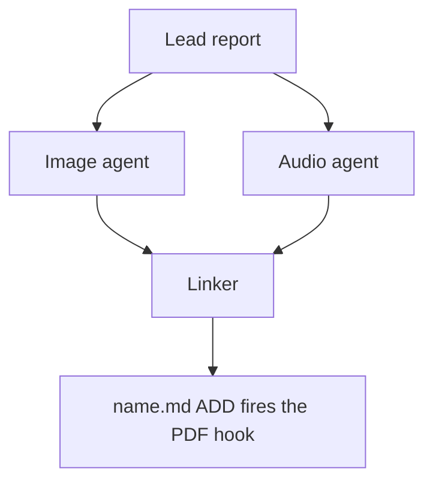

# Chat History - ace-run (research.51.image)

- **TIMESTAMP:** 2026-10-19 15:20:03 EDT
- **MODEL:** codex/gpt-6-astra
- **AGENT:** research.51.image
- **PROMPT:** `~/.sase/multi_prompts/202610/gh_sase_org__sase-multiprompt-261019_142606.md`

## Prompt

%id(image, clan=research.51) %m:gpt-6-astra
%wait:research.51.final %q(1.5x, w=0.25) #gh:gh_sase-org__sase 
%macros_enabled:false
# Previous Continuation

This fork uses versioned continuation replay. Blocks are stable, parent-first projections of exact continuation nodes; any historical source without recoverable node provenance is represented as an opaque legacy boundary.

- **Projection version:** `1`
- **Ordered nodes:** `1`

## Continuation Block `block:v1:741f0f0864a6dc2553e86cf1554d962b`

- **Node:** `agent-delta:20261019142611:6973cbc199be9cb3`
- **Kind:** `agent_delta`
- **Parents:** (none)
- **Content:** `local:continuation/records/agent_delta/agent-delta:20261019142611:6973cbc199be9cb3.json`

### User

**Protected user instruction.** Carry this request unless an explicit attributed update supersedes it.

%clan(research.51, tribe=research, summary=[[[bold]RESEARCH PROMPT:[/bold] Can you review the Obsidian tasks in the ~/bob/sase.md file with the goal of helping me
split out some child project notes? Also, if there are any duplicates, call those out as
well. End your analysis with a recommended project split and an overall summary of the
tasks that live in this file.]]) %id:research.51.final %m:@xlarge
%wait:research.51.cdx %wait:research.51.cld %wait:research.51.grk %wait:research.51.mus %wait:research.51.gem %q(1.5x, w=0.25)
#gh:gh_sase-org__sase 
You are the lead researcher: 5 independent researchers have reported on the request
below, and you will add your own research and merge every perspective into one
consolidated report.

SASE derives your plan's links from the artifacts you read this turn; use
`sase artifact read` for context you actually used.

Research request:

Can you review the Obsidian tasks in the ~/bob/sase.md file with the goal of helping me
split out some child project notes? Also, if there are any duplicates, call those out as
well. End your analysis with a recommended project split and an overall summary of the
tasks that live in this file.

The researchers' registered reports:


- wait_name={{ a.wait_name }} label={{ a.label }} source_path={{ a.source_path }} path={{ a.path }} ref={{ a.ref }}


Month directory (create it if missing):

$(sase repo path research --ensure)/$(date +%Y%m)

Steps:

1. From the registered reports above, identify exactly one report per expected suffix
   in cdx, cld, grk, mus, gem, belonging to this
   dispatch's `research.51.cdx`, `research.51.cld`, `research.51.grk`, `research.51.mus`, `research.51.gem` dependencies, matching by `wait_name` and the canonical research
   label's existing `__<suffix>.md` suffix. Never reassign suffixes from list order.
   Open the research repo with `/sase_repo`, then read each report through its canonical
   research reference (or the `ref` field's `file:<id>` reference if the original has
   moved) using `sase artifact read`. Do not read predecessor chat transcripts. If the
   records above do not identify exactly one report per expected suffix, stop and report
   the missing or ambiguous input instead of guessing.
2. Research the request yourself, prioritizing gaps, weak evidence, and disagreements
   between the reports.
3. Pick a descriptive stem `<name>` that collides with nothing in the month directory
   (do NOT end the name with `_consolidated` or `_<YYYYmmdd>` or anything similar unless
   it relates to the research topic), create `<month-dir>/<name>/`, and move each report
   inside it as `<name>__<suffix>.md`, preserving its existing suffix. Each report's
   `source_path` is provenance for where it lives in your own opened research checkout;
   resolve its canonical repo-relative path there before moving it. Never modify the
   other agents' checkouts or the stored snapshot recorded at `ref` — only the copy in
   your own checkout moves. Preserve every file and never overwrite: on any collision,
   pick a different stem first.
4. Write the consolidated report to `<name>/<name>__final.md`: merge the strongest findings
   from every report above and your own research, resolve conflicts, cut duplication,
   and add missing critical context without unnecessary length.

   Do not create `<name>/<name>.md`, not even as a placeholder, because the linker
   agent `research.51.linker` publishes it from your report.

5. After the write succeeds, register the consolidated report as a durable snapshot so
   the linker agent, `research.51.linker`, can find it:

   sase artifact create -p "<absolute-report-path>" -l "research:<repo-relative-report-path>"

   Use the consolidated report's actual absolute path and its path relative to the
   research repo root, for example `research:202609/<name>/<name>__final.md`. Register
   only the consolidated report, and do not pass `--move`. If registration fails,
   report that failure; do not report the task as fully complete.

Final layout:

```text
<month-dir>/<name>/
├── <name>__cdx.md
├── <name>__cld.md
├── <name>__grk.md
├── <name>__mus.md
├── <name>__gem.md
└── <name>__final.md
```

### Assistant

Reading the five researcher reports now; I'll then do my own check of `~/bob/sase.md` and merge everything.

I've read all five reports. Next I'm checking the vault conventions and verifying the points where the reports disagree.

Still verifying: I'm scanning the full task list for duplicates the reports may have missed, then checking the child notes.

I'm checking a few tasks against the current `sase` CLI to see which ones may already be done.

Counts check out (228 open tasks). Now I'm confirming one dependency, then I'll write the consolidated report.

I have what I need. Before writing, I'm checking that my merged routing places every one of the 228 open tasks exactly once.

Routing is complete: all 228 tasks placed exactly once. Now I'm moving the five reports into their folder and writing the final report.

Verified. A couple of small wording fixes, then I'll register the report.

Registration succeeded. Now submitting the final declaration.

I've merged the five reports into one, checked their claims against your vault and the `sase` CLI, and registered the result for the linker. I didn't edit anything in the vault.

**Act first:** L59 (Codex reset) and L528 (Claude Code reset) both expire **Oct 22, three days from now**.

## What's in `sase.md`
- **228 open tasks:** 3 open, 7 next or in progress, 218 marked blocked. There are also 83 untracked bullets under Future Work and Requirements.
- **It holds most of the SASE backlog.** Your 27 open child notes have only about 104 open tasks combined, so the hub carries about 69% of the work.
- **"Blocked" mostly means "scheduled for later".** 210 tasks have a scheduled date; only 11 have a real dependency.
- **The live work is small:** PyPI release reliability, the merge-queue reading, the project-stats epic, two deck keymap fixes, the agent-history test, and the reply to rrimps's PR #301.

## Duplicates
- **Exact:** L1355 and L1357 are the same Future Work bullet. `sase_pre_blog.md` also repeats a task at its L18 and L25.
- **Should be merged into one task each:**
  - grill: L282 + L1183
  - the four rename ideas: L126, L745, L1027, L1418
  - Copilot completion: L244 + L1391
  - remove hidden agents: L918 + L1372
  - surviving a machine restart: L664 + L1001
  - Codex/Claude reminders: L27 + L59 + L528
  - tmux: L199 + L1278
  - Hermes: L119 + L1275
- **Contradictions to decide:**
  - Hidden agents: L918 removes them, L1409 adds a `%hide` keymap.
  - `,X`: L1039 and L1425 assign it different jobs, but both features already shipped, so L1425 can go.
  - `/sase_run`: one task creates the skill and another removes it.
  - Skill bundles: L756 and L1281 propose different designs.
- **Already in a child note:** L1105 (`sase_memory`), L117/L119 (`sase_pre_blog`), L295 (`sase_art_links`), L472 (`sase_post_blog`) and L879 (`sase_better_tasks`).
- **Stale:** about 18 Future Work and Requirements bullets are done, obsolete or duplicated.

## Corrections from my own checks
- **Statistics tasks are mostly done.** `sase stats project` already shows commits per model (L353) and the Statistics tab already uses it (L355). Plan counts are 0 for every model, though, so check the plan half of L353 before closing it.
- **The rename cleanups are still big jobs.** One report said L833 was probably done. The source still has about 1,600 lines mentioning `lumberjack` and about 2,100 mentioning `sdd`, so L833 and L1134 are real work.
- **chezmoi (L380) isn't a contradiction.** The canceled task was an older duplicate, and chezmoi still isn't a SASE project.
- **L1096 is no longer needed.** `sase repo open` now redirects to the linked checkout instead of failing.
- **Watch the scope of existing children.** Several have short "ready to be talked about" goals. Moving a lot of speculative backlog into them means they never finish.

## Recommended split
- **Create 5 child notes now (76 tasks):**
  - `sase_better_tui` (23)
  - `sase_better_piw` (13), for the prompt input widget
  - `sase_better_macros` (19)
  - `sase_agent_recovery` (8)
  - `sase_completion` (13): start by deciding L129, whether to keep host-owned completion.
- **Create 3 more when you start that work (33 tasks):**
  - `sase_community` (12): docs, gallery, rename as one task, contributor demo
  - `sase_better_research` (9)
  - `sase_waits_and_queues` (12)
- **Move 94 tasks into 17 existing children.** The biggest are `sase_memory`, `sase_art`, `sase_better_tasks` and `sase_better_plans`.
- **Move 8 personal tasks out:** the subscription reminders, Spotify, Databricks interview prep and Blender.
- **Keep about 16 tasks in `sase.md`:** the stars goal and child list, general reading, the tmux question, small cleanups, and a few routines tasks.

I checked that this places all 228 tasks exactly once. There's no `bob task move` command, so moving tasks means fixing their ids and inbound links by hand. The report lists the specific links that will break.

Report: `202610/bob_sase_task_portfolio_split/bob_sase_task_portfolio_split__final.md`. The five original reports are in the same folder; the cld and cdx versions have task-by-task tables with full titles. The research repo changes are declared for the host to commit.

---

%macros_enabled:true
# New Query

 Generate an infographic that illustrates the main points made in this research markdown
file. Write the image to `<stem>_infographic.png` in the same directory, where
`<stem>` is the source file's stem with any trailing `__final` removed (so
`topic__final.md` becomes `topic_infographic.png`; other stems are unchanged).
Create it without overwrite. If it already exists, stop and report the collision.


The lead researcher's registered report:


- wait_name={{ a.wait_name }} label={{ a.label }} source_path={{ a.source_path }} path={{ a.path }} ref={{ a.ref }}


List drill-down candidates from the infographic's panels, then propose the ones that
help a reader understand the lead's research report, writing them to a companion
manifest for the swarm linker to place.
The linker is the only publisher: you propose, it places or omits.

## 1. Scope and source

- Never edit the report, never write a report of your own, and create no other file in
  the research checkout (`$(sase repo path research --ensure)`). Keep scratch files in a
  fresh `mktemp -d` directory outside it.
- Read the report once with `sase artifact read` on the registered lead entry listed
  above (its `ref`, or its `research:` label), redirecting the output to a scratch copy.
  Never work from memory or the forked conversation alone.
- If no registered lead report is listed, propose nothing and set `status: failed` with
  that reason (step 8).
- If this prompt also asked for an infographic, finish it first. It is the overview, and
  your diagrams are its drill-downs (step 2).

## 2. Find candidates

The infographic is the overview, and your diagrams are its drill-downs. Each one opens
a single panel and draws the detail the report gives for it but the panel had no room
for: the steps, branches, conditions, actors, states, failure or fallback paths, and
gates behind it. Expanding a panel this way is the purpose of this step, not a repeat of the infographic.

Before deciding anything, write a candidate list in your scratch directory:

- For each infographic panel, taken from your generation prompt and the image you
  checked, name the report passages that hold its detail and what the panel left out.
  With no infographic in this prompt, use each report section that describes a mechanism
  instead.
- Add any mechanism the report explains at length that the infographic left out
  entirely.
- Note the diagram type that would fit each candidate (step 4).

## 3. Decide

Judge every candidate, then propose each one that passes, best first. Propose at most three.
Zero is right only when no candidate passes. That is common for surveys and
recommendation lists, where no panel hides a mechanism. Never reach zero just because the infographic
already covers a topic.

A candidate passes when all of these hold:

- it draws three or more connected parts: a flow, a state lifecycle, an exchange
  between actors over time, a dependency structure, or a phased plan;
- it adds detail its panel lacks: at least two steps, branches, conditions, actors, or
  states the panel does not show. Redrawing a panel at the same level of detail is a
  repeat;
- a reader would grasp that detail faster from the picture than from the prose;
- every box, arrow, and label restates something the report says;
- it does not repeat a Mermaid diagram already in the report, a table, or a short list
  that already shows every step, branch, and condition the diagram would draw. Never turn a table into a diagram.

Rank passing candidates by how much report detail they reveal. Prefer candidates from
different panels over two from one panel. When a panel's detail is too big for one
diagram (step 4), draw its most decision-relevant part, such as the go/no-go rule or
the failure path, and scope the caption to that part. Do not drop the candidate.

Add no actors, steps, numbers, orderings, or causal arrows the report does not state.
Conditional wording stays conditional, and a proposed design stays distinct from an
implemented one.

## 4. Draw

Size each diagram for a PDF column about 650 px wide and at most about half a page tall.

- Types: `flowchart` (prefer `TD`; use `LR` only for a chain of five or fewer short
  nodes), `sequenceDiagram` (at most four participants), `stateDiagram-v2`,
  `classDiagram`, `erDiagram`.
- No init directives, `click`, `style`, `classDef`, HTML, or icons.
- At most four boxes side by side and about five ranks. In `TD` flows avoid decision
  diamonds and put the condition on a labelled edge instead.
- Labels of about four words or fewer, in the report's terms. Quote every label
  (`A["Lead report"]`, `-->|"on failure"|`). Never use `end` as a node id.

## 5. Validate

Put every diagram in a scratch Markdown file with a short paragraph before each one.
Pick the CLI once: probe `mmdc` first, then `npx -y -p @mermaid-js/mermaid-cli mmdc`.
A form is usable only if this smoke render exits 0 and writes `probe.svg`:

```sh
printf 'flowchart TD\n  A["ok"]\n' > <scratch>/probe.mmd
<mmdc> -i <scratch>/probe.mmd -o <scratch>/probe.svg
```

A failed probe means that checker form is unavailable, not that a diagram is bad. If a
probe fails only because Chrome cannot start its sandbox (common as root or in
containers), retry once with `-p <scratch>/puppeteer.json` holding
`{"args": ["--no-sandbox"]}`, and keep that flag for the real check. Record
`<mmdc> --version`.

Run the selected CLI against the scratch Markdown:

```sh
<mmdc> -i <scratch>/check.md -o <scratch>/check_render.md
```

The check passes only when the command exits 0, its output says
`Found N mermaid charts in Markdown input` for your N, and
`<scratch>/check_render-1.svg` through `-N.svg` all exist. `mmdc` stops at the first
failing diagram and prints `Parse error on line …` with an excerpt. Fix, simplify, or
drop that diagram and rerun; stop after three rounds.

Read each SVG's natural width with
`grep -o 'max-width: [0-9.]*px' <svg> | head -1`. Above about 1300 px, the diagram would
print below half size in the ~650 px column. Treat it like a failure: simplify it (fewer
side-by-side boxes, or `TD` instead of `LR`) or drop it. If no form is usable, propose
nothing and set `status: failed` with the reason (step 8).

## 6. Anchor

For each kept diagram, choose an `anchor`: 5-20 words copied verbatim from _one line_ of
a body paragraph or list item in the report. Headings, table rows, code blocks, and
existing Mermaid fences never qualify. Confirm `grep -cF -- '<anchor>' <scratch-copy>`
prints `1`; if no unique anchor exists, drop the diagram.
Anchor a drill-down in the passage that holds its detail, not in the bottom line or
summary the panel condenses.

## 7. Write the manifest

Write `<stem>.diagrams.md` beside the report, without overwrite, where `<stem>` is the
report's stem with any trailing `__final` removed, following the `#research/image` stem
rule (so `topic__final.md` becomes `topic.diagrams.md`). If it already exists, stop
diagram work, register nothing, and set `status: failed` naming the collision (step 8).
Write no file when no diagram survived.

Keep all metadata in the body, never in frontmatter: `sase artifact read` strips YAML
frontmatter. Use no local paths and no `file:` refs; the research repo is public.

````markdown
# Diagram proposals: <report title>

Proposals for the swarm linker, not a report. Each diagram restates only what the source
report says.

```yaml
source: research:<YYYYMM>/<name>/<name>__final.md
producer: <this agent's name>
check: "mmdc 12.0.0 rendered 1 of 1 Mermaid diagrams"
```

## publication-order

```yaml
anchor: |-
  so the link must be in the linker's first commit.
illustrates: |-
  The linker waits for every companion agent because the PDF hook fires once, on the
  ADD of name.md.
caption: The linker publishes once, after every companion finishes.
```


````

- `source` is the report's `research:` label, `producer` is your agent name, and `check`
  records the CLI version and chart count from the passing run.
- Each `## <id>` is a unique lowercase slug. `anchor` is a YAML literal block, so
  backticks and quotes copy exactly. `illustrates` is one sentence in the report's own
  terms stating the point the diagram makes. `caption` is at most about 15 words and has
  no figure number.
- Each `mermaid` fence is byte-identical to the source that passed the check; rerun the
  check after any edit.

## 8. Register and report

- When a manifest exists, register it without `--move`:
  `sase artifact create -p "<abs-path>" -l "diagrams:<YYYYMM>/<name>/<stem>.diagrams.md"`.
  The `diagrams:` label keeps it out of every `research:` listing.
- Then always set the `diagrams` variable, including when you proposed nothing. A missing
  variable means unknown or failed, never "considered and declined". It never carries
  Mermaid bodies. On `ready` and `none`, `considered` is how many drill-down candidates
  you judged. `failed` may omit it:

  ```sh
  sase var set diagrams --json --value '{"status": "ready", "count": 2, "considered": 4, "manifest": "<YYYYMM>/<name>/<stem>.diagrams.md", "source_ref": "<lead ref>"}'
  sase var set diagrams --json --value '{"status": "none", "count": 0, "considered": 3, "reason": "Survey of five naming options; the three panels compare options and hide no flow."}'
  sase var set diagrams --json --value '{"status": "failed", "count": 0, "reason": "Mermaid CLI (mmdc) unavailable on this host"}'
  ```

- A diagram failure never fails this agent. Finish normally so the linker can publish.
  In the final response, list every candidate with its verdict: proposed, or rejected
  with a reason. A `none` reason names the candidates considered and why each one
  failed.


## Response

I’ll read the registered report, create the infographic beside it, then assess its panels for useful drill-down diagrams. I’m using the SASE repository and artifact workflows and the image-generation skill.


I’m opening the research checkout and checking the output names before writing. I’ll use the registered report as the source for both the infographic and any diagram proposals.


The report’s main point is ownership: 228 open tasks and 83 additional ideas are concentrated in the hub, with “blocked” usually meaning scheduled for later. I’ll show the proposed five new children, the remaining task destinations, and the scope and link checks needed before moving tasks.


The infographic is saved, and I’ve checked its labels and counts. Of seven drill-down candidates, the child-scope decision looks useful: it shows where a task can go when it doesn’t fit an existing child’s completion criterion. The others would mostly repeat the report’s tables or short lists.


The scope diagram passed Mermaid validation and is 552 px wide, suitable for a PDF column. Its anchor appears exactly once in the report. I’m registering the infographic and proposal manifest, then using the SASE variable and finalizer skills to record the result for the linker.


Created and registered the [infographic](/home/bryan/.local/state/sase/workspaces/sase-org/sase/sase_11/sase/repos/research/202610/bob_sase_task_portfolio_split/bob_sase_task_portfolio_split_infographic.png) and [diagram proposal manifest](/home/bryan/.local/state/sase/workspaces/sase-org/sase/sase_11/sase/repos/research/202610/bob_sase_task_portfolio_split/bob_sase_task_portfolio_split.diagrams.md), without overwriting existing files. The report is unchanged.

Seven drill-down candidates assessed:

- **Child scope — proposed:** shows the alternatives when a task doesn’t serve the child’s completion criterion.
- **Scheduling versus dependencies — rejected:** descriptive counts and explicit lists.
- **Merges and conflicts — rejected:** would repeat the audit tables.
- **Completion prerequisite — rejected:** no additional execution mechanism explained.
- **Task destinations — rejected:** would redraw routing tables.
- **Safe migration — rejected:** already a complete numbered procedure.
- **Ready-lane expansion — rejected:** the short explanation already conveys the mechanism clearly.

The proposal passed Mermaid 12.0.0 validation; its anchor is unique. Set `diagrams.status=ready`, with **1 proposal from 7 candidates**, for the linker to consider.

Generated with the built-in image tool using this [prompt](/tmp/sase-task-infographic.Z3FU46/infographic-prompt.txt).
