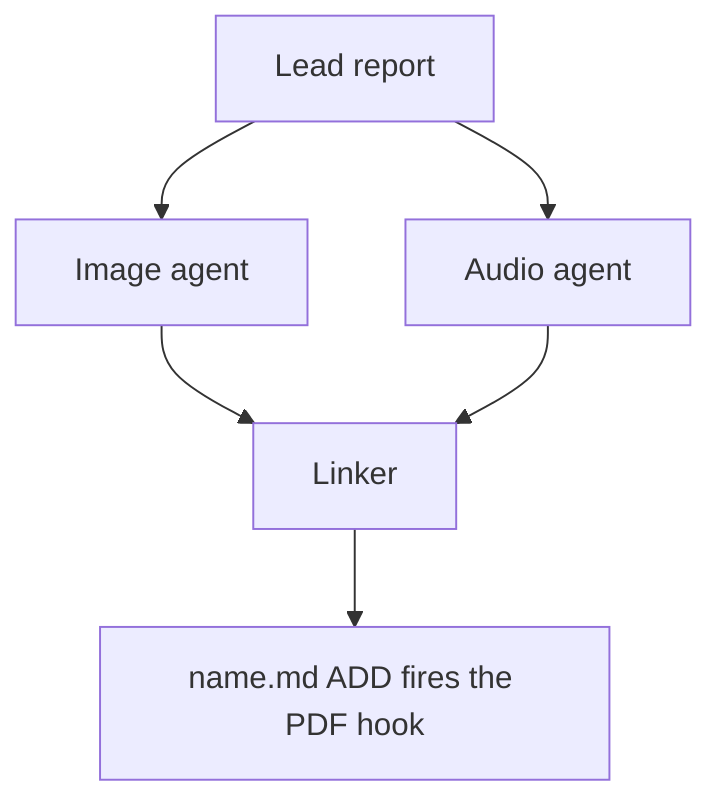

# Chat History - ace-run (research.52.image)

- **TIMESTAMP:** 2026-10-19 16:21:27 EDT
- **MODEL:** codex/gpt-6-astra
- **AGENT:** research.52.image
- **PROMPT:** `~/.sase/multi_prompts/202610/gh_sase_org__sase-multiprompt-261019_152246.md`

## Prompt

%id(image, clan=research.52) %m:gpt-6-astra
%wait:research.52.final %q(1.5x, w=0.25) #gh:gh_sase-org__sase 
%macros_enabled:false
# Previous Continuation

This fork uses versioned continuation replay. Blocks are stable, parent-first projections of exact continuation nodes; any historical source without recoverable node provenance is represented as an opaque legacy boundary.

- **Projection version:** `1`
- **Ordered nodes:** `1`

## Continuation Block `block:v1:1a5977c48a151bfc1711bde0244fb970`

- **Node:** `agent-delta:20261019152251:7dc136753e546bd7`
- **Kind:** `agent_delta`
- **Parents:** (none)
- **Content:** `local:continuation/records/agent_delta/agent-delta:20261019152251:7dc136753e546bd7.json`

### User

**Protected user instruction.** Carry this request unless an explicit attributed update supersedes it.

%clan(research.52, tribe=research, summary=[[[bold]RESEARCH PROMPT:[/bold] I want to make it much clearer whether or not a user can scroll down to see the entirety
of the currently focused sase agent deck (which they can only do when the cards are not
split out to sub-tabs).

- I was thinking that we could achieve this by only showing card sub-tabs when we
  actually have split out sub-tabs (i.e. when the user has to use the `<ctrl+j/k>`
  keymaps to view other cards in the current deck).
- We could also start showing a bright and clearly visible set of badges that indicate
  the view.
- As a part of this change, I was also thinking that we stop showing "auto" and "fixed"
  and start representing this state using a little lock icon instead?
- Think hard about what the best possible UX is here (I might have gotten a few things
  wrong).

Can you do some research with the goal of helping me decide the best way to implement
this? Also, critique this plan in general. Is this a good idea? Would you take a
different approach? Make any adjustments to the requirements that you think are
justified but clearly call these out. End your analysis with a recommended solution.]]) %id:research.52.final %m:@xlarge
%wait:research.52.cdx %wait:research.52.cld %wait:research.52.grk %wait:research.52.mus %wait:research.52.gem %q(1.5x, w=0.25)
#gh:gh_sase-org__sase 
You are the lead researcher: 5 independent researchers have reported on the request
below, and you will add your own research and merge every perspective into one
consolidated report.

SASE derives your plan's links from the artifacts you read this turn; use
`sase artifact read` for context you actually used.

Research request:

I want to make it much clearer whether or not a user can scroll down to see the entirety
of the currently focused sase agent deck (which they can only do when the cards are not
split out to sub-tabs).

- I was thinking that we could achieve this by only showing card sub-tabs when we
  actually have split out sub-tabs (i.e. when the user has to use the `<ctrl+j/k>`
  keymaps to view other cards in the current deck).
- We could also start showing a bright and clearly visible set of badges that indicate
  the view.
- As a part of this change, I was also thinking that we stop showing "auto" and "fixed"
  and start representing this state using a little lock icon instead?
- Think hard about what the best possible UX is here (I might have gotten a few things
  wrong).

Can you do some research with the goal of helping me decide the best way to implement
this? Also, critique this plan in general. Is this a good idea? Would you take a
different approach? Make any adjustments to the requirements that you think are
justified but clearly call these out. End your analysis with a recommended solution.

The researchers' registered reports:


- wait_name={{ a.wait_name }} label={{ a.label }} source_path={{ a.source_path }} path={{ a.path }} ref={{ a.ref }}


Month directory (create it if missing):

$(sase repo path research --ensure)/$(date +%Y%m)

Steps:

1. From the registered reports above, identify exactly one report per expected suffix
   in cdx, cld, grk, mus, gem, belonging to this
   dispatch's `research.52.cdx`, `research.52.cld`, `research.52.grk`, `research.52.mus`, `research.52.gem` dependencies, matching by `wait_name` and the canonical research
   label's existing `__<suffix>.md` suffix. Never reassign suffixes from list order.
   Open the research repo with `/sase_repo`, then read each report through its canonical
   research reference (or the `ref` field's `file:<id>` reference if the original has
   moved) using `sase artifact read`. Do not read predecessor chat transcripts. If the
   records above do not identify exactly one report per expected suffix, stop and report
   the missing or ambiguous input instead of guessing.
2. Research the request yourself, prioritizing gaps, weak evidence, and disagreements
   between the reports.
3. Pick a descriptive stem `<name>` that collides with nothing in the month directory
   (do NOT end the name with `_consolidated` or `_<YYYYmmdd>` or anything similar unless
   it relates to the research topic), create `<month-dir>/<name>/`, and move each report
   inside it as `<name>__<suffix>.md`, preserving its existing suffix. Each report's
   `source_path` is provenance for where it lives in your own opened research checkout;
   resolve its canonical repo-relative path there before moving it. Never modify the
   other agents' checkouts or the stored snapshot recorded at `ref` — only the copy in
   your own checkout moves. Preserve every file and never overwrite: on any collision,
   pick a different stem first.
4. Write the consolidated report to `<name>/<name>__final.md`: merge the strongest findings
   from every report above and your own research, resolve conflicts, cut duplication,
   and add missing critical context without unnecessary length.

   Do not create `<name>/<name>.md`, not even as a placeholder, because the linker
   agent `research.52.linker` publishes it from your report.

5. After the write succeeds, register the consolidated report as a durable snapshot so
   the linker agent, `research.52.linker`, can find it:

   sase artifact create -p "<absolute-report-path>" -l "research:<repo-relative-report-path>"

   Use the consolidated report's actual absolute path and its path relative to the
   research repo root, for example `research:202609/<name>/<name>__final.md`. Register
   only the consolidated report, and do not pass `--move`. If registration fails,
   report that failure; do not report the task as fully complete.

Final layout:

```text
<month-dir>/<name>/
├── <name>__cdx.md
├── <name>__cld.md
├── <name>__grk.md
├── <name>__mus.md
├── <name>__gem.md
└── <name>__final.md
```

### Assistant

Reading the remaining three researcher reports (grk, mus, gem) next; I'll then check the disputed points in the code myself.

Now let me verify the disputed points in code: FINAL/RECORD spread behavior, scroll-spy, footer labels, lock glyph usage, and the P cycle.

Checking whether FINAL/RECORD/Tools actually use the measured spread decision (the reports disagree on this), then the footer and P-cycle code.

Code checks are done. One disagreement left to ground externally: lock vs. pin semantics. Running a quick search.

Before writing, let me measure the proposed title strings in terminal cells so the mockups are accurate.

I have everything I need. Writing the consolidated report now.

Now registering the consolidated report as a durable artifact.

Registration succeeded. Now submitting the turn's final declaration.

I merged the five reports and my own checks into one report and registered it for the linker agent, `research.52.linker`. The research repo commit has been declared and lands when this turn ends.

**Inputs:** `research.52.cdx` was registered twice under the same label, and the two copies differ only in a link header, so I treated them as one report.

## Recommendation

**Your plan is a good idea, and "show card tabs only when the deck is actually paged" is the core fix.** Four of five researchers agree, and so do I. Today the loudest part of the title is the tab strip (highlighted active tab plus `2/2`). It looks the same whether the cards are spread or paged, and the only thing that says "spread" is one grey word.

What I'd change about your plan:
- **When tabs show:** decide by how the deck is actually drawn, not by whether `Ctrl+J/K` is needed. Those keys already work in spread mode too: they jump to the next card there.
- **Which decks:** apply the rule to Main, Files, FINAL and RECORD. Tools is always paged, so it keeps its tabs.
- **"Scroll down" is often false.** When a spread deck opens on Reply, Context is scrolled off *above*, with blank space below. One existing screenshot test image shows exactly this, under a title that still looks like a pager (`‹ 2/2 › Reply`). So in spread, the title should name where you are and point the right way, e.g. `◆ MAIN  SPREAD  Reply · ▴ Context`.
- **Paged decks need a cue at the bottom edge,** where you decide you're done: `+1 card · Ctrl+J`. A badge in the top border is the wrong place for that.
- **Bright badge:** yes, but making it bright in both states tells you nothing; the tabs appearing and disappearing does the real work. Make it a solid label on the focused panel only, with no colour per state (paged is the common case, so amber would just be noise). Show it only on Main and Files, where you can actually choose a layout.
- **Lock icon:** yes. A camera's exposure lock and the iPhone's rotation lock both use a lock to mean "stop adjusting automatically", which is what "fixed" means. But 🔒 already means read-only or private elsewhere in the TUI. So:
  - put it inside the label (`SPREAD 🔒`), not next to the deck name;
  - show nothing when automatic, and never an open lock;
  - rename "fixed" to "locked" everywhere.
- **Unlocking:** today only the command palette can return a deck to automatic. As a follow-up, I suggest a lock/unlock key that freezes whatever layout automatic mode picked. That also stops a streaming agent's deck from switching from spread to paged while you read.
- **Footer:** say `Ctrl+J/K jump` in spread and `cards` when paged.

The new titles fit the space today's titles use; the spread ones get shorter (27–36 cells vs 43). It's all display code in this repo; nothing needs to change in sase-core. The report splits the work into two small phases.

**Decisions for you:**
1. Accept renaming "fixed" to "locked"?
2. How to unlock: a new lock/unlock key (my pick), have `P` cycle back to automatic, or keep it palette-only?
3. Label colour: neutral light grey (my pick) or the deck's own colour?
4. Should the bottom cue turn bold when you reach the end of a paged card?

Report: `202610/deck_scroll_scope_tabs_and_layout_lock/deck_scroll_scope_tabs_and_layout_lock__final.md` (artifact `file:explicit:df00fb445604f0dc79b02311`), next to the five renamed researcher reports.

Sources for the lock comparison:
- [Photography Life: Nikon AE-L/AF-L button](https://photographylife.com/nikon-ae-l-af-l-button)
- [Wex: What is AE Lock and AF Lock?](https://www.wexphotovideo.com/blog/tips-and-technique/what-is-ae-lock-and-af-lock/)
- [How-To Geek: lock iPhone screen orientation](https://www.howtogeek.com/657244/how-to-lock-your-iphone-or-ipads-screen-orientation/)
- [BGR: the lock icon next to the battery](https://bgr.com/2204821/what-does-the-lock-icon-next-to-battery-mean-iphone/)

---

%macros_enabled:true
# New Query

 Generate an infographic that illustrates the main points made in this research markdown
file. Write the image to `<stem>_infographic.png` in the same directory, where
`<stem>` is the source file's stem with any trailing `__final` removed (so
`topic__final.md` becomes `topic_infographic.png`; other stems are unchanged).
Create it without overwrite. If it already exists, stop and report the collision.


The lead researcher's registered report:


- wait_name={{ a.wait_name }} label={{ a.label }} source_path={{ a.source_path }} path={{ a.path }} ref={{ a.ref }}


List drill-down candidates from the infographic's panels, then propose the ones that
help a reader understand the lead's research report, writing them to a companion
manifest for the swarm linker to place.
The linker is the only publisher: you propose, it places or omits.

## 1. Scope and source

- Never edit the report, never write a report of your own, and create no other file in
  the research checkout (`$(sase repo path research --ensure)`). Keep scratch files in a
  fresh `mktemp -d` directory outside it.
- Read the report once with `sase artifact read` on the registered lead entry listed
  above (its `ref`, or its `research:` label), redirecting the output to a scratch copy.
  Never work from memory or the forked conversation alone.
- If no registered lead report is listed, propose nothing and set `status: failed` with
  that reason (step 8).
- If this prompt also asked for an infographic, finish it first. It is the overview, and
  your diagrams are its drill-downs (step 2).

## 2. Find candidates

The infographic is the overview, and your diagrams are its drill-downs. Each one opens
a single panel and draws the detail the report gives for it but the panel had no room
for: the steps, branches, conditions, actors, states, failure or fallback paths, and
gates behind it. Expanding a panel this way is the purpose of this step, not a repeat of the infographic.

Before deciding anything, write a candidate list in your scratch directory:

- For each infographic panel, taken from your generation prompt and the image you
  checked, name the report passages that hold its detail and what the panel left out.
  With no infographic in this prompt, use each report section that describes a mechanism
  instead.
- Add any mechanism the report explains at length that the infographic left out
  entirely.
- Note the diagram type that would fit each candidate (step 4).

## 3. Decide

Judge every candidate, then propose each one that passes, best first. Propose at most three.
Zero is right only when no candidate passes. That is common for surveys and
recommendation lists, where no panel hides a mechanism. Never reach zero just because the infographic
already covers a topic.

A candidate passes when all of these hold:

- it draws three or more connected parts: a flow, a state lifecycle, an exchange
  between actors over time, a dependency structure, or a phased plan;
- it adds detail its panel lacks: at least two steps, branches, conditions, actors, or
  states the panel does not show. Redrawing a panel at the same level of detail is a
  repeat;
- a reader would grasp that detail faster from the picture than from the prose;
- every box, arrow, and label restates something the report says;
- it does not repeat a Mermaid diagram already in the report, a table, or a short list
  that already shows every step, branch, and condition the diagram would draw. Never turn a table into a diagram.

Rank passing candidates by how much report detail they reveal. Prefer candidates from
different panels over two from one panel. When a panel's detail is too big for one
diagram (step 4), draw its most decision-relevant part, such as the go/no-go rule or
the failure path, and scope the caption to that part. Do not drop the candidate.

Add no actors, steps, numbers, orderings, or causal arrows the report does not state.
Conditional wording stays conditional, and a proposed design stays distinct from an
implemented one.

## 4. Draw

Size each diagram for a PDF column about 650 px wide and at most about half a page tall.

- Types: `flowchart` (prefer `TD`; use `LR` only for a chain of five or fewer short
  nodes), `sequenceDiagram` (at most four participants), `stateDiagram-v2`,
  `classDiagram`, `erDiagram`.
- No init directives, `click`, `style`, `classDef`, HTML, or icons.
- At most four boxes side by side and about five ranks. In `TD` flows avoid decision
  diamonds and put the condition on a labelled edge instead.
- Labels of about four words or fewer, in the report's terms. Quote every label
  (`A["Lead report"]`, `-->|"on failure"|`). Never use `end` as a node id.

## 5. Validate

Put every diagram in a scratch Markdown file with a short paragraph before each one.
Pick the CLI once: probe `mmdc` first, then `npx -y -p @mermaid-js/mermaid-cli mmdc`.
A form is usable only if this smoke render exits 0 and writes `probe.svg`:

```sh
printf 'flowchart TD\n  A["ok"]\n' > <scratch>/probe.mmd
<mmdc> -i <scratch>/probe.mmd -o <scratch>/probe.svg
```

A failed probe means that checker form is unavailable, not that a diagram is bad. If a
probe fails only because Chrome cannot start its sandbox (common as root or in
containers), retry once with `-p <scratch>/puppeteer.json` holding
`{"args": ["--no-sandbox"]}`, and keep that flag for the real check. Record
`<mmdc> --version`.

Run the selected CLI against the scratch Markdown:

```sh
<mmdc> -i <scratch>/check.md -o <scratch>/check_render.md
```

The check passes only when the command exits 0, its output says
`Found N mermaid charts in Markdown input` for your N, and
`<scratch>/check_render-1.svg` through `-N.svg` all exist. `mmdc` stops at the first
failing diagram and prints `Parse error on line …` with an excerpt. Fix, simplify, or
drop that diagram and rerun; stop after three rounds.

Read each SVG's natural width with
`grep -o 'max-width: [0-9.]*px' <svg> | head -1`. Above about 1300 px, the diagram would
print below half size in the ~650 px column. Treat it like a failure: simplify it (fewer
side-by-side boxes, or `TD` instead of `LR`) or drop it. If no form is usable, propose
nothing and set `status: failed` with the reason (step 8).

## 6. Anchor

For each kept diagram, choose an `anchor`: 5-20 words copied verbatim from _one line_ of
a body paragraph or list item in the report. Headings, table rows, code blocks, and
existing Mermaid fences never qualify. Confirm `grep -cF -- '<anchor>' <scratch-copy>`
prints `1`; if no unique anchor exists, drop the diagram.
Anchor a drill-down in the passage that holds its detail, not in the bottom line or
summary the panel condenses.

## 7. Write the manifest

Write `<stem>.diagrams.md` beside the report, without overwrite, where `<stem>` is the
report's stem with any trailing `__final` removed, following the `#research/image` stem
rule (so `topic__final.md` becomes `topic.diagrams.md`). If it already exists, stop
diagram work, register nothing, and set `status: failed` naming the collision (step 8).
Write no file when no diagram survived.

Keep all metadata in the body, never in frontmatter: `sase artifact read` strips YAML
frontmatter. Use no local paths and no `file:` refs; the research repo is public.

````markdown
# Diagram proposals: <report title>

Proposals for the swarm linker, not a report. Each diagram restates only what the source
report says.

```yaml
source: research:<YYYYMM>/<name>/<name>__final.md
producer: <this agent's name>
check: "mmdc 12.0.0 rendered 1 of 1 Mermaid diagrams"
```

## publication-order

```yaml
anchor: |-
  so the link must be in the linker's first commit.
illustrates: |-
  The linker waits for every companion agent because the PDF hook fires once, on the
  ADD of name.md.
caption: The linker publishes once, after every companion finishes.
```


````

- `source` is the report's `research:` label, `producer` is your agent name, and `check`
  records the CLI version and chart count from the passing run.
- Each `## <id>` is a unique lowercase slug. `anchor` is a YAML literal block, so
  backticks and quotes copy exactly. `illustrates` is one sentence in the report's own
  terms stating the point the diagram makes. `caption` is at most about 15 words and has
  no figure number.
- Each `mermaid` fence is byte-identical to the source that passed the check; rerun the
  check after any edit.

## 8. Register and report

- When a manifest exists, register it without `--move`:
  `sase artifact create -p "<abs-path>" -l "diagrams:<YYYYMM>/<name>/<stem>.diagrams.md"`.
  The `diagrams:` label keeps it out of every `research:` listing.
- Then always set the `diagrams` variable, including when you proposed nothing. A missing
  variable means unknown or failed, never "considered and declined". It never carries
  Mermaid bodies. On `ready` and `none`, `considered` is how many drill-down candidates
  you judged. `failed` may omit it:

  ```sh
  sase var set diagrams --json --value '{"status": "ready", "count": 2, "considered": 4, "manifest": "<YYYYMM>/<name>/<stem>.diagrams.md", "source_ref": "<lead ref>"}'
  sase var set diagrams --json --value '{"status": "none", "count": 0, "considered": 3, "reason": "Survey of five naming options; the three panels compare options and hide no flow."}'
  sase var set diagrams --json --value '{"status": "failed", "count": 0, "reason": "Mermaid CLI (mmdc) unavailable on this host"}'
  ```

- A diagram failure never fails this agent. Finish normally so the linker can publish.
  In the final response, list every candidate with its verdict: proposed, or rejected
  with a reason. A `none` reason names the candidates considered and why each one
  failed.


## Response

I’ll read the registered report, create the infographic, then assess its panels for useful diagram drill-downs. I’m using the imagegen, SASE repository, artifact, and finalization workflows.


The report’s central idea is “tabs mean pages.” I’ll make that the visual anchor, with panels for scroll direction, hidden cards, layout badges, and unlocking. The graphic will mark the recommendations as proposed changes.


The infographic is complete and checked. I corrected the block-paging example and removed an unintended open-lock symbol. Next I’ll assess drill-downs for details the overview leaves out, especially cue updates and the proposed lock’s effect during streaming.


I judged eight candidates and selected three: streaming layout locks, spread direction-cue updates, and the optional bottom-cue emphasis. The other five would repeat existing lists or tables, or overlap these proposals. Mermaid validation is running now.


All three diagrams passed Mermaid 12.0.0 validation, and each insertion anchor matches exactly one report line. The infographic and manifest are registered, with `diagrams.status` set to `ready` for the linker. The report is unchanged; the research checkout contains only the two requested new files.


Created the [infographic](/home/bryan/.local/state/sase/workspaces/sase-org/sase/sase_11/sase/repos/research/202610/deck_scroll_scope_tabs_and_layout_lock/deck_scroll_scope_tabs_and_layout_lock_infographic.png) and [diagram manifest](/home/bryan/.local/state/sase/workspaces/sase-org/sase/sase_11/sase/repos/research/202610/deck_scroll_scope_tabs_and_layout_lock/deck_scroll_scope_tabs_and_layout_lock.diagrams.md) without overwriting files. The report is unchanged.

All eight candidates were judged:

| Candidate | Verdict |
|---|---|
| Streaming layout lock | **Proposed:** shows automatic paging, holding the current layout, and unlocking. |
| Spread direction cues | **Proposed:** shows refresh triggers and scrolling/non-scrolling branches. |
| Bottom-cue emphasis | **Proposed:** shows optional emphasis updates after scrolling, resize, and growth. |
| Tab visibility | Rejected: repeats the implementation table. |
| Lock presentation fallbacks | Rejected: existing condition lists already explain them. |
| Implementation phases | Rejected: repeats the overview and phase list. |
| Nested scroll scopes | Rejected: repeats the complete three-part hierarchy. |
| Shared refresh budget | Rejected: overlaps the proposed cue diagrams. |

Mermaid 12.0.0 rendered all three proposals successfully. Both deliverables are registered; `diagrams.status` is `ready`. Placement remains the linker’s decision.

Generated with built-in imagegen; [prompt and correction](/tmp/sase-research-image.99zveK/image-prompt.txt).
