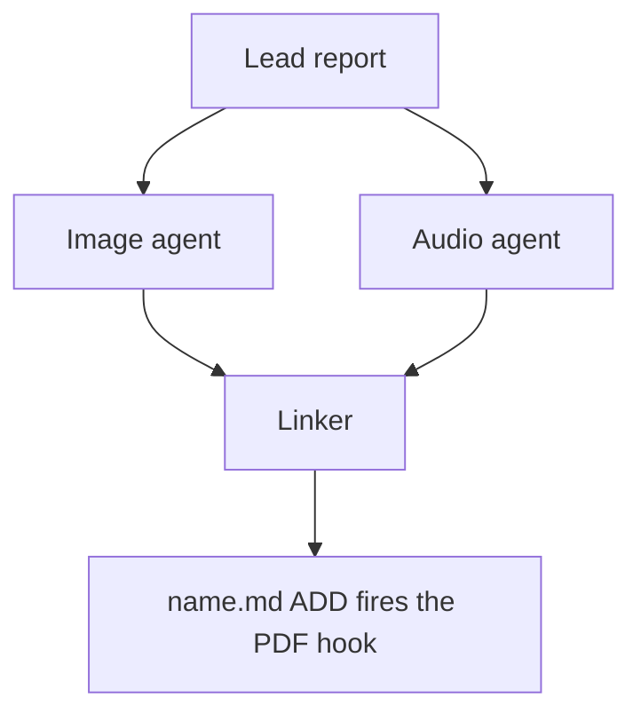

# Chat History - ace-run (research.54.image)

- **TIMESTAMP:** 2026-10-20 10:26:34 EDT
- **MODEL:** codex/gpt-6-astra
- **AGENT:** research.54.image
- **PROMPT:** `~/.sase/multi_prompts/202610/gh_sase_org__sase-multiprompt-261020_090613.md`

## Prompt

%id(image, clan=research.54) %m:gpt-6-astra
%wait:research.54.final %q(1.5x, w=0.25) #gh:gh_sase-org__sase 
%macros_enabled:false
# Previous Continuation

This fork uses versioned continuation replay. Blocks are stable, parent-first projections of exact continuation nodes; any historical source without recoverable node provenance is represented as an opaque legacy boundary.

- **Projection version:** `1`
- **Ordered nodes:** `1`

## Continuation Block `block:v1:70e69281b5b567f13a38d4df28f65f21`

- **Node:** `agent-delta:20261020090618:8636c07afc680cc7`
- **Kind:** `agent_delta`
- **Parents:** (none)
- **Content:** `local:continuation/records/agent_delta/agent-delta:20261020090618:8636c07afc680cc7.json`

### User

**Protected user instruction.** Carry this request unless an explicit attributed update supersedes it.

%clan(research.54, tribe=research, summary=[[[bold]RESEARCH PROMPT:[/bold] The mermaid diagrams that the image agent in the `#research_swarm` macro swarm
recommends are difficult to understand in isolation, not very useful, and not very
visually appealing. I would like to improve this agent's instructions (using some
mermaid diagram advice that is factored out to its own macro maybe?) so it produces much
more useful, easy to understand, and beautiful mermaid diagrams.

Can you do some research with the goal of helping me decide the best way to implement
this? Also, critique this plan in general. Is this a good idea? Would you take a
different approach? Make any adjustments to the requirements that you think are
justified but clearly call these out. End your analysis with a recommended solution.]]) %id:research.54.final %m:@xlarge
%wait:research.54.cdx %wait:research.54.cld %wait:research.54.grk %wait:research.54.mus %wait:research.54.gem %q(1.5x, w=0.25)
#gh:gh_sase-org__sase 
You are the lead researcher: 5 independent researchers have reported on the request
below, and you will add your own research and merge every perspective into one
consolidated report.

SASE derives your plan's links from the artifacts you read this turn; use
`sase artifact read` for context you actually used.

Research request:

The mermaid diagrams that the image agent in the `#research_swarm` macro swarm
recommends are difficult to understand in isolation, not very useful, and not very
visually appealing. I would like to improve this agent's instructions (using some
mermaid diagram advice that is factored out to its own macro maybe?) so it produces much
more useful, easy to understand, and beautiful mermaid diagrams.

Can you do some research with the goal of helping me decide the best way to implement
this? Also, critique this plan in general. Is this a good idea? Would you take a
different approach? Make any adjustments to the requirements that you think are
justified but clearly call these out. End your analysis with a recommended solution.

The researchers' registered reports:


- wait_name={{ a.wait_name }} label={{ a.label }} source_path={{ a.source_path }} path={{ a.path }} ref={{ a.ref }}


Month directory (create it if missing):

$(sase repo path research --ensure)/$(date +%Y%m)

Steps:

1. From the registered reports above, identify exactly one report per expected suffix
   in cdx, cld, grk, mus, gem, belonging to this
   dispatch's `research.54.cdx`, `research.54.cld`, `research.54.grk`, `research.54.mus`, `research.54.gem` dependencies, matching by `wait_name` and the canonical research
   label's existing `__<suffix>.md` suffix. Never reassign suffixes from list order.
   Open the research repo with `/sase_repo`, then read each report through its canonical
   research reference (or the `ref` field's `file:<id>` reference if the original has
   moved) using `sase artifact read`. Do not read predecessor chat transcripts. If the
   records above do not identify exactly one report per expected suffix, stop and report
   the missing or ambiguous input instead of guessing.
2. Research the request yourself, prioritizing gaps, weak evidence, and disagreements
   between the reports.
3. Pick a descriptive stem `<name>` that collides with nothing in the month directory
   (do NOT end the name with `_consolidated` or `_<YYYYmmdd>` or anything similar unless
   it relates to the research topic), create `<month-dir>/<name>/`, and move each report
   inside it as `<name>__<suffix>.md`, preserving its existing suffix. Each report's
   `source_path` is provenance for where it lives in your own opened research checkout;
   resolve its canonical repo-relative path there before moving it. Never modify the
   other agents' checkouts or the stored snapshot recorded at `ref` — only the copy in
   your own checkout moves. Preserve every file and never overwrite: on any collision,
   pick a different stem first.
4. Write the consolidated report to `<name>/<name>__final.md`: merge the strongest findings
   from every report above and your own research, resolve conflicts, cut duplication,
   and add missing critical context without unnecessary length.

   Do not create `<name>/<name>.md`, not even as a placeholder, because the linker
   agent `research.54.linker` publishes it from your report.

5. After the write succeeds, register the consolidated report as a durable snapshot so
   the linker agent, `research.54.linker`, can find it:

   sase artifact create -p "<absolute-report-path>" -l "research:<repo-relative-report-path>"

   Use the consolidated report's actual absolute path and its path relative to the
   research repo root, for example `research:202609/<name>/<name>__final.md`. Register
   only the consolidated report, and do not pass `--move`. If registration fails,
   report that failure; do not report the task as fully complete.

Final layout:

```text
<month-dir>/<name>/
├── <name>__cdx.md
├── <name>__cld.md
├── <name>__grk.md
├── <name>__mus.md
├── <name>__gem.md
└── <name>__final.md
```

### Assistant

I've opened the research repo. Next I'll read the five reports, running the reads from the workspace root.

I've read all five reports. Next I'll check the main disagreements against the source: the plugin macros, the PDF renderer's Mermaid config, and sase's skill loader.

Still checking whether `sase skill init` deploys plugin-shipped skills to providers. That decides whether the skill-source option works outside the swarm.

Reports moved. Now I'll write the consolidated report.

Report written. I'll check that all three Mermaid figures in it render under the PDF config and that the sizes I quoted match.

All three render and the sizes match. Registering the consolidated report:

Layout is complete and the primary workspace is clean. Submitting the final declaration.

I've written and registered the consolidated report, and the research repo commit is declared for the host to make after this turn. I found exactly one report per suffix (cdx, cld, grk, mus, gem), read each through `sase artifact read`, and moved them into `202610/research_swarm_mermaid_diagram_craft/`. The final report is `research_swarm_mermaid_diagram_craft__final.md`, registered as `file:explicit:2044c475647e2b3745223fb4` for the linker.

**Verdict:** your instinct is right, but moving the Mermaid advice into its own macro is the smallest part of the fix. Three things in the current `#research/diagrams` instructions cause the bad diagrams:
- **Wrong subject:** it asks for "drill-downs" ranked by how much detail they reveal, so it draws minor mechanisms instead of the figure a reader needs.
- **Flat output by rule:** the drawing rules are mostly bans — no `classDef`, labels of about four words, no decision shapes, and nothing asking for a title.
- **No real check:** the agent never looks at its render, and its one size check can't fail. Under the PDF's settings it reads an internal 200 px value for every diagram.

I tested the reports' disagreements by rendering under the PDF renderer's exact Mermaid 12.2.0 config:
- **Colour:** `classDef` colours do render in the PDF, so grk and gem were wrong to keep the ban. Theme directives (`%%{init}%%` or a frontmatter `theme`) are silently ignored, so mus's and gem's theme proposals do nothing there.
- **`<br/>` line breaks** work, contrary to grk.
- **Decision shapes:** hexagons came out 24% shorter than diamonds on the same graph. Long text in either shape makes it balloon.
- **New diagram types (mus):**
  - `timeline` drops its title and printed at 66% for three dates.
  - `pie` and `quadrantChart` need numbers the report usually doesn't state.
  - `mindmap` is just a nested list.
- **Forcing structure (gem):** gem's redraw prints at 77% and adds start and end steps the source report doesn't contain.
- **The model:** your `#rsa` alias runs the image agent on `gpt-6-astra`, the same general model it uses for the cdx researcher. So the "wrong model" theory is weaker than two reports claimed.
- **Who draws the diagrams:** only 4 of the 20 Mermaid figures in published reports came from the diagrams agent; lead researchers wrote the other 16.

**Recommended solution:**
1. **Package the advice as a plugin skill.** Add `skills/mermaid_diagrams.md` to `sase-research-artifacts`. The diagrams macro includes it as `#skill/mermaid_diagrams`, and any agent, including the lead, can load it as `/mermaid_diagrams`. I confirmed sase loads plugin skills and `sase skill init` deploys them to every provider.
2. **Change what gets drawn.** Pick figures that answer a named reader question, ranked by how much the report's conclusion depends on them. Zero diagrams for a survey report counts as success.
3. **Replace the bans with positive rules:**
   - an in-figure title;
   - a bold name plus a short gloss on each node, up to about eight words;
   - at most three colour classes, each setting fill, stroke and text colour.
4. **Add a look step.** Render with the PDF's settings, look at the image, and revise at most twice. Fail any figure that would print below 75% scale.
5. **Measure before anything bigger.** Run a small blind before/after comparison before splitting diagrams into their own agent or changing the PDF renderer's theme.

**Requirement changes I made:**
- I redefined "beautiful" as clean structure plus a small colour palette, because the PDF locks the theme.
- Fixing the instructions alone isn't enough; the plan has to add the look step.
- It reverses the earlier drill-down design choice.
- "More useful" may mean fewer diagrams.
- Optionally, let the lead researcher use the same skill.

The report includes a draft outline of the skill and an example figure I drew in the recommended style. It printed at 81% on the first draft and 100% after one revision, which shows why the look step matters. All three figures in the report render under the PDF config.

Not verified: which Mermaid version GitHub uses and how the diagrams look in GitHub dark mode, whether Mermaid's default layout beats `dagre` in general (two samples disagree), and the full Highlights PDF pipeline. I computed page fit from the renderer's code rather than producing a PDF.

---

%macros_enabled:true
# New Query

 Generate an infographic that illustrates the main points made in this research markdown
file. Write the image to `<stem>_infographic.png` in the same directory, where
`<stem>` is the source file's stem with any trailing `__final` removed (so
`topic__final.md` becomes `topic_infographic.png`; other stems are unchanged).
Create it without overwrite. If it already exists, stop and report the collision.


The lead researcher's registered report:


- wait_name={{ a.wait_name }} label={{ a.label }} source_path={{ a.source_path }} path={{ a.path }} ref={{ a.ref }}


List drill-down candidates from the infographic's panels, then propose the ones that
help a reader understand the lead's research report, writing them to a companion
manifest for the swarm linker to place.
The linker is the only publisher: you propose, it places or omits.

## 1. Scope and source

- Never edit the report, never write a report of your own, and create no other file in
  the research checkout (`$(sase repo path research --ensure)`). Keep scratch files in a
  fresh `mktemp -d` directory outside it.
- Read the report once with `sase artifact read` on the registered lead entry listed
  above (its `ref`, or its `research:` label), redirecting the output to a scratch copy.
  Never work from memory or the forked conversation alone.
- If no registered lead report is listed, propose nothing and set `status: failed` with
  that reason (step 8).
- If this prompt also asked for an infographic, finish it first. It is the overview, and
  your diagrams are its drill-downs (step 2).

## 2. Find candidates

The infographic is the overview, and your diagrams are its drill-downs. Each one opens
a single panel and draws the detail the report gives for it but the panel had no room
for: the steps, branches, conditions, actors, states, failure or fallback paths, and
gates behind it. Expanding a panel this way is the purpose of this step, not a repeat of the infographic.

Before deciding anything, write a candidate list in your scratch directory:

- For each infographic panel, taken from your generation prompt and the image you
  checked, name the report passages that hold its detail and what the panel left out.
  With no infographic in this prompt, use each report section that describes a mechanism
  instead.
- Add any mechanism the report explains at length that the infographic left out
  entirely.
- Note the diagram type that would fit each candidate (step 4).

## 3. Decide

Judge every candidate, then propose each one that passes, best first, within the cap below.
Zero is right only when no candidate passes. That is common for surveys and
recommendation lists, where no panel hides a mechanism. Never reach zero just because the infographic
already covers a topic.

A candidate passes when all of these hold:

- it draws three or more connected parts: a flow, a state lifecycle, an exchange
  between actors over time, a dependency structure, or a phased plan;
- it adds detail its panel lacks: at least two steps, branches, conditions, actors, or
  states the panel does not show. Redrawing a panel at the same level of detail is a
  repeat;
- a reader would grasp that detail faster from the picture than from the prose;
- every box, arrow, and label restates something the report says;
- it does not repeat a Mermaid diagram already in the report, a table, or a short list
  that already shows every step, branch, and condition the diagram would draw. Never turn a table into a diagram.

Rank passing candidates by how much report detail they reveal. Prefer candidates from
different panels over two from one panel. When a panel's detail is too big for one
diagram (step 4), draw its most decision-relevant part, such as the go/no-go rule or
the failure path, and scope the caption to that part. Do not drop the candidate.

Propose at most three diagrams for most reports. A complex report may warrant up to five:
one that explains four or more distinct mechanisms in separate `##` sections, such as an architecture, a protocol, a migration, or a multi-phase plan.
Propose a fourth or fifth diagram only when it passes every test above, drills into a panel or mechanism that no higher-ranked proposal covers, and anchors in a `##` section that holds no other proposal (step 6).
Five is a ceiling, not a target: never lower the bar, split one diagram into two, or add one to reach a count.
A passing candidate the cap leaves out is reported as over the cap (step 8).

Add no actors, steps, numbers, orderings, or causal arrows the report does not state.
Conditional wording stays conditional, and a proposed design stays distinct from an
implemented one.

## 4. Draw

Size each diagram for a PDF column about 650 px wide and at most about half a page tall.

- Types: `flowchart` (prefer `TD`; use `LR` only for a chain of five or fewer short
  nodes), `sequenceDiagram` (at most four participants), `stateDiagram-v2`,
  `classDiagram`, `erDiagram`.
- No init directives, `click`, `style`, `classDef`, HTML, or icons.
- At most four boxes side by side and about five ranks. In `TD` flows avoid decision
  diamonds and put the condition on a labelled edge instead.
- Labels of about four words or fewer, in the report's terms. Quote every label
  (`A["Lead report"]`, `-->|"on failure"|`). Never use `end` as a node id.

## 5. Validate

Put every diagram in a scratch Markdown file with a short paragraph before each one.
Pick the CLI once: probe `mmdc` first, then `npx -y -p @mermaid-js/mermaid-cli mmdc`.
A form is usable only if this smoke render exits 0 and writes `probe.svg`:

```sh
printf 'flowchart TD\n  A["ok"]\n' > <scratch>/probe.mmd
<mmdc> -i <scratch>/probe.mmd -o <scratch>/probe.svg
```

A failed probe means that checker form is unavailable, not that a diagram is bad. If a
probe fails only because Chrome cannot start its sandbox (common as root or in
containers), retry once with `-p <scratch>/puppeteer.json` holding
`{"args": ["--no-sandbox"]}`, and keep that flag for the real check. Record
`<mmdc> --version`.

Run the selected CLI against the scratch Markdown:

```sh
<mmdc> -i <scratch>/check.md -o <scratch>/check_render.md
```

The check passes only when the command exits 0, its output says
`Found N mermaid charts in Markdown input` for your N, and
`<scratch>/check_render-1.svg` through `-N.svg` all exist. `mmdc` stops at the first
failing diagram and prints `Parse error on line …` with an excerpt. Fix, simplify, or
drop that diagram and rerun; stop after five rounds.

Read each SVG's natural width with
`grep -o 'max-width: [0-9.]*px' <svg> | head -1`. Above about 1300 px, the diagram would
print below half size in the ~650 px column. Treat it like a failure: simplify it (fewer
side-by-side boxes, or `TD` instead of `LR`) or drop it. If no form is usable, propose
nothing and set `status: failed` with the reason (step 8).

## 6. Anchor

For each kept diagram, choose an `anchor`: 5-20 words copied verbatim from _one line_ of
a body paragraph or list item in the report. Headings, table rows, code blocks, and
existing Mermaid fences never qualify. Confirm `grep -cF -- '<anchor>' <scratch-copy>`
prints `1`; if no unique anchor exists, drop the diagram.
Anchor a drill-down in the passage that holds its detail, not in the bottom line or
summary the panel condenses.
If a fourth or fifth diagram's anchor shares a `##` section with another proposal's anchor, drop that diagram (step 3).

## 7. Write the manifest

Write `<stem>.diagrams.md` beside the report, without overwrite, where `<stem>` is the
report's stem with any trailing `__final` removed, following the `#research/image` stem
rule (so `topic__final.md` becomes `topic.diagrams.md`). If it already exists, stop
diagram work, register nothing, and set `status: failed` naming the collision (step 8).
Write no file when no diagram survived.

Keep all metadata in the body, never in frontmatter: `sase artifact read` strips YAML
frontmatter. Use no local paths and no `file:` refs; the research repo is public.

````markdown
# Diagram proposals: <report title>

Proposals for the swarm linker, not a report. Each diagram restates only what the source
report says.

```yaml
source: research:<YYYYMM>/<name>/<name>__final.md
producer: <this agent's name>
check: "mmdc 12.0.0 rendered 1 of 1 Mermaid diagrams"
```

## publication-order

```yaml
anchor: |-
  so the link must be in the linker's first commit.
illustrates: |-
  The linker waits for every companion agent because the PDF hook fires once, on the
  ADD of name.md.
caption: The linker publishes once, after every companion finishes.
```


````

- `source` is the report's `research:` label, `producer` is your agent name, and `check`
  records the CLI version and chart count from the passing run.
- Each `## <id>` is a unique slug of lowercase letters, digits, and hyphens; the linker
  publishes the diagram under the anchor `figure-<id>`. `anchor` is a YAML literal block,
  so backticks and quotes copy exactly. `illustrates` is one sentence in the report's
  own terms stating the point the diagram makes and what the figure lets a reader see;
  the linker also builds the figure's in-text reference sentence from it. `caption` is
  at most about 15 words and has no figure number.
- Each `mermaid` fence is byte-identical to the source that passed the check; rerun the
  check after any edit.

## 8. Register and report

- When a manifest exists, register it without `--move`:
  `sase artifact create -p "<abs-path>" -l "diagrams:<YYYYMM>/<name>/<stem>.diagrams.md"`.
  The `diagrams:` label keeps it out of every `research:` listing.
- Then always set the `diagrams` variable, including when you proposed nothing. A missing
  variable means unknown or failed, never "considered and declined". It never carries
  Mermaid bodies. On `ready` and `none`, `considered` is how many drill-down candidates
  you judged. `failed` may omit it:

  ```sh
  sase var set diagrams --json --value '{"status": "ready", "count": 2, "considered": 4, "manifest": "<YYYYMM>/<name>/<stem>.diagrams.md", "source_ref": "<lead ref>"}'
  sase var set diagrams --json --value '{"status": "none", "count": 0, "considered": 3, "reason": "Survey of five naming options; the three panels compare options and hide no flow."}'
  sase var set diagrams --json --value '{"status": "failed", "count": 0, "reason": "Mermaid CLI (mmdc) unavailable on this host"}'
  ```

- A diagram failure never fails this agent. Finish normally so the linker can publish.
  In the final response, list every candidate with its verdict: proposed, rejected with a reason, or over the cap. A `none` reason names the candidates considered and why each one
  failed.


## Response

I’ll use the imagegen skill to create the infographic from the registered report, then assess drill-down candidates and validate any proposals. I’ll use the SASE repo and artifact workflows to read the source and save the companions without overwriting existing files.


The report recommends changing both what gets drawn and how it is checked: select figures around reader questions, share the craft guidance, and inspect the rendered result. I’ll make those the infographic’s focus, while keeping the proposed changes distinct from the findings already verified.


The infographic is saved and visually checked. I’ve listed nine drill-down candidates. Most repeat an existing figure or a compact rule list; the strongest addition is a comparison showing why the old width check misses oversized diagrams and how the proposed check uses actual SVG dimensions.


The size-check proposal renders at 422 × 384 px, fits the requested column, and passed visual inspection. Its anchor is unique in the report. The companion manifest is ready; I’ll register it for the linker to decide whether to include.


Both companions are registered, and `diagrams.status` is `ready` with one proposal from nine candidates. Only the requested PNG and manifest were added; the report is unchanged. I’m using the SASE final skill to declare those files for the host to commit.


Created the [infographic](/home/bryan/.local/state/sase/workspaces/sase-org/sase/sase_12/sase/repos/research/202610/research_swarm_mermaid_diagram_craft/research_swarm_mermaid_diagram_craft_infographic.png) using imagegen ([prompt](/tmp/mermaid-craft-image.FrkRHi/image-prompt.txt)), without overwriting anything.

Registered the [diagram manifest](/home/bryan/.local/state/sase/workspaces/sase-org/sase/sase_12/sase/repos/research/202610/research_swarm_mermaid_diagram_craft/research_swarm_mermaid_diagram_craft.diagrams.md). Status: **ready**, one proposal from nine candidates. The linker decides placement.

Candidate verdicts:

- **PDF size measurement — proposed:** compares the ineffective width grep with the proposed dimension-based check.
- **Selection criteria — rejected:** already a compact ranking; a flow would invent conditions.
- **Shared skill distribution — rejected:** duplicates the panel and existing table.
- **Figure contract and type choice — rejected:** repeats concise rule lists.
- **Render-review loop — rejected:** already illustrated in the report.
- **Blind evaluation — rejected:** already a compact procedure.
- **Separate-agent dependencies — rejected:** already fully specified in a short passage.
- **Template protection — rejected:** the precise syntax rule is clearer as prose.
- **Automatic versus locked layouts — rejected:** duplicates existing figures.

The proposal passed Mermaid CLI 12.0.0 validation and visual inspection at **422 × 384 px**. The source report remains unchanged.
