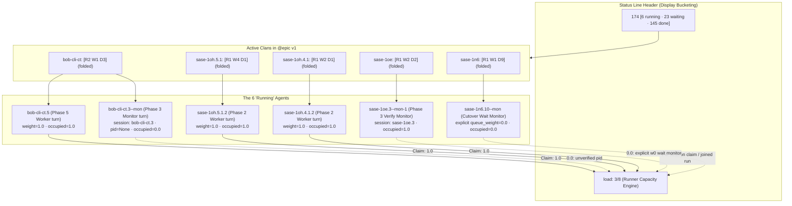

# Chat History - ace-run (research.5e.gem)

- **TIMESTAMP:** 2026-10-26 18:10:31 EDT
- **MODEL:** agy/gemini-3.8-flash-high
- **AGENT:** research.5e.gem
- **PROMPT:** `~/.sase/multi_prompts/202610/gh_sase_org__sase-multiprompt-261026_174150.md`

## Prompt

%id(gem, clan=research.5e)
%m:agy/gemini-3.8-flash-high %q(1.5x, w=0.25)
#gh:gh_sase-org__sase 
You are researcher gem in a 5-researcher swarm.
The other researchers, `research.5e.cdx`, `research.5e.cld`, `research.5e.grk`, `research.5e.mus`, are independently investigating the same request and will write their own self-named reports ending in `__cdx.md` and `__cld.md` and `__grk.md` and `__mus.md`. Your report will end in `__gem.md`.

Conduct your research independently and form your own conclusions. Do NOT attempt to
locate, open, read, or otherwise consult the other researcher's report from this swarm,
even if it becomes available before you finish. Do not obtain that peer's findings
indirectly through its chat transcript, summaries, or requests to the peer. You may
independently use the same external sources, shared input material, and unrelated prior
research. You may check filenames or file existence to avoid overwriting your own
output, but do not inspect the peer's report contents. If you encounter its filename,
leave the report alone. The lead researcher will read every report and synthesize their
findings after you have all finished.

There is not nearly enough transparancy about how the load is determined for the current
machine. For example, in the ~/tmp/screenshots/20261026_172751.png screenshot you can
see that there are 6 agents running (from the agent count at the top), but the load is
only at 3/8. This seems like it is probably a mistake/bug (I only see 1 agent that is
running a waiting monitor, so I would expect a load of 5 I think--I'm not sure), but the
bigger problem is that it is very unclear what error we are making right now, if any
(which nodes do not have any weight associated with them, for example).

Can you do some research with the goal of helping me decide on the best UX changes to
make this state clearer and helping to resolve the issues with the way the machine's
load is calculated (if any)? End your analysis with a recommended UX and solutions to
any issues you find with machine load calculations. 
Write this research to a new markdown file under the $(sase repo path research --ensure)/$(date +%Y%m)/ directory.
Choose a descriptive filename stem yourself, but the filename MUST end with the
`__gem` suffix, i.e. `<stem>__gem.md` (double underscore before the
suffix). Create the report without overwrite: if the exact file already exists, pick a
different stem instead of replacing it.


After the write succeeds, register the report as a durable snapshot:

sase artifact create -p "<absolute-report-path>" -l "research:<repo-relative-report-path>"

Use the report's actual absolute path and its path relative to the research repo root
(for example
`research:202609/topic__a.md`),
including any subdirectory the steps above put it in. Do not derive the label from
the current month, the clock, or a guessed name.
Do not pass `--move`; the source stays in the research repo for later reorganization. If
registration itself fails, report that failure — do not report the research task as
fully complete.

## Response

### Research Findings & Architectural Recommendations: Machine Load Transparency & Capacity UX

I have conducted independent research on how machine load is calculated in SASE and how it is surfaced in the ACE TUI, focusing on the discrepancy observed in [`20261026_172751.png`](file:///home/bryan/tmp/screenshots/20261026_172751.png) (where the top status bar showed **6 running**, but the gauge read **`load: 3/8`**).

The full research report has been written and registered as a durable artifact snapshot:
- **Report Path:** [`machine_load_transparency_and_capacity_ux__gem.md`](file:///home/bryan/.local/state/sase/workspaces/sase-org/sase/sase_22/sase/repos/research/202610/machine_load_transparency_and_capacity_ux__gem.md)
- **Artifact Label:** `research:202610/machine_load_transparency_and_capacity_ux__gem.md` (`file:explicit:c5f72437e8c7e4d87d73cf8c`)

---

### 1. Root Cause Analysis of the `load: 3/8` vs `6 running` Discrepancy

The discrepancy is caused by a fundamental semantic difference between **Process Display Status Bucketing** and **Runner Capacity Admission Claims**, compounded by a core status-mapping flaw:



1. **Who were the 6 "running" agents?**
   - **`bob-cli-ct`** (`[R2 W1 D3]`): `bob-cli-ct.5` (Wave 4 worker) + `bob-cli-ct.3--mon` (Wave 3 verify monitor).
   - **`sase-1oh.5.1`** (`[R1 W4 D1]`): `sase-1oh.5.1.2` (Wave 2 worker).
   - **`sase-1oh.4.1`** (`[R1 W2 D1]`): `sase-1oh.4.1.2` (Wave 2 worker).
   - **`sase-1oe`** (`[R1 W2 D2]`): `sase-1oe.3` / `sase-1oe.3--mon-1` (Wave 3 verify monitor running `sase tool run check`).
   - **`sase-1n6`** (`[R1 W1 D9]`): `sase-1n6.10` / `sase-1n6.10--mon` (Cutover gate wait monitor).
   - **Sum of in-flight counts:** `2 + 1 + 1 + 1 + 1 = 6`.

2. **Why `sase-1n6` counted as "Running":**
   In [`sase-core/crates/sase_core/src/agent_archive/status.rs`](file:///home/bryan/.local/state/sase/workspaces/sase-org/sase/sase_22/sase/repos/linked/sase-core/crates/sase_core/src/agent_archive/status.rs#L13-L30), `status_bucket_for_status` matches known statuses (`"WAITING"`, `"QUEUED"`, `"DONE"`). Any custom or compound status—such as `"WAITING CUTOVER"`—falls through to the default **`"Running"`**! This inflated the header count to 6 even though the monitor was passively waiting.

3. **Why the Rust Runner Capacity Engine computed 3.0 / 8.0:**
   Runner capacity tracks **active capacity claims against `max_running_agents` (8.0)**:
   - **`sase-1n6.10--mon`**: Holds **0.0 units** because it explicitly authored `queue_weight: 0.0`.
   - **`bob-cli-ct.3--mon`**: Holds **0.0 units** because its process handle was not registered with an active PID marker (under [`records.rs:is_occupying_record`](file:///home/bryan/.local/state/sase/workspaces/sase-org/sase/sase_22/sase/repos/linked/sase-core/crates/sase_core/src/runner_capacity/records.rs#L39-L47), monitors without live PIDs occupy 0).
   - **Serial Session Consolidation**: Multiple turns in a serial session (`agent_session`) share a single claim in [`claims.rs:build_claims`](file:///home/bryan/.local/state/sase/workspaces/sase-org/sase/sase_22/sase/repos/linked/sase-core/crates/sase_core/src/runner_capacity/claims.rs#L31-L86), with capacity equal to `max(weights)`.
   - **Active 1.0 unit workers**: `sase-1oh.5.1.2` (1.0), `sase-1oh.4.1.2` (1.0), and `bob-cli-ct.5` (1.0).
   - **Total:** `1.0 + 1.0 + 1.0 = 3.0 units`.

---

### 2. Critical Bug Discovered: Clashing "checkout / diff" Tooltip Labels

In [`agent_load_indicator.py`](file:///home/bryan/.local/state/sase/workspaces/sase-org/sase/sase_22/src/sase/ace/tui/widgets/agent_load_indicator.py#L111-L127), the gauge has a tooltip intended to show:
```text
Held by:
• <agent>: <weight>
```
However, testing live against running processes revealed that every holder currently displays as:
```text
Held by:
• checkout: 1
• checkout: 1
• diff: 1 (monitor)
• checkout: 0.25
```

#### Cause
In [`agent_runner_slots.py`](file:///home/bryan/.local/state/sase/workspaces/sase-org/sase/sase_22/src/sase/ace/tui/models/agent_runner_slots.py#L225-L228), `source_agent_by_artifact_dir` is built with a naive dictionary comprehension over `capacity_agents`. Because root agents and their workflow step child rows (`setup`, `checkout`, `main`, `diff`) share the same artifact directory, the step child rows **overwrite** the root agent row in the dictionary! The tooltip then extracts the child's `cl_name`, outputting `'checkout'` or `'diff'` instead of the real agent name.

---

### 3. Why the UI State is Currently Opaque

1. **Header Disconnect:** `6 running` (process count) vs `load: 3/8` (capacity units) gives no indication of whether "load" means CPU load average or slot usage.
2. **Hidden Weights:** Default weight `1.0` is suppressed by [`_queue_weight_badge.py`](file:///home/bryan/.local/state/sase/workspaces/sase-org/sase/sase_22/src/sase/ace/tui/widgets/_queue_weight_badge.py). Clan containers also suppress weight badges. When clans are folded, **zero weights or capacity figures are visible anywhere on screen**.
3. **Deck Panel Vacuum:** The Deck panel only shows a `QUEUE` section for agents waiting in the admission queue; once an agent is running or when a clan is selected, capacity information is entirely absent.

---

### 4. Recommended Solutions & UX Roadmap

#### A. Fix the Capacity Holder Label Bug
In [`src/sase/ace/tui/models/agent_runner_slots.py`](file:///home/bryan/.local/state/sase/workspaces/sase-org/sase/sase_22/src/sase/ace/tui/models/agent_runner_slots.py#L225-L228):
Prioritize root agent rows over step child rows (`is_child_row=False`, `appears_as_agent=True`) when populating `source_agent_by_artifact_dir`. When fixed, holder tooltips immediately render true agent names (`sase-1oh.4.1.2`, `bob-cli-ct.5`, `research.5e.gem`).

#### B. Fix Compound Status Bucketing in Rust Core
In [`sase-core/crates/sase_core/src/agent_archive/status.rs`](file:///home/bryan/.local/state/sase/workspaces/sase-org/sase/sase_22/sase/repos/linked/sase-core/crates/sase_core/src/agent_archive/status.rs#L13-L30):
Add a pattern matching `canonical_status.starts_with("WAITING") || canonical_status.starts_with("WAIT") => "Waiting"`. This prevents waiting monitors like `"WAITING CUTOVER"` from being bucketed as `"Running"`.

#### C. Clan Container Capacity Rollup Badges
In folded clan rows, display net capacity alongside process counts:
- `bob-cli (RUNNING) x6 [R2 W1 D3] · 1.0 cap`
- `sase (WAITING CUTOVER) x11 [R1 W1 D9] · 0 cap (wait monitor)`

#### D. Runner Capacity Inspector Modal (`L`)
Add an interactive modal bound to clicking the gauge or pressing `L`:
- Shows machine limit (`8.0`), occupied units (`3.0`), and free headroom (`5.0`).
- Tables active claims by real agent name, project, role, PID, and held weight.
- Separately lists zero-weight monitors (`w0`) with explanations (e.g., `Wait monitor (%queue weight=0)`).
- Lists queued waiters and admission blockers.

#### E. Permanent Deck Panel Capacity Card
Add a dedicated "Runner Capacity" card to the Deck panel for running agents and clans, detailing active claim lineage, authored `%queue` directives, and held weight.
