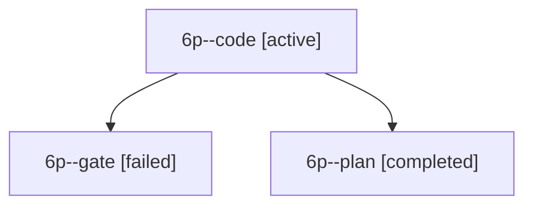

# Session: 6p

[Agent Hoods](../README.md) / [bbugyi200](../users/bbugyi200/README.md) / [apollo](../users/bbugyi200/machines/apollo/README.md) / [6p](../users/bbugyi200/machines/apollo/hoods/6p/README.md) / 6p

Owner: `bbugyi200.apollo` · Hood: `6p` · Members: 3

## Lineage

The diagram is an optional enhancement; the ordered table below contains the same lineage in accessible text.

| Role | Agent | State | Model / provider | Timing | Commits | Prompt | Chat |
|---|---|---|---|---|---:|---|---|
| code | 6p--code | active | sonnet / claude | 2026-10-11T11:02:54.913166+00:00 | [1](../agents/bbugyi200.apollo.6p--code/README.md#commits) | [Prompt](../agents/bbugyi200.apollo.6p--code/prompt.md) | — |
| gate | 6p--gate | failed | opus / claude | 2026-10-11T11:01:59.955076+00:00 → 2026-10-11T11:02:28.586904+00:00 | 0 | — | [Chat](../agents/bbugyi200.apollo.6p--gate/chat.md) |
| plan | 6p--plan | completed | opus / claude | 2026-10-11T10:49:18.895411+00:00 → 2026-10-11T11:00:04.351814+00:00 | 0 | [Prompt](../agents/bbugyi200.apollo.6p--plan/prompt.md) | [Chat](../agents/bbugyi200.apollo.6p--plan/chat.md) |

## Commits

| Role | Repo | Commit | Subject | Committed |
|---|---|---|---|---|
| — | sase | [`59b6b0f`](https://github.com/sase-org/sase/commit/59b6b0faec49eaa7356b2ccf073f1255d0db09f3) | chore: Add SDD prompt and plan for prompt\_history\_metadata | 2026-06-13 13:01:45 EDT |
| — | sase | [`bdea1b3`](https://github.com/sase-org/sase/commit/bdea1b3f805fde1dfa2a9851159d18f00e97681e) | feat(tui): surface prompt metadata in history modal | 2026-06-13 13:18:35 EDT |
| — | sase | [`6df95bb`](https://github.com/sase-org/sase/commit/6df95bbecc640071a22a768af6c5718242227d1d) | fix(sdd): preserve unknown store records | 2026-07-12 11:08:13 EDT |
| code | sase | [`725f7ea`](https://github.com/sase-org/sase/commit/725f7ea04e1d82a2f51a5d9d82a6ccb6f4a0a3da) | fix(plan): validate the formatted plan before propose archives it | 2026-10-11 12:28:41 EDT |

## Neighbors

| Agent | Relation | State |
|---|---|---|
| [6p.f1](../agents/bbugyi200.apollo.6p.f1/README.md) | descendant | completed |
