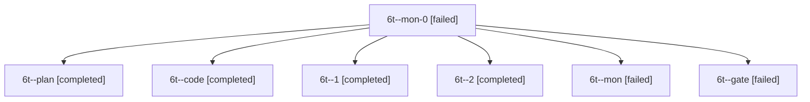

# Session: 6t

[Agent Hoods](../README.md) / [bbugyi200](../users/bbugyi200/README.md) / [apollo](../users/bbugyi200/machines/apollo/README.md) / [6t](../users/bbugyi200/machines/apollo/hoods/6t/README.md) / 6t

Owner: `bbugyi200.apollo` · Hood: `6t` · Members: 7

## Lineage

The diagram is an optional enhancement; the ordered table below contains the same lineage in accessible text.

| Role | Agent | State | Model / provider | Timing | Commits | Prompt | Chat |
|---|---|---|---|---|---:|---|---|
| mon-0 | 6t--mon-0 | failed | muse-spark-1.3-contributor / muse | 2026-10-11T18:14:52.298241+00:00 → 2026-10-11T18:25:11.757841+00:00 | 0 | — | [Chat](../agents/bbugyi200.apollo.6t--mon-0/chat.md) |
| plan | 6t--plan | completed | opus / claude | 2026-10-11T16:53:34.575654+00:00 → 2026-10-11T17:06:08.071459+00:00 | 0 | [Prompt](../agents/bbugyi200.apollo.6t--plan/prompt.md) | [Chat](../agents/bbugyi200.apollo.6t--plan/chat.md) |
| code | 6t--code | completed | muse-spark-1.3-contributor / muse | 2026-10-11T17:08:16.902391+00:00 → 2026-10-11T17:41:29.912765+00:00 | 0 | [Prompt](../agents/bbugyi200.apollo.6t--code/prompt.md) | [Chat](../agents/bbugyi200.apollo.6t--code/chat.md) |
| 1 | 6t--1 | completed | muse-spark-1.3-contributor / muse | 2026-10-11T18:08:50.454841+00:00 → 2026-10-11T18:15:42.149622+00:00 | 0 | [Prompt](../agents/bbugyi200.apollo.6t--1/prompt.md) | [Chat](../agents/bbugyi200.apollo.6t--1/chat.md) |
| 2 | 6t--2 | completed | muse-spark-1.3-contributor / muse | 2026-10-11T18:25:11.360051+00:00 → 2026-10-11T18:37:01.750049+00:00 | [1](../agents/bbugyi200.apollo.6t--2/README.md#commits) | [Prompt](../agents/bbugyi200.apollo.6t--2/prompt.md) | [Chat](../agents/bbugyi200.apollo.6t--2/chat.md) |
| mon | 6t--mon | failed | muse-spark-1.3-contributor / muse | 2026-10-11T17:40:29.452800+00:00 → 2026-10-11T18:08:50.899227+00:00 | 0 | — | [Chat](../agents/bbugyi200.apollo.6t--mon/chat.md) |
| gate | 6t--gate | failed | opus / claude | 2026-10-11T17:07:23.314034+00:00 → 2026-10-11T17:07:54.050388+00:00 | 0 | — | [Chat](../agents/bbugyi200.apollo.6t--gate/chat.md) |

## Commits

| Role | Repo | Commit | Subject | Committed |
|---|---|---|---|---|
| — | sase | [`094b828`](https://github.com/sase-org/sase/commit/094b82885a33acb8d95ed1d5df831e4fa7cb84c4) | chore: Add SDD prompt and plan for prompt\_command | 2026-06-13 14:25:08 EDT |
| — | sase | [`076e3bd`](https://github.com/sase-org/sase/commit/076e3bd622a9dbcc2d4ed93ecafc092010a26bec) | chore: Create epic and phase beads for prompt\_command plan | 2026-06-13 14:32:23 EDT |
| 2 | sase | [`df61663`](https://github.com/sase-org/sase/commit/df6166320472d3ee088e2ac19fd0dd9766b6c8b0) | feat(projects): show PROJECT\_NAME, never directory key, via display snapshot | 2026-10-11 14:33:26 EDT |
