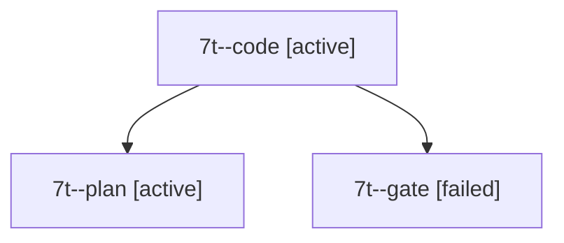

# Session: 7t

[Agent Hoods](../README.md) / [bbugyi200](../users/bbugyi200/README.md) / [apollo](../users/bbugyi200/machines/apollo/README.md) / [7t](../users/bbugyi200/machines/apollo/hoods/7t/README.md) / 7t

Owner: `bbugyi200.apollo` · Hood: `7t` · Members: 3

## Lineage

The diagram is an optional enhancement; the ordered table below contains the same lineage in accessible text.

| Role | Agent | State | Model / provider | Timing | Commits | Prompt | Chat |
|---|---|---|---|---|---:|---|---|
| code | 7t--code | active | grok-4.6 / grok | 2026-10-15T14:07:31.137013+00:00 | 0 | — | — |
| plan | 7t--plan | active | opus / claude | 2026-10-15T13:54:55.057065+00:00 | 0 | [Prompt](../agents/bbugyi200.apollo.7t--plan/prompt.md) | [Chat](../agents/bbugyi200.apollo.7t--plan/chat.md) |
| gate | 7t--gate | failed | opus / claude | 2026-10-15T14:06:46.621956+00:00 → 2026-10-15T14:07:02.039518+00:00 | 0 | — | [Chat](../agents/bbugyi200.apollo.7t--gate/chat.md) |

## Commits

| Role | Repo | Commit | Subject | Committed |
|---|---|---|---|---|
| — | sase | [`8675b6b`](https://github.com/sase-org/sase/commit/8675b6bc17b6b067bedbfcfc2a0a4a2db6eba68d) | fix: gate runners before deferred workspace setup | 2026-07-13 09:41:10 EDT |
