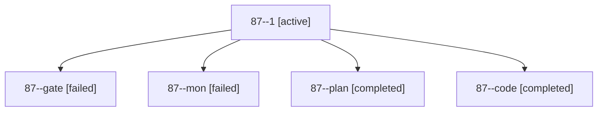

# Session: 87

[Agent Hoods](../README.md) / [bbugyi200](../users/bbugyi200/README.md) / [apollo](../users/bbugyi200/machines/apollo/README.md) / [87](../users/bbugyi200/machines/apollo/hoods/87/README.md) / 87

Owner: `bbugyi200.apollo` · Hood: `87` · Members: 5

## Lineage

The diagram is an optional enhancement; the ordered table below contains the same lineage in accessible text.

| Role | Agent | State | Model / provider | Timing | Commits | Prompt | Chat |
|---|---|---|---|---|---:|---|---|
| 1 | 87--1 | active | muse-spark-1.3-contributor / muse | 2026-10-16T20:38:18.426747+00:00 | [1](../agents/bbugyi200.apollo.87--1/README.md#commits) | [Prompt](../agents/bbugyi200.apollo.87--1/prompt.md) | — |
| gate | 87--gate | failed | opus / claude | 2026-10-16T19:44:10.921420+00:00 → 2026-10-16T19:44:27.222884+00:00 | 0 | — | [Chat](../agents/bbugyi200.apollo.87--gate/chat.md) |
| mon | 87--mon | failed | muse-spark-1.3-contributor / muse | 2026-10-16T20:00:14.761685+00:00 → 2026-10-16T20:38:18.787939+00:00 | 0 | — | [Chat](../agents/bbugyi200.apollo.87--mon/chat.md) |
| plan | 87--plan | completed | opus / claude | 2026-10-16T19:31:31.362592+00:00 → 2026-10-16T20:01:24.662193+00:00 | 0 | [Prompt](../agents/bbugyi200.apollo.87--plan/prompt.md) | [Chat](../agents/bbugyi200.apollo.87--plan/chat.md) |
| code | 87--code | completed | muse-spark-1.3-contributor / muse | 2026-10-16T19:45:00.341517+00:00 → 2026-10-16T20:01:24.662193+00:00 | 0 | — | [Chat](../agents/bbugyi200.apollo.87--code/chat.md) |

## Commits

| Role | Repo | Commit | Subject | Committed |
|---|---|---|---|---|
| 1 | sase | [`577ebb5`](https://github.com/sase-org/sase/commit/577ebb554ff28b5a230a2e6352147ad848d51820) | perf(sdd): cache alias terminal map per artifact-link event snapshot | 2026-10-16 16:42:23 EDT |
