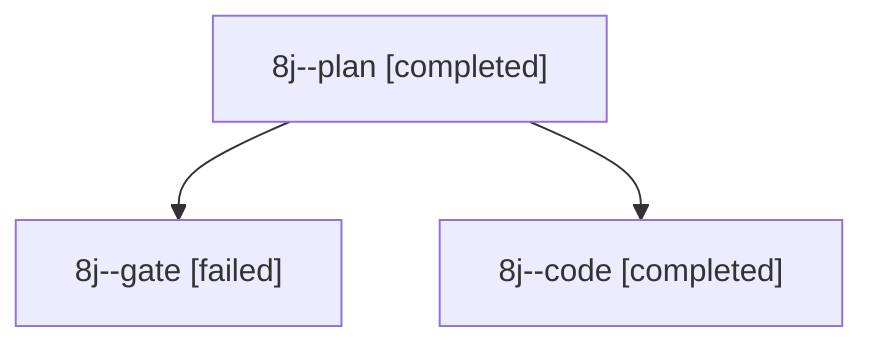

# Session: 8j

[Agent Hoods](../README.md) / [bbugyi200](../users/bbugyi200/README.md) / [apollo](../users/bbugyi200/machines/apollo/README.md) / [8j](../users/bbugyi200/machines/apollo/hoods/8j/README.md) / 8j

Owner: `bbugyi200.apollo` · Hood: `8j` · Members: 3

## Lineage

The diagram is an optional enhancement; the ordered table below contains the same lineage in accessible text.

| Role | Agent | State | Model / provider | Timing | Commits | Prompt | Chat |
|---|---|---|---|---|---:|---|---|
| plan | 8j--plan | completed | opus / claude | 2026-10-17T12:59:26.728322+00:00 → 2026-10-17T13:10:57.998437+00:00 | 0 | [Prompt](../agents/bbugyi200.apollo.8j--plan/prompt.md) | [Chat](../agents/bbugyi200.apollo.8j--plan/chat.md) |
| gate | 8j--gate | failed | opus / claude | 2026-10-17T13:10:54.004544+00:00 → 2026-10-17T13:11:36.860755+00:00 | 0 | — | [Chat](../agents/bbugyi200.apollo.8j--gate/chat.md) |
| code | 8j--code | completed | gpt-6-luna / codex | 2026-10-17T13:11:58.654758+00:00 → 2026-10-17T16:03:11.062900+00:00 | [1](../agents/bbugyi200.apollo.8j--code/README.md#commits) | [Prompt](../agents/bbugyi200.apollo.8j--code/prompt.md) | [Chat](../agents/bbugyi200.apollo.8j--code/chat.md) |

## Commits

| Role | Repo | Commit | Subject | Committed |
|---|---|---|---|---|
| code | sase | [`a4465e1`](https://github.com/sase-org/sase/commit/a4465e18dbd5d37273f2e911c332ab92a24131f0) | fix(gate-turn): scope successor evidence to its gate | 2026-10-17 11:59:08 EDT |
