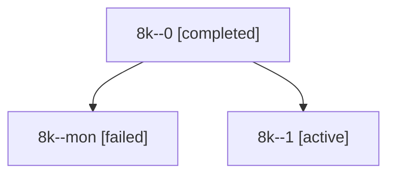

# Session: 8k

[Agent Hoods](../README.md) / [bbugyi200](../users/bbugyi200/README.md) / [apollo](../users/bbugyi200/machines/apollo/README.md) / [8k](../users/bbugyi200/machines/apollo/hoods/8k/README.md) / 8k

Owner: `bbugyi200.apollo` · Hood: `8k` · Members: 3

## Lineage



The diagram is an optional enhancement; the ordered table below contains the same lineage in accessible text.

| Role | Agent | State | Model / provider | Timing | Commits | Prompt | Chat |
|---|---|---|---|---|---:|---|---|
| <a id="member-0"></a>0 | 8k--0 | completed | gpt-6-astra / codex | 2026-10-17T13:21:56.231069+00:00 → 2026-10-17T13:37:22.253343+00:00 | 0 | [Prompt](../agents/bbugyi200.apollo.8k--0/prompt.md) | [Chat](../agents/bbugyi200.apollo.8k--0/chat.md) |
| <a id="member-mon"></a>mon | 8k--mon | failed | gpt-6-astra / codex | 2026-10-17T13:35:47.423821+00:00 → 2026-10-17T14:21:21.397858+00:00 | 0 | — | [Chat](../agents/bbugyi200.apollo.8k--mon/chat.md) |
| <a id="member-1"></a>1 | 8k--1 | active | gpt-6-astra / codex | 2026-10-17T14:21:21.222366+00:00 | [1](../agents/bbugyi200.apollo.8k--1/README.md#commits) | [Prompt](../agents/bbugyi200.apollo.8k--1/prompt.md) | — |

## Commits

| Role | Repo | Commit | Subject | Committed |
|---|---|---|---|---|
| 1 | sase | [`f2a7b80`](https://github.com/sase-org/sase/commit/f2a7b802f9727ffc62b871ae44973c92fa844df6) | fix(tests): derive healer fixture timestamps from test clock | 2026-10-17 15:13:31 EDT |

## Variables

| Role | Variable | Value |
|---|---|---|
| 1 | `artifacts` | \[{kind: markdown, label: sase-1m3.8 verification and clean-source failure evidence, path: /home/bryan/.sase/artifacts/agents/gh\_sase-org\_\_sase/20261017102024/project-stats-verification-5383490b11b2.m… |

#### artifacts

**Role:** `1`

```yaml
- kind: markdown
  label: sase-1m3.8 verification and clean-source failure evidence
  path: /home/bryan/.sase/artifacts/agents/gh_sase-org__sase/20261017102024/project-stats-verification-5383490b11b2.md
  ref: file:explicit:8d7a5979cc12fda81813545a
  source_path: /home/bryan/.local/state/sase/workspaces/sase-org/sase/sase_11/local/project-stats-verification.md
- kind: markdown
  label: Main conflict repair verification
  path: /home/bryan/.sase/artifacts/agents/gh_sase-org__sase/20261017102024/main-conflict-verification-61fbe6ac7693.md
  ref: file:explicit:b86b2d80eafbf649cd5961e2
  source_path: /home/bryan/.local/state/sase/workspaces/sase-org/sase/sase_11/.pytest_cache/main-conflict-verification.md
```

Values are truncated for display; see each member's agent meta.json for the full values.
