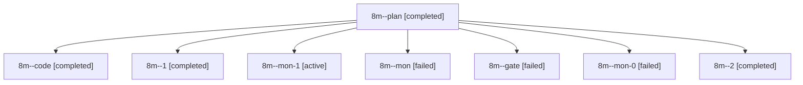

# Session: 8m

[Agent Hoods](../README.md) / [bbugyi200](../users/bbugyi200/README.md) / [apollo](../users/bbugyi200/machines/apollo/README.md) / [8m](../users/bbugyi200/machines/apollo/hoods/8m/README.md) / 8m

Owner: `bbugyi200.apollo` · Hood: `8m` · Members: 8

## Lineage

The diagram is an optional enhancement; the ordered table below contains the same lineage in accessible text.

| Role | Agent | State | Model / provider | Timing | Commits | Prompt | Chat |
|---|---|---|---|---|---:|---|---|
| plan | 8m--plan | completed | opus / claude | 2026-10-17T14:53:58.556200+00:00 → 2026-10-17T16:08:37.536675+00:00 | 0 | [Prompt](../agents/bbugyi200.apollo.8m--plan/prompt.md) | [Chat](../agents/bbugyi200.apollo.8m--plan/chat.md) |
| code | 8m--code | completed | grok-4.6 / grok | 2026-10-17T15:05:26.428063+00:00 → 2026-10-17T16:08:37.536675+00:00 | 0 | — | [Chat](../agents/bbugyi200.apollo.8m--code/chat.md) |
| 1 | 8m--1 | completed | grok-4.6 / grok | 2026-10-17T16:50:10.145985+00:00 → 2026-10-17T16:56:36.007756+00:00 | 0 | [Prompt](../agents/bbugyi200.apollo.8m--1/prompt.md) | [Chat](../agents/bbugyi200.apollo.8m--1/chat.md) |
| mon-1 | 8m--mon-1 | active | grok-4.6 / grok | 2026-10-17T18:04:59.462312+00:00 | [1](../agents/bbugyi200.apollo.8m--mon-1/README.md#commits) | — | — |
| mon | 8m--mon | failed | grok-4.6 / grok | 2026-10-17T16:07:26.419570+00:00 → 2026-10-17T16:50:10.527956+00:00 | 0 | — | [Chat](../agents/bbugyi200.apollo.8m--mon/chat.md) |
| gate | 8m--gate | failed | opus / claude | 2026-10-17T15:03:46.409715+00:00 → 2026-10-17T15:04:15.925114+00:00 | 0 | — | [Chat](../agents/bbugyi200.apollo.8m--gate/chat.md) |
| mon-0 | 8m--mon-0 | failed | grok-4.6 / grok | 2026-10-17T16:55:23.920570+00:00 → 2026-10-17T17:56:51.316231+00:00 | 0 | — | [Chat](../agents/bbugyi200.apollo.8m--mon-0/chat.md) |
| 2 | 8m--2 | completed | grok-4.6 / grok | 2026-10-17T17:56:50.843681+00:00 → 2026-10-17T18:06:21.052019+00:00 | 0 | [Prompt](../agents/bbugyi200.apollo.8m--2/prompt.md) | [Chat](../agents/bbugyi200.apollo.8m--2/chat.md) |

## Commits

| Role | Repo | Commit | Subject | Committed |
|---|---|---|---|---|
| — | sase | [`cbb50de`](https://github.com/sase-org/sase/commit/cbb50de611d7b0486cda8ec0bac81202ee702a49) | chore: Add SDD prompt and plan for prompt\_stash | 2026-06-15 22:07:05 EDT |
| — | sase | [`7dac5bb`](https://github.com/sase-org/sase/commit/7dac5bbd5ecd3455909a95182c5bc0c104f51694) | chore: create prompt stash epic beads | 2026-06-15 22:22:05 EDT |
| — | sase | [`81eca4e`](https://github.com/sase-org/sase/commit/81eca4e6663478ea9d7cec34594d2ad43cc057c1) | fix(ace): scope group folds to agent panels | 2026-07-14 10:07:18 EDT |
| mon-1 | sase | [`80f3dc7`](https://github.com/sase-org/sase/commit/80f3dc7572670becdc80ad548b177496f9db020a) | feat(onboarding): create a root SASE marker on empty origin | 2026-10-17 14:26:41 EDT |
