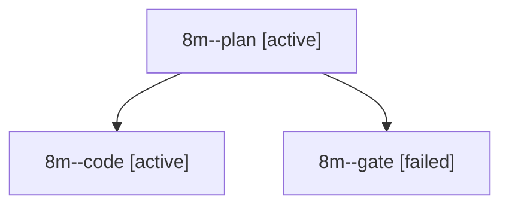

# Session: 8m

[Agent Hoods](../README.md) / [bbugyi200](../users/bbugyi200/README.md) / [apollo](../users/bbugyi200/machines/apollo/README.md) / [8m](../users/bbugyi200/machines/apollo/hoods/8m/README.md) / 8m

Owner: `bbugyi200.apollo` · Hood: `8m` · Members: 3

## Lineage

The diagram is an optional enhancement; the ordered table below contains the same lineage in accessible text.

| Role | Agent | State | Model / provider | Timing | Commits | Prompt | Chat |
|---|---|---|---|---|---:|---|---|
| plan | 8m--plan | active | opus / claude | 2026-10-17T14:53:58.556200+00:00 | 0 | [Prompt](../agents/bbugyi200.apollo.8m--plan/prompt.md) | [Chat](../agents/bbugyi200.apollo.8m--plan/chat.md) |
| code | 8m--code | active | grok-4.6 / grok | 2026-10-17T15:05:26.428063+00:00 | 0 | — | — |
| gate | 8m--gate | failed | opus / claude | 2026-10-17T15:03:46.409715+00:00 → 2026-10-17T15:04:15.925114+00:00 | 0 | — | [Chat](../agents/bbugyi200.apollo.8m--gate/chat.md) |

## Commits

| Role | Repo | Commit | Subject | Committed |
|---|---|---|---|---|
| — | sase | [`cbb50de`](https://github.com/sase-org/sase/commit/cbb50de611d7b0486cda8ec0bac81202ee702a49) | chore: Add SDD prompt and plan for prompt\_stash | 2026-06-15 22:07:05 EDT |
| — | sase | [`7dac5bb`](https://github.com/sase-org/sase/commit/7dac5bbd5ecd3455909a95182c5bc0c104f51694) | chore: create prompt stash epic beads | 2026-06-15 22:22:05 EDT |
| — | sase | [`81eca4e`](https://github.com/sase-org/sase/commit/81eca4e6663478ea9d7cec34594d2ad43cc057c1) | fix(ace): scope group folds to agent panels | 2026-07-14 10:07:18 EDT |
