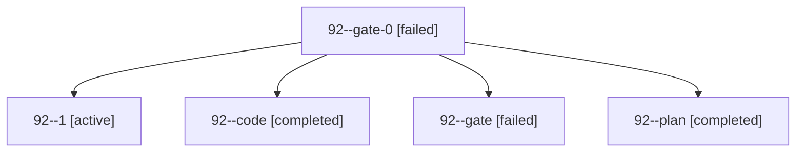

# Session: 92

[Agent Hoods](../README.md) / [bbugyi200](../users/bbugyi200/README.md) / [apollo](../users/bbugyi200/machines/apollo/README.md) / [92](../users/bbugyi200/machines/apollo/hoods/92/README.md) / 92

Owner: `bbugyi200.apollo` · Hood: `92` · Members: 5

## Lineage

The diagram is an optional enhancement; the ordered table below contains the same lineage in accessible text.

| Role | Agent | State | Model / provider | Timing | Commits | Prompt | Chat |
|---|---|---|---|---|---:|---|---|
| gate-0 | 92--gate-0 | failed | grok-4.6 / grok | 2026-10-18T20:29:16.071509+00:00 → 2026-10-18T20:30:28.364294+00:00 | 0 | — | [Chat](../agents/bbugyi200.apollo.92--gate-0/chat.md) |
| 1 | 92--1 | active | grok-4.6 / grok | 2026-10-18T20:31:20.910299+00:00 | [1](../agents/bbugyi200.apollo.92--1/README.md#commits) | [Prompt](../agents/bbugyi200.apollo.92--1/prompt.md) | — |
| code | 92--code | completed | grok-4.6 / grok | 2026-10-18T20:25:21.819138+00:00 → 2026-10-18T20:30:18.195238+00:00 | 0 | — | [Chat](../agents/bbugyi200.apollo.92--code/chat.md) |
| gate | 92--gate | failed | opus / claude | 2026-10-18T20:24:15.361406+00:00 → 2026-10-18T20:24:32.667646+00:00 | 0 | — | [Chat](../agents/bbugyi200.apollo.92--gate/chat.md) |
| plan | 92--plan | completed | opus / claude | 2026-10-18T20:18:46.629837+00:00 → 2026-10-18T20:30:18.195238+00:00 | 0 | [Prompt](../agents/bbugyi200.apollo.92--plan/prompt.md) | [Chat](../agents/bbugyi200.apollo.92--plan/chat.md) |

## Commits

| Role | Repo | Commit | Subject | Committed |
|---|---|---|---|---|
| — | sase | [`49c9470`](https://github.com/sase-org/sase/commit/49c9470431d6ce6a192ee3b5db2b84ec59eef036) | chore: Add SDD prompt and plan for agents\_list\_command | 2026-06-17 07:11:45 EDT |
| — | sase | [`00dc569`](https://github.com/sase-org/sase/commit/00dc569bba2ce6e1850ebab0bd7de17cda0d664e) | feat(cli)!: rename \`agents status\` to \`agents list\` | 2026-06-17 07:43:09 EDT |
| — | sase | [`fc3fc55`](https://github.com/sase-org/sase/commit/fc3fc552c09b3b78c30fdb0765eaf02ea70af32d) | fix: normalize GitHub sidecar origins to SSH | 2026-07-15 10:28:06 EDT |
| 1 | sase | [`fa1b12d`](https://github.com/sase-org/sase/commit/fa1b12db27565b9c4938a5c71b37b8d97c1a0ab0) | feat(agent-cli): report shadowed CLI installs and stale Codex binaries | 2026-10-18 18:00:33 EDT |

## Neighbors

| Agent | Relation | State |
|---|---|---|
| [92.f1](../agents/bbugyi200.apollo.92.f1/README.md) | descendant | completed |
