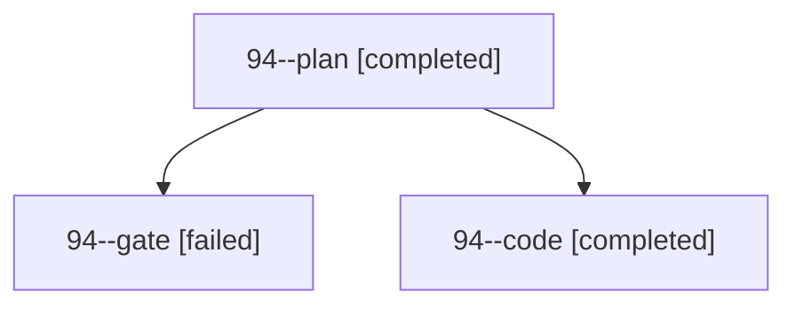

# Session: 94

[Agent Hoods](../README.md) / [bbugyi200](../users/bbugyi200/README.md) / [apollo](../users/bbugyi200/machines/apollo/README.md) / [94](../users/bbugyi200/machines/apollo/hoods/94/README.md) / 94

Owner: `bbugyi200.apollo` · Hood: `94` · Members: 3

## Lineage

The diagram is an optional enhancement; the ordered table below contains the same lineage in accessible text.

| Role | Agent | State | Model / provider | Timing | Commits | Prompt | Chat |
|---|---|---|---|---|---:|---|---|
| plan | 94--plan | completed | opus / claude | 2026-10-19T20:50:05.201570+00:00 → 2026-10-19T21:55:04.971743+00:00 | 0 | [Prompt](../agents/bbugyi200.apollo.94--plan/prompt.md) | [Chat](../agents/bbugyi200.apollo.94--plan/chat.md) |
| gate | 94--gate | failed | opus / claude | 2026-10-19T21:00:18.022130+00:00 → 2026-10-19T21:00:34.417360+00:00 | 0 | — | [Chat](../agents/bbugyi200.apollo.94--gate/chat.md) |
| code | 94--code | completed | grok-4.6 / grok | 2026-10-19T21:01:11.807733+00:00 → 2026-10-19T21:55:04.971743+00:00 | 0 | — | [Chat](../agents/bbugyi200.apollo.94--code/chat.md) |

## Commits

| Role | Repo | Commit | Subject | Committed |
|---|---|---|---|---|
| — | sase | [`ac28e8e`](https://github.com/sase-org/sase/commit/ac28e8ebd387937fd411df9aa2fefdb52a012a1b) | chore: Add SDD prompt and plan for xprompt\_metadata\_capture | 2026-06-17 07:19:19 EDT |
| — | sase | [`ecd13bf`](https://github.com/sase-org/sase/commit/ecd13bf83276677daa5d6bf4ad18dcb615a70810) | fix(xprompt): capture launch-boundary xprompt metadata for daemon agents | 2026-06-17 07:38:34 EDT |
| — | sase | [`d2157eb`](https://github.com/sase-org/sase/commit/d2157eb0e53bcf6363055a294ed15a11696665ac) | fix(init): filter batch inventory to projects | 2026-07-15 11:01:06 EDT |
