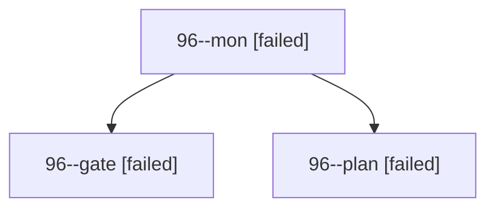

# Session: 96

[Agent Hoods](../README.md) / [bbugyi200](../users/bbugyi200/README.md) / [apollo](../users/bbugyi200/machines/apollo/README.md) / [96](../users/bbugyi200/machines/apollo/hoods/96/README.md) / 96

Owner: `bbugyi200.apollo` · Hood: `96` · Members: 3

## Lineage

The diagram is an optional enhancement; the ordered table below contains the same lineage in accessible text.

| Role | Agent | State | Model / provider | Timing | Commits | Prompt | Chat |
|---|---|---|---|---|---:|---|---|
| mon | 96--mon | failed | opus / claude | 2026-10-20T10:52:36.490934+00:00 → 2026-10-20T10:54:24.256121+00:00 | 0 | — | [Chat](../agents/bbugyi200.apollo.96--mon/chat.md) |
| gate | 96--gate | failed | opus / claude | 2026-10-20T10:52:18.271729+00:00 → 2026-10-20T10:52:38.704201+00:00 | 0 | — | [Chat](../agents/bbugyi200.apollo.96--gate/chat.md) |
| plan | 96--plan | failed | opus / claude | 2026-10-20T10:23:50.682440+00:00 → 2026-10-20T10:53:06.528962+00:00 | 0 | [Prompt](../agents/bbugyi200.apollo.96--plan/prompt.md) | [Chat](../agents/bbugyi200.apollo.96--plan/chat.md) |

## Commits

| Role | Repo | Commit | Subject | Committed |
|---|---|---|---|---|
| — | sase | [`5e9bfa1`](https://github.com/sase-org/sase/commit/5e9bfa1987f0b9ba998173e4e3e5e23793b10f85) | feat(ace)!: collapse focused agent panels | 2026-07-15 12:05:20 EDT |

## Neighbors

| Agent | Relation | State |
|---|---|---|
| [96.f1](../agents/bbugyi200.apollo.96.f1/README.md) | descendant | completed |
