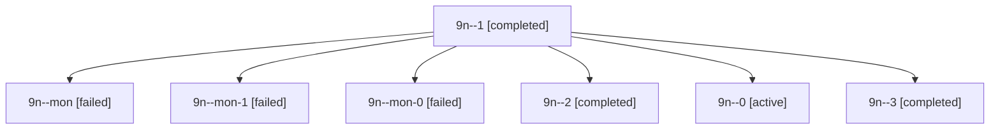

# Session: 9n

[Agent Hoods](../README.md) / [bbugyi200](../users/bbugyi200/README.md) / [apollo](../users/bbugyi200/machines/apollo/README.md) / [9n](../users/bbugyi200/machines/apollo/hoods/9n/README.md) / 9n

Owner: `bbugyi200.apollo` · Hood: `9n` · Members: 7

## Lineage



The diagram is an optional enhancement; the ordered table below contains the same lineage in accessible text.

| Role | Agent | State | Model / provider | Timing | Commits | Prompt | Chat |
|---|---|---|---|---|---:|---|---|
| <a id="member-1"></a>1 | 9n--1 | completed | gpt-6-astra / codex | 2026-10-20T20:27:44.360600+00:00 → 2026-10-20T20:34:13.965484+00:00 | 0 | [Prompt](../agents/bbugyi200.apollo.9n--1/prompt.md) | [Chat](../agents/bbugyi200.apollo.9n--1/chat.md) |
| <a id="member-mon"></a>mon | 9n--mon | failed | gpt-6-astra / codex | 2026-10-20T17:58:15.153621+00:00 → 2026-10-20T20:25:12.135903+00:00 | 0 | — | [Chat](../agents/bbugyi200.apollo.9n--mon/chat.md) |
| <a id="member-mon-1"></a>mon-1 | 9n--mon-1 | failed | gpt-6-astra / codex | 2026-10-20T21:29:28.008598+00:00 → 2026-10-20T23:25:41.699231+00:00 | 0 | — | [Chat](../agents/bbugyi200.apollo.9n--mon-1/chat.md) |
| <a id="member-mon-0"></a>mon-0 | 9n--mon-0 | failed | gpt-6-astra / codex | 2026-10-20T20:33:04.305489+00:00 → 2026-10-20T21:19:22.692142+00:00 | 0 | — | [Chat](../agents/bbugyi200.apollo.9n--mon-0/chat.md) |
| <a id="member-2"></a>2 | 9n--2 | completed | gpt-6-astra / codex | 2026-10-20T21:21:30.555834+00:00 → 2026-10-20T21:31:01.857266+00:00 | 0 | [Prompt](../agents/bbugyi200.apollo.9n--2/prompt.md) | [Chat](../agents/bbugyi200.apollo.9n--2/chat.md) |
| <a id="member-0"></a>0 | 9n--0 | active | gpt-6-astra / codex | 2026-10-20T17:51:18.781388+00:00 | 0 | [Prompt](../agents/bbugyi200.apollo.9n--0/prompt.md) | [Chat](../agents/bbugyi200.apollo.9n--0/chat.md) |
| <a id="member-3"></a>3 | 9n--3 | completed | gpt-6-astra / codex | 2026-10-20T23:25:52.952688+00:00 → 2026-10-21T00:19:09.383598+00:00 | [1](../agents/bbugyi200.apollo.9n--3/README.md#commits) | [Prompt](../agents/bbugyi200.apollo.9n--3/prompt.md) | [Chat](../agents/bbugyi200.apollo.9n--3/chat.md) |

## Commits

| Role | Repo | Commit | Subject | Committed |
|---|---|---|---|---|
| — | sase | [`d794742`](https://github.com/sase-org/sase/commit/d7947425969670dac3e859eb00c76e0f0e0386d8) | chore: Add SDD prompt and plan for prompt\_ctrl\_g\_stack\_editor | 2026-06-17 11:47:00 EDT |
| — | sase | [`e6d547f`](https://github.com/sase-org/sase/commit/e6d547f542bff0063b38f8665933056240d62a9d) | feat(tui): make Ctrl+G the single stack-aware prompt editor key | 2026-06-17 12:01:44 EDT |
| 3 | sase | [`2df906d`](https://github.com/sase-org/sase/commit/2df906dd57307209d3d9c4ae6051b762acb05a70) | fix(tui): keep deck focus when opening split panels | 2026-10-20 19:47:40 EDT |

## Variables

| Role | Variable | Value |
|---|---|---|
| 3 | `artifacts` | \[{kind: markdown, label: Deck split keep-focus verification and baseline evidence, path: /home/bryan/.sase/artifacts/agents/gh\_sase-org\_\_sase/20261020192441/verification-report-4e223d0324d2.md, ref:… |

#### artifacts

**Role:** `3`

```yaml
- kind: markdown
  label: Deck split keep-focus verification and baseline evidence
  path: /home/bryan/.sase/artifacts/agents/gh_sase-org__sase/20261020192441/verification-report-4e223d0324d2.md
  ref: file:explicit:64a8834f1fb3cda84d4c2398
  source_path: /home/bryan/.local/state/sase/workspaces/sase-org/sase/sase_11/.pytest_cache/deck-split-recovery/verification-report.md
```

Values are truncated for display; see each member's agent meta.json for the full values.
