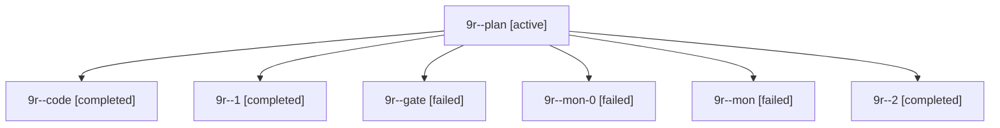

# Session: 9r

[Agent Hoods](../README.md) / [bbugyi200](../users/bbugyi200/README.md) / [apollo](../users/bbugyi200/machines/apollo/README.md) / [9r](../users/bbugyi200/machines/apollo/hoods/9r/README.md) / 9r

Owner: `bbugyi200.apollo` · Hood: `9r` · Members: 7

## Lineage

The diagram is an optional enhancement; the ordered table below contains the same lineage in accessible text.

| Role | Agent | State | Model / provider | Timing | Commits | Prompt | Chat |
|---|---|---|---|---|---:|---|---|
| plan | 9r--plan | active | opus / claude | 2026-10-20T21:14:02.194578+00:00 | 0 | [Prompt](../agents/bbugyi200.apollo.9r--plan/prompt.md) | [Chat](../agents/bbugyi200.apollo.9r--plan/chat.md) |
| code | 9r--code | completed | grok-4.6 / grok | 2026-10-20T21:21:48.187932+00:00 → 2026-10-20T22:28:00.958431+00:00 | 0 | — | [Chat](../agents/bbugyi200.apollo.9r--code/chat.md) |
| 1 | 9r--1 | completed | grok-4.6 / grok | 2026-10-20T23:27:48.252807+00:00 → 2026-10-20T23:34:41.935582+00:00 | 0 | [Prompt](../agents/bbugyi200.apollo.9r--1/prompt.md) | [Chat](../agents/bbugyi200.apollo.9r--1/chat.md) |
| gate | 9r--gate | failed | opus / claude | 2026-10-20T21:20:52.243953+00:00 → 2026-10-20T21:21:15.039308+00:00 | 0 | — | [Chat](../agents/bbugyi200.apollo.9r--gate/chat.md) |
| mon-0 | 9r--mon-0 | failed | grok-4.6 / grok | 2026-10-20T23:33:38.676775+00:00 → 2026-10-21T00:13:07.389769+00:00 | [1](../agents/bbugyi200.apollo.9r--mon-0/README.md#commits) | — | [Chat](../agents/bbugyi200.apollo.9r--mon-0/chat.md) |
| mon | 9r--mon | failed | grok-4.6 / grok | 2026-10-20T22:26:31.306972+00:00 → 2026-10-20T23:27:48.295138+00:00 | 0 | — | [Chat](../agents/bbugyi200.apollo.9r--mon/chat.md) |
| 2 | 9r--2 | completed | grok-4.6 / grok | 2026-10-21T00:13:07.266276+00:00 → 2026-10-21T00:21:27.467621+00:00 | 0 | [Prompt](../agents/bbugyi200.apollo.9r--2/prompt.md) | [Chat](../agents/bbugyi200.apollo.9r--2/chat.md) |

## Commits

| Role | Repo | Commit | Subject | Committed |
|---|---|---|---|---|
| — | sase | [`fa6e214`](https://github.com/sase-org/sase/commit/fa6e21446401f0dff01fbb719243b40b7441c5d2) | chore: Add SDD prompt and plan for log\_panel | 2026-06-17 14:19:07 EDT |
| — | sase | [`3b17852`](https://github.com/sase-org/sase/commit/3b17852e718f82a23af6bc75379bfb5b837a732c) | chore: create log panel epic beads | 2026-06-17 14:33:15 EDT |
| mon-0 | sase | [`ed03952`](https://github.com/sase-org/sase/commit/ed03952a6362d26c4b4909bf064354bcadc4abe8) | feat(llm): reap grok providers that hang after turn end | 2026-10-20 20:09:16 EDT |
