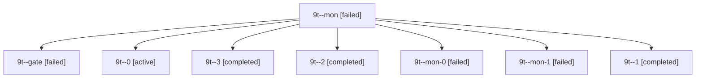

# Session: 9t

[Agent Hoods](../README.md) / [bbugyi200](../users/bbugyi200/README.md) / [apollo](../users/bbugyi200/machines/apollo/README.md) / [9t](../users/bbugyi200/machines/apollo/hoods/9t/README.md) / 9t

Owner: `bbugyi200.apollo` · Hood: `9t` · Members: 8

## Lineage



The diagram is an optional enhancement; the ordered table below contains the same lineage in accessible text.

| Role | Agent | State | Model / provider | Timing | Commits | Prompt | Chat |
|---|---|---|---|---|---:|---|---|
| <a id="member-mon"></a>mon | 9t--mon | failed | gpt-6-astra / codex | 2026-10-21T11:14:19.581126+00:00 → 2026-10-21T11:24:46.764047+00:00 | 0 | — | [Chat](../agents/bbugyi200.apollo.9t--mon/chat.md) |
| <a id="member-gate"></a>gate | 9t--gate | failed | gpt-6-astra / codex | 2026-10-21T16:19:17.833153+00:00 → 2026-10-21T16:19:46.287495+00:00 | 0 | — | [Chat](../agents/bbugyi200.apollo.9t--gate/chat.md) |
| <a id="member-0"></a>0 | 9t--0 | active | gpt-6-astra / codex | 2026-10-21T11:05:31.514867+00:00 | 0 | [Prompt](../agents/bbugyi200.apollo.9t--0/prompt.md) | [Chat](../agents/bbugyi200.apollo.9t--0/chat.md) |
| <a id="member-3"></a>3 | 9t--3 | completed | gpt-6-astra / codex | 2026-10-21T12:02:43.863138+00:00 → 2026-10-21T12:10:54.267283+00:00 | 0 | [Prompt](../agents/bbugyi200.apollo.9t--3/prompt.md) | [Chat](../agents/bbugyi200.apollo.9t--3/chat.md) |
| <a id="member-2"></a>2 | 9t--2 | completed | gpt-6-astra / codex | 2026-10-21T11:40:21.668750+00:00 → 2026-10-21T11:48:32.599523+00:00 | 0 | [Prompt](../agents/bbugyi200.apollo.9t--2/prompt.md) | [Chat](../agents/bbugyi200.apollo.9t--2/chat.md) |
| <a id="member-mon-0"></a>mon-0 | 9t--mon-0 | failed | gpt-6-astra / codex | 2026-10-21T11:36:30.790551+00:00 → 2026-10-21T11:40:21.764817+00:00 | 0 | — | [Chat](../agents/bbugyi200.apollo.9t--mon-0/chat.md) |
| <a id="member-mon-1"></a>mon-1 | 9t--mon-1 | failed | gpt-6-astra / codex | 2026-10-21T11:47:14.167686+00:00 → 2026-10-21T12:02:44.264086+00:00 | 0 | — | [Chat](../agents/bbugyi200.apollo.9t--mon-1/chat.md) |
| <a id="member-1"></a>1 | 9t--1 | completed | gpt-6-astra / codex | 2026-10-21T11:24:46.641805+00:00 → 2026-10-21T11:37:41.017913+00:00 | 0 | [Prompt](../agents/bbugyi200.apollo.9t--1/prompt.md) | [Chat](../agents/bbugyi200.apollo.9t--1/chat.md) |

## Commits

| Role | Repo | Commit | Subject | Committed |
|---|---|---|---|---|
| — | sase | [`ede79bc`](https://github.com/sase-org/sase/commit/ede79bc989570e82fe5ed8da00f425b8e924e48d) | fix(ace): compact SASE plan heading | 2026-07-15 18:12:20 EDT |

## Variables

| Role | Variable | Value |
|---|---|---|
| 1 | `artifacts` | \[{kind: file, label: Mac release timing: bob-cli-ab.3, path: /home/bryan/.sase/artifacts/agents/gh\_sase-org\_\_sase/20261021072344/calibration\_mac\_timing-8e14987fb0cb.json, ref: file:explicit:416e5e751… |
| 2 | `artifacts` | \[{kind: markdown, label: Recovered calibration report before exclusion validation repair, path: /home/bryan/.sase/artifacts/agents/gh\_sase-org\_\_sase/20261021073922/calibration-bcb147a7f0a1.md, ref: f… |
| 3 | `artifacts` | \[{kind: markdown, label: Corrected calibration census, path: /home/bryan/.sase/artifacts/agents/gh\_sase-org\_\_sase/20261021080144/calibration\_census-b16632addbed.md, ref: file:explicit:c9ad49e5fc63d54… |

#### artifacts

**Role:** `1`

```yaml
- kind: file
  label: Mac release timing: bob-cli-ab.3
  path: /home/bryan/.sase/artifacts/agents/gh_sase-org__sase/20261021072344/calibration_mac_timing-8e14987fb0cb.json
  ref: file:explicit:416e5e7515b42bf9c399706f
  source_path: /home/bryan/.local/state/sase/workspaces/sase-org/sase/sase_10/sase/repos/external/gh/bobs-org/bob-cli--research/202610/capture_similar_tasks_band/calibration_mac_timing.json
- kind: markdown
  label: Calibration report with measured Mac timings (labels pending)
  path: /home/bryan/.sase/artifacts/agents/gh_sase-org__sase/20261021072344/calibration-bcb147a7f0a1.md
  ref: file:explicit:f007cddccf76f85ba02fd40a
  source_path: /home/bryan/.local/state/sase/workspaces/sase-org/sase/sase_10/sase/repos/external/gh/bobs-org/bob-cli--research/202610/capture_similar_tasks_band/calibration.md
```

#### artifacts

**Role:** `2`

```yaml
- kind: markdown
  label: Recovered calibration report before exclusion validation repair
  path: /home/bryan/.sase/artifacts/agents/gh_sase-org__sase/20261021073922/calibration-bcb147a7f0a1.md
  ref: file:explicit:d89f6e4081f0eb01f82d5e59
  source_path: /home/bryan/.local/state/sase/workspaces/sase-org/sase/sase_10/sase/repos/external/gh/bobs-org/bob-cli--research/202610/capture_similar_tasks_band/calibration.md
```

#### artifacts

**Role:** `3`

```yaml
- kind: markdown
  label: Corrected calibration census
  path: /home/bryan/.sase/artifacts/agents/gh_sase-org__sase/20261021080144/calibration_census-b16632addbed.md
  ref: file:explicit:c9ad49e5fc63d54df5ba9edd
  source_path: /home/bryan/.local/state/sase/workspaces/sase-org/sase/sase_10/sase/repos/external/gh/bobs-org/bob-cli--research/202610/capture_similar_tasks_band/calibration_census.md
- kind: file
  label: Corrected task-pair labeling worksheet
  path: /home/bryan/.sase/artifacts/agents/gh_sase-org__sase/20261021080144/calibration_worksheet-fb1e30c7074f.csv
  ref: file:explicit:965954f61a5d725b7827ed11
  source_path: /home/bryan/.local/state/sase/workspaces/sase-org/sase/sase_10/sase/repos/external/gh/bobs-org/bob-cli--research/202610/capture_similar_tasks_band/calibration_worksheet.csv
- kind: markdown
  label: Task pairs for Bryan to label
  path: /home/bryan/.sase/artifacts/agents/gh_sase-org__sase/20261021080144/calibration_review-8fa15a590bcf.md
  ref: file:explicit:bd9fe71a265c714e4f41578a
  source_path: /home/bryan/.local/state/sase/workspaces/sase-org/sase/sase_10/sase/repos/external/gh/bobs-org/bob-cli--research/202610/capture_similar_tasks_band/calibration_review.md
- kind: file
  label: Complete leave-one-out query responses
  path: /home/bryan/.sase/artifacts/agents/gh_sase-org__sase/20261021080144/calibration_queries-f1d070bd2c56.jsonl
  ref: file:explicit:12ffdbf73c4f258517bdb94e
  source_path: /home/bryan/.local/state/sase/workspaces/sase-org/sase/sase_10/sase/repos/external/gh/bobs-org/bob-cli--research/202610/capture_similar_tasks_band/calibration_queries.jsonl
- kind: file
  label: Calibration provenance
  path: /home/bryan/.sase/artifacts/agents/gh_sase-org__sase/20261021080144/calibration_provenance-19c5a68b7d30.json
  ref: file:explicit:c3dc974fd1d48bc1e11616d6
  source_path: /home/bryan/.local/state/sase/workspaces/sase-org/sase/sase_10/sase/repos/external/gh/bobs-org/bob-cli--research/202610/capture_similar_tasks_band/calibration_provenance.json
- kind: file
  label: Apollo corrected-query timings
  path: /home/bryan/.sase/artifacts/agents/gh_sase-org__sase/20261021080144/calibration_apollo_timings-a9eaa97efcb3.tsv
  ref: file:explicit:fa6366e2980b3ab54566205d
  source_path: /home/bryan/.local/state/sase/workspaces/sase-org/sase/sase_10/sase/repos/external/gh/bobs-org/bob-cli--research/202610/capture_similar_tasks_band/calibration_apollo_timings.tsv
- kind: file
  label: Calibration task catalog
  path: /home/bryan/.sase/artifacts/agents/gh_sase-org__sase/20261021080144/calibration_catalog-b4477faab210.tsv
  ref: file:explicit:0d0e7d862e34b52c1cc6a527
  source_path: /home/bryan/.local/state/sase/workspaces/sase-org/sase/sase_10/sase/repos/external/gh/bobs-org/bob-cli--research/202610/capture_similar_tasks_band/calibration_catalog.tsv
- kind: markdown
  label: Calibration report before final census update
  path: /home/bryan/.sase/artifacts/agents/gh_sase-org__sase/20261021080144/calibration-55666b9be438.md
  ref: file:explicit:a4176a0e01de558bd1be9ce4
  source_path: /home/bryan/.local/state/sase/workspaces/sase-org/sase/sase_10/sase/repos/external/gh/bobs-org/bob-cli--research/202610/capture_similar_tasks_band/calibration.md
- kind: markdown
  label: Verified calibration report — 80 pairs awaiting Bryan labels
  path: /home/bryan/.sase/artifacts/agents/gh_sase-org__sase/20261021080144/calibration-a9cf776f4980.md
  ref: file:explicit:4b45a63b6333b9258375bd48
  source_path: /home/bryan/.local/state/sase/workspaces/sase-org/sase/sase_10/sase/repos/external/gh/bobs-org/bob-cli--research/202610/capture_similar_tasks_band/calibration.md
```

Values are truncated for display; see each member's agent meta.json for the full values.

## Neighbors

| Agent | Relation | State |
|---|---|---|
| [9t--4--plan](../agents/bbugyi200.apollo.9t--4--plan/README.md) | descendant | completed |
| [9t--4--review](../agents/bbugyi200.apollo.9t--4--review/README.md) | descendant | completed |
| [9t.cdx](../agents/bbugyi200.apollo.9t.cdx/README.md) | descendant | completed |
