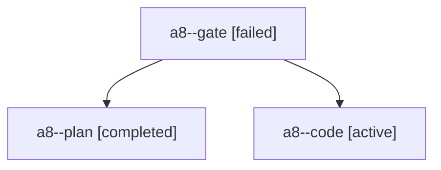

# Session: a8

[Agent Hoods](../README.md) / [bbugyi200](../users/bbugyi200/README.md) / [apollo](../users/bbugyi200/machines/apollo/README.md) / [a8](../users/bbugyi200/machines/apollo/hoods/a8/README.md) / a8

Owner: `bbugyi200.apollo` · Hood: `a8` · Members: 3

## Lineage

The diagram is an optional enhancement; the ordered table below contains the same lineage in accessible text.

| Role | Agent | State | Model / provider | Timing | Commits | Prompt | Chat |
|---|---|---|---|---|---:|---|---|
| gate | a8--gate | failed | opus / claude | 2026-10-24T16:08:21.843085+00:00 → 2026-10-24T16:09:03.843999+00:00 | 0 | — | [Chat](../agents/bbugyi200.apollo.a8--gate/chat.md) |
| plan | a8--plan | completed | opus / claude | 2026-10-24T15:45:28.867872+00:00 → 2026-10-24T15:59:35.807115+00:00 | 0 | [Prompt](../agents/bbugyi200.apollo.a8--plan/prompt.md) | [Chat](../agents/bbugyi200.apollo.a8--plan/chat.md) |
| code | a8--code | active | gpt-6-luna / codex | 2026-10-24T16:10:09.005375+00:00 | [1](../agents/bbugyi200.apollo.a8--code/README.md#commits) | [Prompt](../agents/bbugyi200.apollo.a8--code/prompt.md) | — |

## Commits

| Role | Repo | Commit | Subject | Committed |
|---|---|---|---|---|
| — | sase | [`fac33c7`](https://github.com/sase-org/sase/commit/fac33c7a2f920b86d70ef05774ce4b699c9df7d3) | feat(tui): add on-demand prompt formatting | 2026-07-16 08:34:02 EDT |
| code | sase | [`a7ba7ae`](https://github.com/sase-org/sase/commit/a7ba7ae3ac252f4690c2fcae776354255a044130) | fix(prompts): sanitize follow-up terminal text | 2026-10-24 14:00:55 EDT |
