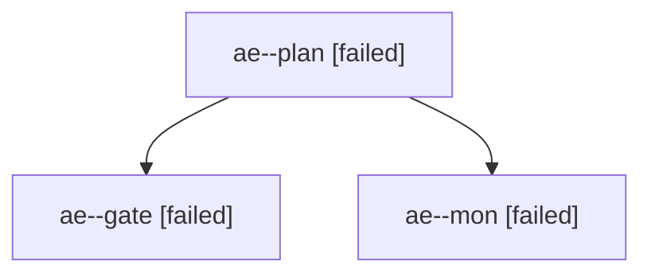

# Session: ae

[Agent Hoods](../README.md) / [bbugyi200](../users/bbugyi200/README.md) / [apollo](../users/bbugyi200/machines/apollo/README.md) / [ae](../users/bbugyi200/machines/apollo/hoods/ae/README.md) / ae

Owner: `bbugyi200.apollo` · Hood: `ae` · Members: 3

## Lineage

The diagram is an optional enhancement; the ordered table below contains the same lineage in accessible text.

| Role | Agent | State | Model / provider | Timing | Commits | Prompt | Chat |
|---|---|---|---|---|---:|---|---|
| plan | ae--plan | failed | opus / claude | 2026-10-26T19:03:01.954302+00:00 → 2026-10-26T20:07:37.005735+00:00 | 0 | [Prompt](../agents/bbugyi200.apollo.ae--plan/prompt.md) | [Chat](../agents/bbugyi200.apollo.ae--plan/chat.md) |
| gate | ae--gate | failed | opus / claude | 2026-10-26T20:06:54.218705+00:00 → 2026-10-26T20:07:12.401396+00:00 | 0 | — | [Chat](../agents/bbugyi200.apollo.ae--gate/chat.md) |
| mon | ae--mon | failed | opus / claude | 2026-10-26T20:07:11.583795+00:00 → 2026-10-26T20:09:03.079355+00:00 | 0 | — | [Chat](../agents/bbugyi200.apollo.ae--mon/chat.md) |
