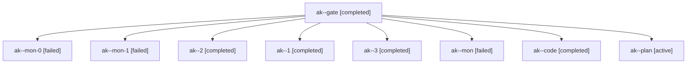

# Session: ak

[Agent Hoods](../README.md) / [bbugyi200](../users/bbugyi200/README.md) / [apollo](../users/bbugyi200/machines/apollo/README.md) / [ak](../users/bbugyi200/machines/apollo/hoods/ak/README.md) / ak

Owner: `bbugyi200.apollo` · Hood: `ak` · Members: 9

## Lineage

The diagram is an optional enhancement; the ordered table below contains the same lineage in accessible text.

| Role | Agent | State | Model / provider | Timing | Commits | Prompt | Chat |
|---|---|---|---|---|---:|---|---|
| gate | ak--gate | completed | opus / claude | 2026-10-27T11:52:37.758087+00:00 → 2026-10-27T11:53:19.224172+00:00 | 0 | — | [Chat](../agents/bbugyi200.apollo.ak--gate/chat.md) |
| mon-0 | ak--mon-0 | failed | grok-4.6 / grok | 2026-10-27T13:43:56.512123+00:00 → 2026-10-27T15:13:23.002516+00:00 | 0 | — | [Chat](../agents/bbugyi200.apollo.ak--mon-0/chat.md) |
| mon-1 | ak--mon-1 | failed | grok-4.6 / grok | 2026-10-27T15:22:52.693891+00:00 → 2026-10-27T15:44:07.405543+00:00 | 0 | — | [Chat](../agents/bbugyi200.apollo.ak--mon-1/chat.md) |
| 2 | ak--2 | completed | grok-4.6 / grok | 2026-10-27T15:13:22.775661+00:00 → 2026-10-27T15:23:58.781142+00:00 | 0 | [Prompt](../agents/bbugyi200.apollo.ak--2/prompt.md) | [Chat](../agents/bbugyi200.apollo.ak--2/chat.md) |
| 1 | ak--1 | completed | grok-4.6 / grok | 2026-10-27T13:30:47.500073+00:00 → 2026-10-27T13:44:50.778396+00:00 | 0 | [Prompt](../agents/bbugyi200.apollo.ak--1/prompt.md) | [Chat](../agents/bbugyi200.apollo.ak--1/chat.md) |
| 3 | ak--3 | completed | grok-4.6 / grok | 2026-10-27T15:44:06.914226+00:00 → 2026-10-27T16:14:45.049031+00:00 | [1](../agents/bbugyi200.apollo.ak--3/README.md#commits) | [Prompt](../agents/bbugyi200.apollo.ak--3/prompt.md) | [Chat](../agents/bbugyi200.apollo.ak--3/chat.md) |
| mon | ak--mon | failed | grok-4.6 / grok | 2026-10-27T12:38:34.132814+00:00 → 2026-10-27T13:30:47.921188+00:00 | 0 | — | [Chat](../agents/bbugyi200.apollo.ak--mon/chat.md) |
| code | ak--code | completed | grok-4.6 / grok | 2026-10-27T11:53:35.828816+00:00 → 2026-10-27T12:39:25.219883+00:00 | 0 | [Prompt](../agents/bbugyi200.apollo.ak--code/prompt.md) | [Chat](../agents/bbugyi200.apollo.ak--code/chat.md) |
| plan | ak--plan | active | opus / claude | 2026-10-27T11:41:22.745397+00:00 | 0 | [Prompt](../agents/bbugyi200.apollo.ak--plan/prompt.md) | [Chat](../agents/bbugyi200.apollo.ak--plan/chat.md) |

## Commits

| Role | Repo | Commit | Subject | Committed |
|---|---|---|---|---|
| — | sase | [`592c252`](https://github.com/sase-org/sase/commit/592c252a3e45ff626cc98505e3b4d42dfa49f98b) | test: stabilize cross-version CI checks | 2026-07-16 13:44:11 EDT |
| 3 | sase | [`2243ebc`](https://github.com/sase-org/sase/commit/2243ebc97b14dec2f31e7868e5bdaca7538886f7) | fix(wait): unstick session waits after a retried handoff turn | 2026-10-27 12:11:58 EDT |
