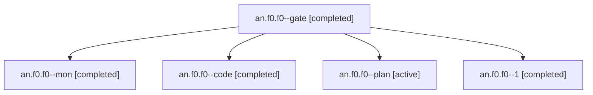

# Session: an.f0.f0

[Agent Hoods](../README.md) / [bbugyi200](../users/bbugyi200/README.md) / [apollo](../users/bbugyi200/machines/apollo/README.md) / [an](../users/bbugyi200/machines/apollo/hoods/an/README.md) / an.f0.f0

Owner: `bbugyi200.apollo` · Hood: `an` · Members: 5

## Lineage

The diagram is an optional enhancement; the ordered table below contains the same lineage in accessible text.

| Role | Agent | State | Model / provider | Timing | Commits | Prompt | Chat |
|---|---|---|---|---|---:|---|---|
| gate | an.f0.f0--gate | completed | opus / claude | 2026-10-27T18:29:30.840354+00:00 → 2026-10-27T18:30:19.328216+00:00 | 0 | — | [Chat](../agents/bbugyi200.apollo.an.f0.f0--gate/chat.md) |
| mon | an.f0.f0--mon | completed | grok-4.6 / grok | 2026-10-27T20:20:36.663166+00:00 → 2026-10-27T20:36:24.588638+00:00 | 0 | — | [Chat](../agents/bbugyi200.apollo.an.f0.f0--mon/chat.md) |
| code | an.f0.f0--code | completed | grok-4.6 / grok | 2026-10-27T18:30:40.880887+00:00 → 2026-10-27T20:21:42.065517+00:00 | 0 | [Prompt](../agents/bbugyi200.apollo.an.f0.f0--code/prompt.md) | [Chat](../agents/bbugyi200.apollo.an.f0.f0--code/chat.md) |
| plan | an.f0.f0--plan | active | opus / claude | 2026-10-27T18:11:22.077781+00:00 | 0 | [Prompt](../agents/bbugyi200.apollo.an.f0.f0--plan/prompt.md) | [Chat](../agents/bbugyi200.apollo.an.f0.f0--plan/chat.md) |
| 1 | an.f0.f0--1 | completed | grok-4.6 / grok | 2026-10-27T20:36:24.389178+00:00 → 2026-10-27T21:03:01.790409+00:00 | [1](../agents/bbugyi200.apollo.an.f0.f0--1/README.md#commits) | [Prompt](../agents/bbugyi200.apollo.an.f0.f0--1/prompt.md) | [Chat](../agents/bbugyi200.apollo.an.f0.f0--1/chat.md) |

## Commits

| Role | Repo | Commit | Subject | Committed |
|---|---|---|---|---|
| 1 | sase | [`a6cf924`](https://github.com/sase-org/sase/commit/a6cf9242759915a65d1085e361d29b7adff4078a) | fix(finalizer): absorb raw commits in linked repos and bind baselines to the claimed workspace | 2026-10-27 16:42:28 EDT |
