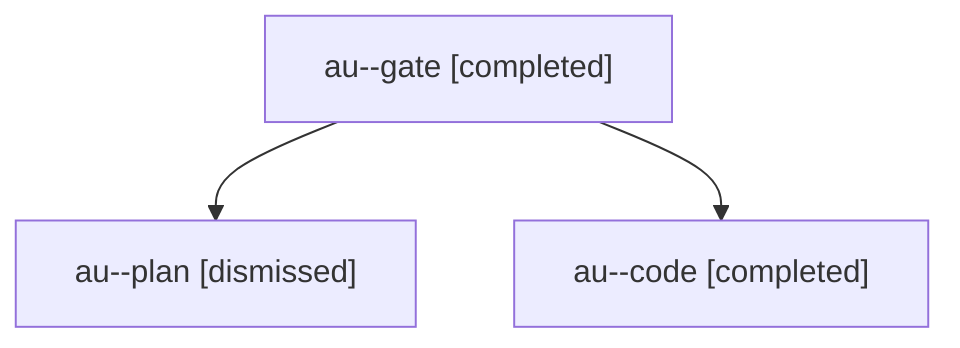

# Session: au

[Agent Hoods](../README.md) / [bbugyi200](../users/bbugyi200/README.md) / [apollo](../users/bbugyi200/machines/apollo/README.md) / [au](../users/bbugyi200/machines/apollo/hoods/au/README.md) / au

Owner: `bbugyi200.apollo` · Hood: `au` · Members: 3

## Lineage



The diagram is an optional enhancement; the ordered table below contains the same lineage in accessible text.

| Role | Agent | State | Model / provider | Timing | Commits | Prompt | Chat |
|---|---|---|---|---|---:|---|---|
| <a id="member-gate"></a>gate | au--gate | completed | opus / claude | 2026-10-28T11:43:22.098212+00:00 → 2026-10-28T11:43:48.912893+00:00 | 0 | — | [Chat](../agents/bbugyi200.apollo.au--gate/chat.md) |
| <a id="member-plan"></a>plan | au--plan | dismissed | opus / claude | 2026-10-28T07:27:57.368812 → 2026-10-28T07:38:35.228108 | 0 | [Prompt](../agents/bbugyi200.apollo.au--plan/prompt.md) | [Chat](../agents/bbugyi200.apollo.au--plan/chat.md) |
| <a id="member-code"></a>code | au--code | completed | gpt-6-luna / codex | 2026-10-28T11:44:03.271387+00:00 → 2026-10-28T13:14:33.242070+00:00 | [1](../agents/bbugyi200.apollo.au--code/README.md#commits) | [Prompt](../agents/bbugyi200.apollo.au--code/prompt.md) | [Chat](../agents/bbugyi200.apollo.au--code/chat.md) |

## Commits

| Role | Repo | Commit | Subject | Committed |
|---|---|---|---|---|
| code | — | `a1d1ea0` | fix(beads): converge managed sidecar defaults and bead writes | 2026-10-28 09:11:26 EDT |

## Variables

| Role | Variable | Value |
|---|---|---|
| code | `artifacts` | \[{kind: markdown, label: Symvision \_RecoveryAssessment check failure, path: /home/bryan/.sase/artifacts/agents/gh\_sase-org\_\_sase/20261028074348/sase\_symvision\_recovery\_assessment\_ci\_evidence-8fa43a97… |

#### artifacts

**Role:** `code`

```yaml
- kind: markdown
  label: Symvision _RecoveryAssessment check failure
  path: /home/bryan/.sase/artifacts/agents/gh_sase-org__sase/20261028074348/sase_symvision_recovery_assessment_ci_evidence-8fa43a979e81.md
  ref: file:explicit:8ff19ed599821f0541afbaa1
  source_path: /home/bryan/.local/state/sase/workspaces/sase-org/sase/sase_10/.sase_symvision_recovery_assessment_ci_evidence.md
```

Values are truncated for display; see each member's agent meta.json for the full values.
