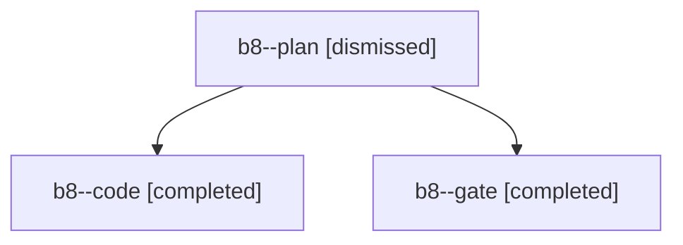

# Session: b8

[Agent Hoods](../README.md) / [bbugyi200](../users/bbugyi200/README.md) / [apollo](../users/bbugyi200/machines/apollo/README.md) / [b8](../users/bbugyi200/machines/apollo/hoods/b8/README.md) / b8

Owner: `bbugyi200.apollo` · Hood: `b8` · Members: 3

## Lineage

The diagram is an optional enhancement; the ordered table below contains the same lineage in accessible text.

| Role | Agent | State | Model / provider | Timing | Commits | Prompt | Chat |
|---|---|---|---|---|---:|---|---|
| plan | b8--plan | dismissed | opus / claude | 2026-10-30T11:46:47.955753 → 2026-10-30T11:56:44.789493 | 0 | [Prompt](../agents/bbugyi200.apollo.b8--plan/prompt.md) | [Chat](../agents/bbugyi200.apollo.b8--plan/chat.md) |
| code | b8--code | completed | grok-4.6 / grok | 2026-10-30T15:58:56.990384+00:00 → 2026-10-30T16:41:47.234214+00:00 | 0 | [Prompt](../agents/bbugyi200.apollo.b8--code/prompt.md) | [Chat](../agents/bbugyi200.apollo.b8--code/chat.md) |
| gate | b8--gate | completed | opus / claude | 2026-10-30T15:57:55.890996+00:00 → 2026-10-30T15:58:39.216070+00:00 | 0 | — | [Chat](../agents/bbugyi200.apollo.b8--gate/chat.md) |

## Commits

| Role | Repo | Commit | Subject | Committed |
|---|---|---|---|---|
| — | — | `97ffad6` | feat(ace): signal core rebuilds in update badge | 2026-07-16 20:02:42 EDT |
