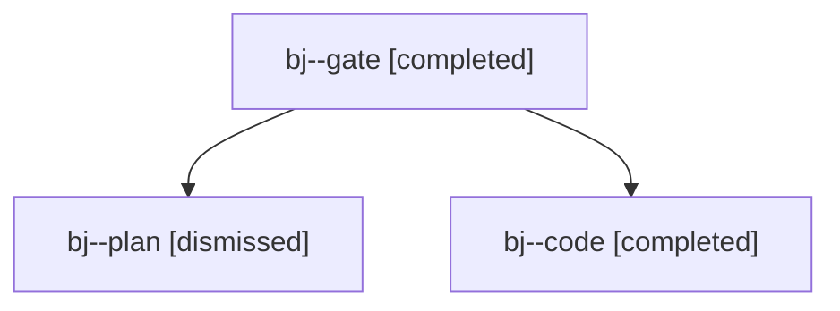

# Session: bj

[Agent Hoods](../README.md) / [bbugyi200](../users/bbugyi200/README.md) / [apollo](../users/bbugyi200/machines/apollo/README.md) / [bj](../users/bbugyi200/machines/apollo/hoods/bj/README.md) / bj

Owner: `bbugyi200.apollo` · Hood: `bj` · Members: 3

## Lineage

The diagram is an optional enhancement; the ordered table below contains the same lineage in accessible text.

| Role | Agent | State | Model / provider | Timing | Commits | Prompt | Chat |
|---|---|---|---|---|---:|---|---|
| gate | bj--gate | completed | opus / claude | 2026-10-30T22:56:55.352603+00:00 → 2026-10-30T22:57:25.510578+00:00 | 0 | — | [Chat](../agents/bbugyi200.apollo.bj--gate/chat.md) |
| plan | bj--plan | dismissed | opus / claude | 2026-10-30T18:48:02.856453 → 2026-10-30T18:56:08.624050 | 0 | [Prompt](../agents/bbugyi200.apollo.bj--plan/prompt.md) | [Chat](../agents/bbugyi200.apollo.bj--plan/chat.md) |
| code | bj--code | completed | gpt-6-luna / codex | 2026-10-30T22:57:44.653693+00:00 → 2026-10-30T23:06:42.601002+00:00 | 0 | [Prompt](../agents/bbugyi200.apollo.bj--code/prompt.md) | [Chat](../agents/bbugyi200.apollo.bj--code/chat.md) |

## Commits

| Role | Repo | Commit | Subject | Committed |
|---|---|---|---|---|
| — | — | `cb733da` | feat(tui): compact Plans rows and state indicators | 2026-07-17 08:06:08 EDT |
