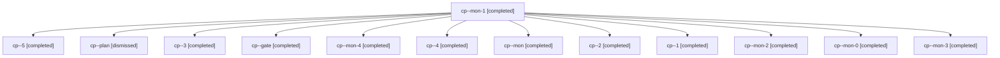

# Session: cp

[Agent Hoods](../README.md) / [bbugyi200](../users/bbugyi200/README.md) / [apollo](../users/bbugyi200/machines/apollo/README.md) / [cp](../users/bbugyi200/machines/apollo/hoods/cp/README.md) / cp

Owner: `bbugyi200.apollo` · Hood: `cp` · Members: 13

## Lineage

The diagram is an optional enhancement; the ordered table below contains the same lineage in accessible text.

| Role | Agent | State | Model / provider | Timing | Commits | Prompt | Chat |
|---|---|---|---|---|---:|---|---|
| mon-1 | cp--mon-1 | completed | opus / claude | 2026-11-06T04:07:41.114862+00:00 → 2026-11-06T06:09:37.595726+00:00 | 0 | — | [Chat](../agents/bbugyi200.apollo.cp--mon-1/chat.md) |
| 5 | cp--5 | completed | opus / claude | 2026-11-06T10:23:40.636528+00:00 → 2026-11-06T10:46:42.914664+00:00 | 0 | [Prompt](../agents/bbugyi200.apollo.cp--5/prompt.md) | [Chat](../agents/bbugyi200.apollo.cp--5/chat.md) |
| plan | cp--plan | dismissed | opus / claude | 2026-11-05T18:48:00.537316 → 2026-11-05T18:49:50.336283 | 0 | [Prompt](../agents/bbugyi200.apollo.cp--plan/prompt.md) | [Chat](../agents/bbugyi200.apollo.cp--plan/chat.md) |
| 3 | cp--3 | completed | opus / claude | 2026-11-06T06:09:37.143458+00:00 → 2026-11-06T06:15:55.112767+00:00 | 0 | [Prompt](../agents/bbugyi200.apollo.cp--3/prompt.md) | [Chat](../agents/bbugyi200.apollo.cp--3/chat.md) |
| gate | cp--gate | completed | opus / claude | 2026-11-06T10:45:41.203355+00:00 → 2026-11-06T10:46:26.206908+00:00 | 0 | — | [Chat](../agents/bbugyi200.apollo.cp--gate/chat.md) |
| mon-4 | cp--mon-4 | completed | opus / claude | 2026-11-06T10:46:23.918764+00:00 → 2026-11-06T10:49:48.955395+00:00 | 0 | — | [Chat](../agents/bbugyi200.apollo.cp--mon-4/chat.md) |
| 4 | cp--4 | completed | opus / claude | 2026-11-06T08:16:49.283203+00:00 → 2026-11-06T08:21:47.911195+00:00 | 0 | [Prompt](../agents/bbugyi200.apollo.cp--4/prompt.md) | [Chat](../agents/bbugyi200.apollo.cp--4/chat.md) |
| mon | cp--mon | completed | opus / claude | 2026-11-05T23:49:13.231143+00:00 → 2026-11-06T01:51:02.619483+00:00 | 0 | — | [Chat](../agents/bbugyi200.apollo.cp--mon/chat.md) |
| 2 | cp--2 | completed | opus / claude | 2026-11-06T03:57:59.428210+00:00 → 2026-11-06T04:08:28.069650+00:00 | 0 | [Prompt](../agents/bbugyi200.apollo.cp--2/prompt.md) | [Chat](../agents/bbugyi200.apollo.cp--2/chat.md) |
| 1 | cp--1 | completed | opus / claude | 2026-11-06T01:51:17.586188+00:00 → 2026-11-06T01:56:53.301301+00:00 | 0 | [Prompt](../agents/bbugyi200.apollo.cp--1/prompt.md) | [Chat](../agents/bbugyi200.apollo.cp--1/chat.md) |
| mon-2 | cp--mon-2 | completed | opus / claude | 2026-11-06T06:15:06.378310+00:00 → 2026-11-06T08:16:49.474690+00:00 | 0 | — | [Chat](../agents/bbugyi200.apollo.cp--mon-2/chat.md) |
| mon-0 | cp--mon-0 | completed | opus / claude | 2026-11-06T01:56:11.319871+00:00 → 2026-11-06T03:57:59.920430+00:00 | 0 | — | [Chat](../agents/bbugyi200.apollo.cp--mon-0/chat.md) |
| mon-3 | cp--mon-3 | completed | opus / claude | 2026-11-06T08:21:08.034004+00:00 → 2026-11-06T10:23:02.503047+00:00 | 0 | — | [Chat](../agents/bbugyi200.apollo.cp--mon-3/chat.md) |

## Commits

| Role | Repo | Commit | Subject | Committed |
|---|---|---|---|---|
| — | — | `eaf6f68` | fix: expose family runner-slot occupancy in agent listings | 2026-07-17 19:16:18 EDT |
