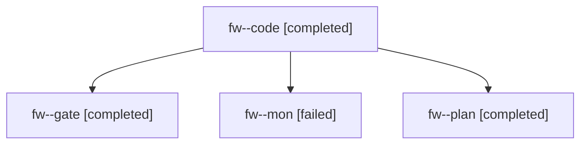

# Session: fw

[Agent Hoods](../README.md) / [bbugyi200](../users/bbugyi200/README.md) / [apollo](../users/bbugyi200/machines/apollo/README.md) / [fw](../users/bbugyi200/machines/apollo/hoods/fw/README.md) / fw

Owner: `bbugyi200.apollo` · Hood: `fw` · Members: 4

## Lineage

The diagram is an optional enhancement; the ordered table below contains the same lineage in accessible text.

| Role | Agent | State | Model / provider | Timing | Commits | Prompt | Chat |
|---|---|---|---|---|---:|---|---|
| code | fw--code | completed | muse-spark-1.3-contributor / muse | 2026-11-24T13:53:40.475543+00:00 → 2026-11-24T14:45:04.469619+00:00 | 0 | [Prompt](../agents/bbugyi200.apollo.fw--code/prompt.md) | [Chat](../agents/bbugyi200.apollo.fw--code/chat.md) |
| gate | fw--gate | completed | opus / claude | 2026-11-24T13:49:57.565351+00:00 → 2026-11-24T13:52:58.736501+00:00 | 0 | — | [Chat](../agents/bbugyi200.apollo.fw--gate/chat.md) |
| mon | fw--mon | failed | muse-spark-1.3-contributor / muse | 2026-11-24T14:14:14.556209+00:00 → 2026-11-24T14:46:15.571632+00:00 | 0 | — | — |
| plan | fw--plan | completed | opus / claude | 2026-11-24T13:38:45.856190+00:00 → 2026-11-24T13:46:47.339091+00:00 | 0 | [Prompt](../agents/bbugyi200.apollo.fw--plan/prompt.md) | [Chat](../agents/bbugyi200.apollo.fw--plan/chat.md) |
