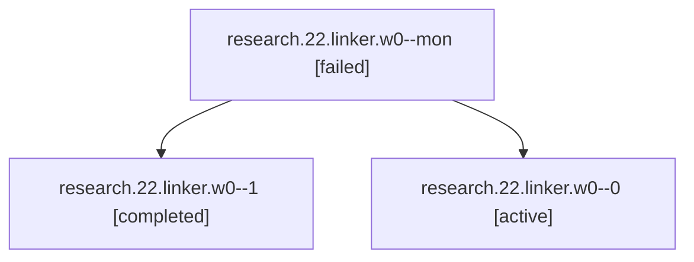

# Session: research.22.linker.w0

[Agent Hoods](../README.md) / [bbugyi200](../users/bbugyi200/README.md) / [apollo](../users/bbugyi200/machines/apollo/README.md) / [research](../users/bbugyi200/machines/apollo/hoods/research/README.md) / research.22.linker.w0

Owner: `bbugyi200.apollo` · Hood: `research` · Members: 3

## Lineage



The diagram is an optional enhancement; the ordered table below contains the same lineage in accessible text.

| Role | Agent | State | Model / provider | Timing | Commits | Prompt | Chat |
|---|---|---|---|---|---:|---|---|
| <a id="member-mon"></a>mon | research.22.linker.w0--mon | failed | opus / claude | 2026-10-18T17:08:50.516005+00:00 → 2026-10-18T17:45:07.457803+00:00 | 0 | — | [Chat](../agents/bbugyi200.apollo.research.22.linker.w0--mon/chat.md) |
| <a id="member-1"></a>1 | research.22.linker.w0--1 | completed | opus / claude | 2026-10-18T17:45:15.487616+00:00 → 2026-10-18T19:44:57.796367+00:00 | [1](../agents/bbugyi200.apollo.research.22.linker.w0--1/README.md#commits) | [Prompt](../agents/bbugyi200.apollo.research.22.linker.w0--1/prompt.md) | [Chat](../agents/bbugyi200.apollo.research.22.linker.w0--1/chat.md) |
| <a id="member-0"></a>0 | research.22.linker.w0--0 | active | opus / claude | 2026-10-18T16:46:59.159158+00:00 | 0 | [Prompt](../agents/bbugyi200.apollo.research.22.linker.w0--0/prompt.md) | [Chat](../agents/bbugyi200.apollo.research.22.linker.w0--0/chat.md) |

## Commits

| Role | Repo | Commit | Subject | Committed |
|---|---|---|---|---|
| 1 | sase | [`457dd72`](https://github.com/sase-org/sase/commit/457dd728d517ddba3ece2cabe30bdaff8e6a9db4) | fix(publish): build release artifacts from the release-please tagged commit | 2026-10-18 15:32:32 EDT |

## Variables

| Role | Variable | Value |
|---|---|---|
| 0 | `artifacts` | \[{kind: markdown, label: research:202610/pypi\_release\_reliability\_track0\_remaining\_work.md, path: /home/bryan/.sase/artifacts/agents/gh\_sase-org\_\_sase/20261018123306/pypi\_release\_reliability\_track0\_r… |
| 1 | `artifacts` | \[{kind: markdown, label: research:202610/pypi\_release\_reliability\_track0\_remaining\_work.md, path: /home/bryan/.sase/artifacts/agents/gh\_sase-org\_\_sase/20261018134407/pypi\_release\_reliability\_track0\_r… |

#### artifacts

**Role:** `0`

```yaml
- kind: markdown
  label: research:202610/pypi_release_reliability_track0_remaining_work.md
  path: /home/bryan/.sase/artifacts/agents/gh_sase-org__sase/20261018123306/pypi_release_reliability_track0_remaining_work-66aea90f53f4.md
  ref: file:explicit:9ec15ff6537641c902fde5de
  source_path: /home/bryan/.local/state/sase/workspaces/sase-org/sase/sase_12/sase/repos/research/202610/pypi_release_reliability_track0_remaining_work.md
```

#### artifacts

**Role:** `1`

```yaml
- kind: markdown
  label: research:202610/pypi_release_reliability_track0_remaining_work.md
  path: /home/bryan/.sase/artifacts/agents/gh_sase-org__sase/20261018134407/pypi_release_reliability_track0_remaining_work-4a686bddc7a0.md
  ref: file:explicit:18fbcdab4efda8e2f4a334c6
  source_path: /home/bryan/.local/state/sase/workspaces/sase-org/sase/sase_12/sase/repos/research/202610/pypi_release_reliability_track0_remaining_work.md
```

Values are truncated for display; see each member's agent meta.json for the full values.

## Neighbors

| Agent | Relation | State |
|---|---|---|
| [research.22.linker](../agents/bbugyi200.apollo.research.22.linker/README.md) | ancestor | active |
| [research.22.cdx](../agents/bbugyi200.apollo.research.22.cdx/README.md) | research.22 hood | active |
| [research.22.cld](../agents/bbugyi200.apollo.research.22.cld/README.md) | research.22 hood | active |
| [research.22.final](../agents/bbugyi200.apollo.research.22.final/README.md) | research.22 hood | active |
| [research.22.gem](../agents/bbugyi200.apollo.research.22.gem/README.md) | research.22 hood | active |
| [research.22.grk](../agents/bbugyi200.apollo.research.22.grk/README.md) | research.22 hood | active |
| [research.22.image](../agents/bbugyi200.apollo.research.22.image/README.md) | research.22 hood | active |
| [research.0.cdx](../agents/bbugyi200.apollo.research.0.cdx/README.md) | research hood | active |
| [research.0.cld](../agents/bbugyi200.apollo.research.0.cld/README.md) | research hood | active |
| [research.0.final](../agents/bbugyi200.apollo.research.0.final/README.md) | research hood | active |
| [research.0.image](../agents/bbugyi200.apollo.research.0.image/README.md) | research hood | completed |
| [research.01.cdx](../agents/bbugyi200.apollo.research.01.cdx/README.md) | research hood | completed |
| [research.01.cld](../agents/bbugyi200.apollo.research.01.cld/README.md) | research hood | completed |
| [research.01.final](../agents/bbugyi200.apollo.research.01.final/README.md) | research hood | completed |
| [research.01.final.f0](../agents/bbugyi200.apollo.research.01.final.f0/README.md) | research hood | active |
| [research.01.image](../agents/bbugyi200.apollo.research.01.image/README.md) | research hood | completed |
| [research.02.cdx](../agents/bbugyi200.apollo.research.02.cdx/README.md) | research hood | active |
| [research.02.cld](../agents/bbugyi200.apollo.research.02.cld/README.md) | research hood | active |
| [research.02.final](../agents/bbugyi200.apollo.research.02.final/README.md) | research hood | active |
| [research.02.gem](../agents/bbugyi200.apollo.research.02.gem/README.md) | research hood | active |
| [research.02.grk](../agents/bbugyi200.apollo.research.02.grk/README.md) | research hood | active |
| [research.02.image](../agents/bbugyi200.apollo.research.02.image/README.md) | research hood | active |
| [research.02.linker](../agents/bbugyi200.apollo.research.02.linker/README.md) | research hood | active |
| [research.02.mus](../agents/bbugyi200.apollo.research.02.mus/README.md) | research hood | active |
| [research.03.cdx](../agents/bbugyi200.apollo.research.03.cdx/README.md) | research hood | completed |
| [research.03.cld](../agents/bbugyi200.apollo.research.03.cld/README.md) | research hood | completed |
| [research.03.final](../agents/bbugyi200.apollo.research.03.final/README.md) | research hood | completed |
| [research.03.image](../agents/bbugyi200.apollo.research.03.image/README.md) | research hood | completed |
| [research.04.cdx](../agents/bbugyi200.apollo.research.04.cdx/README.md) | research hood | completed |
| [research.04.cld](../agents/bbugyi200.apollo.research.04.cld/README.md) | research hood | completed |
| [research.04.final](../agents/bbugyi200.apollo.research.04.final/README.md) | research hood | completed |
| [research.04.image](../agents/bbugyi200.apollo.research.04.image/README.md) | research hood | completed |
| [research.05.cdx](../agents/bbugyi200.apollo.research.05.cdx/README.md) | research hood | completed |
| [research.05.cld](../agents/bbugyi200.apollo.research.05.cld/README.md) | research hood | completed |
| [research.05.final](../agents/bbugyi200.apollo.research.05.final/README.md) | research hood | completed |
| [research.05.image](../agents/bbugyi200.apollo.research.05.image/README.md) | research hood | completed |
| [research.06.cdx](../agents/bbugyi200.apollo.research.06.cdx/README.md) | research hood | completed |
| [research.06.cld](../agents/bbugyi200.apollo.research.06.cld/README.md) | research hood | completed |
| [research.06.final](../agents/bbugyi200.apollo.research.06.final/README.md) | research hood | completed |
| [research.06.image](../agents/bbugyi200.apollo.research.06.image/README.md) | research hood | completed |
| [research.07.cdx](../agents/bbugyi200.apollo.research.07.cdx/README.md) | research hood | completed |
| [research.07.cld](../agents/bbugyi200.apollo.research.07.cld/README.md) | research hood | completed |
| [research.07.final](../agents/bbugyi200.apollo.research.07.final/README.md) | research hood | completed |
| [research.07.final.f1](../agents/bbugyi200.apollo.research.07.final.f1/README.md) | research hood | completed |
| [research.07.image](../agents/bbugyi200.apollo.research.07.image/README.md) | research hood | completed |
| [research.08.audio](../agents/bbugyi200.apollo.research.08.audio/README.md) | research hood | active |
| [research.08.cdx](../agents/bbugyi200.apollo.research.08.cdx/README.md) | research hood | active |
| [research.08.cld](../agents/bbugyi200.apollo.research.08.cld/README.md) | research hood | active |
| [research.08.final](../agents/bbugyi200.apollo.research.08.final/README.md) | research hood | active |
| [research.08.gem](../agents/bbugyi200.apollo.research.08.gem/README.md) | research hood | active |
| [research.08.grk](../agents/bbugyi200.apollo.research.08.grk/README.md) | research hood | active |
| [research.08.image](../agents/bbugyi200.apollo.research.08.image/README.md) | research hood | active |
| [research.08.linker](../agents/bbugyi200.apollo.research.08.linker/README.md) | research hood | active |
| [research.09.audio](../agents/bbugyi200.apollo.research.09.audio/README.md) | research hood | active |
| [research.09.cdx](../agents/bbugyi200.apollo.research.09.cdx/README.md) | research hood | active |
| [research.09.cld](../agents/bbugyi200.apollo.research.09.cld/README.md) | research hood | active |
| [research.09.final](../agents/bbugyi200.apollo.research.09.final/README.md) | research hood | active |
| … and 591 more in the [hood roster](../users/bbugyi200/machines/apollo/hoods/research/README.md) | research hood | — |
