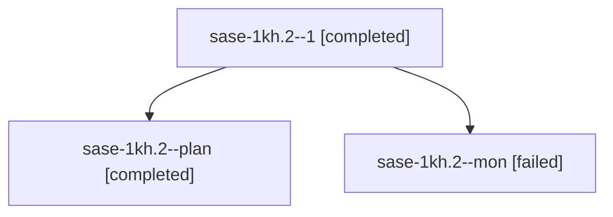

# Session: sase-1kh.2

[Agent Hoods](../README.md) / [bbugyi200](../users/bbugyi200/README.md) / [apollo](../users/bbugyi200/machines/apollo/README.md) / [sase-1kh](../users/bbugyi200/machines/apollo/hoods/sase-1kh/README.md) / sase-1kh.2

Owner: `bbugyi200.apollo` · Hood: `sase-1kh` · Members: 3 · Bead: [sase-1kh.2](https://github.com/sase-org/sase--beads/blob/main/pages/sase-1kh/sase-1kh.2.md)

## Lineage

The diagram is an optional enhancement; the ordered table below contains the same lineage in accessible text.

| Role | Agent | State | Model / provider | Timing | Commits | Prompt | Chat |
|---|---|---|---|---|---:|---|---|
| 1 | sase-1kh.2--1 | completed | muse-spark-1.3-contributor / muse | 2026-10-13T13:15:08.096800+00:00 → 2026-10-13T13:56:05.416170+00:00 | [1](../agents/bbugyi200.apollo.sase-1kh.2--1/README.md#commits) | [Prompt](../agents/bbugyi200.apollo.sase-1kh.2--1/prompt.md) | [Chat](../agents/bbugyi200.apollo.sase-1kh.2--1/chat.md) |
| plan | sase-1kh.2--plan | completed | muse-spark-1.3-contributor / muse | 2026-10-13T12:24:02.282057+00:00 → 2026-10-13T12:58:52.672695+00:00 | 0 | [Prompt](../agents/bbugyi200.apollo.sase-1kh.2--plan/prompt.md) | [Chat](../agents/bbugyi200.apollo.sase-1kh.2--plan/chat.md) |
| mon | sase-1kh.2--mon | failed | muse-spark-1.3-contributor / muse | 2026-10-13T12:57:48.997543+00:00 → 2026-10-13T13:14:53.635059+00:00 | 0 | — | [Chat](../agents/bbugyi200.apollo.sase-1kh.2--mon/chat.md) |

## Commits

| Role | Repo | Commit | Subject | Committed |
|---|---|---|---|---|
| 1 | sase | [`86a343d`](https://github.com/sase-org/sase/commit/86a343de2860e17559cec2a0deb32208615b659b) | feat(finalizers): add raw-commit backstop with foreign-trailer exemption | 2026-10-13 09:44:51 EDT |

## Neighbors

| Agent | Relation | State |
|---|---|---|
| [sase-1kh.1](../agents/bbugyi200.apollo.sase-1kh.1/README.md) | sase-1kh hood | completed |
| [sase-1kh.3](../agents/bbugyi200.apollo.sase-1kh.3/README.md) | sase-1kh hood | completed |
| [sase-1kh.land](bbugyi200.apollo.sase-1kh.land.md) (session · 3) | sase-1kh hood | active 2, failed 1 |
