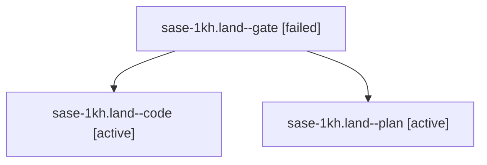

# Session: sase-1kh.land

[Agent Hoods](../README.md) / [bbugyi200](../users/bbugyi200/README.md) / [apollo](../users/bbugyi200/machines/apollo/README.md) / [sase-1kh](../users/bbugyi200/machines/apollo/hoods/sase-1kh/README.md) / sase-1kh.land

Owner: `bbugyi200.apollo` · Hood: `sase-1kh` · Members: 3 · Bead: [sase-1kh](https://github.com/sase-org/sase--beads/blob/main/pages/sase-1kh/README.md)

## Lineage



The diagram is an optional enhancement; the ordered table below contains the same lineage in accessible text.

| Role | Agent | State | Model / provider | Timing | Commits | Prompt | Chat |
|---|---|---|---|---|---:|---|---|
| <a id="member-gate"></a>gate | sase-1kh.land--gate | failed | gpt-6.1-sol / codex | 2026-10-13T15:23:21.798132+00:00 → 2026-10-13T15:23:38.834669+00:00 | 0 | — | [Chat](../agents/bbugyi200.apollo.sase-1kh.land--gate/chat.md) |
| <a id="member-code"></a>code | sase-1kh.land--code | active | gpt-6-luna / codex | 2026-10-13T15:24:13.691210+00:00 | [1](../agents/bbugyi200.apollo.sase-1kh.land--code/README.md#commits) | — | — |
| <a id="member-plan"></a>plan | sase-1kh.land--plan | active | gpt-6.1-sol / codex | 2026-10-13T14:57:23.645632+00:00 | 0 | [Prompt](../agents/bbugyi200.apollo.sase-1kh.land--plan/prompt.md) | [Chat](../agents/bbugyi200.apollo.sase-1kh.land--plan/chat.md) |

## Commits

| Role | Repo | Commit | Subject | Committed |
|---|---|---|---|---|
| code | sase | [`c3d7a7e`](https://github.com/sase-org/sase/commit/c3d7a7e9b5bd4a5ef9697b3411a97a7a8f01c10e) | fix(finalizer): restrict raw commit absorption to owned suffixes | 2026-10-13 13:24:06 EDT |

## Variables

| Role | Variable | Value |
|---|---|---|
| plan | `artifacts` | \[{bead: sase-1kh, kind: markdown, label: sase-1kh landing audit, path: /home/bryan/.sase/artifacts/agents/gh\_sase-org\_\_sase/20261013082324/sase-1kh-landing-audit-43f22640337f.md, ref: file:explicit:5… |

#### artifacts

**Role:** `plan`

```yaml
- bead: sase-1kh
  kind: markdown
  label: sase-1kh landing audit
  path: /home/bryan/.sase/artifacts/agents/gh_sase-org__sase/20261013082324/sase-1kh-landing-audit-43f22640337f.md
  ref: file:explicit:5a1c98b7060a59115e90bd29
  source_path: /tmp/sase-1kh-landing-audit.md
- bead: sase-1kh
  kind: file
  label: sase-1kh isolated follow-up reproductions
  path: /home/bryan/.sase/artifacts/agents/gh_sase-org__sase/20261013082324/sase-1kh-isolated-followups-f2fe3a0fb194.log
  ref: file:explicit:9f6497f057c13ec447c0eac6
  source_path: /tmp/sase-1kh-isolated-followups.log
```

Values are truncated for display; see each member's agent meta.json for the full values.

## Neighbors

| Agent | Relation | State |
|---|---|---|
| [sase-1kh.1](../agents/bbugyi200.apollo.sase-1kh.1/README.md) | sase-1kh hood | completed |
| [sase-1kh.2](bbugyi200.apollo.sase-1kh.2.md) (session · 3) | sase-1kh hood | completed 2, failed 1 |
| [sase-1kh.3](../agents/bbugyi200.apollo.sase-1kh.3/README.md) | sase-1kh hood | completed |
