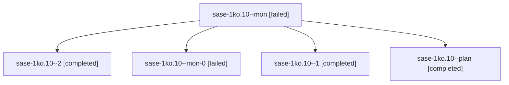

# Session: sase-1ko.10

[Agent Hoods](../README.md) / [bbugyi200](../users/bbugyi200/README.md) / [apollo](../users/bbugyi200/machines/apollo/README.md) / [sase-1ko](../users/bbugyi200/machines/apollo/hoods/sase-1ko/README.md) / sase-1ko.10

Owner: `bbugyi200.apollo` · Hood: `sase-1ko` · Members: 5 · Bead: [sase-1ko.10](https://github.com/sase-org/sase--beads/blob/main/pages/sase-1ko/sase-1ko.10.md)

## Lineage



The diagram is an optional enhancement; the ordered table below contains the same lineage in accessible text.

| Role | Agent | State | Model / provider | Timing | Commits | Prompt | Chat |
|---|---|---|---|---|---:|---|---|
| <a id="member-mon"></a>mon | sase-1ko.10--mon | failed | grok-4.6 / grok | 2026-10-14T12:39:56.088181+00:00 → 2026-10-14T12:51:21.328309+00:00 | 0 | — | [Chat](../agents/bbugyi200.apollo.sase-1ko.10--mon/chat.md) |
| <a id="member-2"></a>2 | sase-1ko.10--2 | completed | grok-4.6 / grok | 2026-10-14T13:22:14.128679+00:00 → 2026-10-14T13:25:19.474561+00:00 | 0 | [Prompt](../agents/bbugyi200.apollo.sase-1ko.10--2/prompt.md) | [Chat](../agents/bbugyi200.apollo.sase-1ko.10--2/chat.md) |
| <a id="member-mon-0"></a>mon-0 | sase-1ko.10--mon-0 | failed | grok-4.6 / grok | 2026-10-14T12:58:39.366847+00:00 → 2026-10-14T13:22:14.394053+00:00 | [1](../agents/bbugyi200.apollo.sase-1ko.10--mon-0/README.md#commits) | — | [Chat](../agents/bbugyi200.apollo.sase-1ko.10--mon-0/chat.md) |
| <a id="member-1"></a>1 | sase-1ko.10--1 | completed | grok-4.6 / grok | 2026-10-14T12:51:20.993591+00:00 → 2026-10-14T12:59:30.741456+00:00 | 0 | [Prompt](../agents/bbugyi200.apollo.sase-1ko.10--1/prompt.md) | [Chat](../agents/bbugyi200.apollo.sase-1ko.10--1/chat.md) |
| <a id="member-plan"></a>plan | sase-1ko.10--plan | completed | grok-4.6 / grok | 2026-10-14T11:51:08.201062+00:00 → 2026-10-14T12:40:50.851283+00:00 | 0 | [Prompt](../agents/bbugyi200.apollo.sase-1ko.10--plan/prompt.md) | [Chat](../agents/bbugyi200.apollo.sase-1ko.10--plan/chat.md) |

## Commits

| Role | Repo | Commit | Subject | Committed |
|---|---|---|---|---|
| mon-0 | sase | [`88acef6`](https://github.com/sase-org/sase/commit/88acef62344479241af5036af108f92fbc71a1eb) | feat(instructions): record E3 explicit-delivery acceptance | 2026-10-14 09:18:29 EDT |

## Variables

| Role | Variable | Value |
|---|---|---|
| plan | `artifacts` | \[{bead: sase-1ko, kind: markdown, label: E3 acceptance record, path: /home/bryan/.sase/artifacts/agents/gh\_sase-org\_\_sase/20261013181117/e3\_acceptance\_record-a6b69f0124c5.md, ref: file:explicit:29427… |

#### artifacts

**Role:** `plan`

```yaml
- bead: sase-1ko
  kind: markdown
  label: E3 acceptance record
  path: /home/bryan/.sase/artifacts/agents/gh_sase-org__sase/20261013181117/e3_acceptance_record-a6b69f0124c5.md
  ref: file:explicit:294276aba63ff9003d936aaf
  source_path: /tmp/e3_acceptance_record.md
- bead: sase-1ko
  kind: file
  label: E3 pre-cutover readout JSON
  path: /home/bryan/.sase/artifacts/agents/gh_sase-org__sase/20261013181117/e3_readout_pre_20261006_103506-583a00121eb7.json
  ref: file:explicit:777e0f69d8eed315766656b3
  source_path: /tmp/e3_readout_pre_20261006_103506.json
- bead: sase-1ko
  kind: file
  label: E3 post-cutover readout JSON
  path: /home/bryan/.sase/artifacts/agents/gh_sase-org__sase/20261013181117/e3_readout_post_20261014_103506-90f34935f64a.json
  ref: file:explicit:cbf7c8bf99bcd81ce4eba5d3
  source_path: /tmp/e3_readout_post_20261014_103506.json
```

Values are truncated for display; see each member's agent meta.json for the full values.

## Neighbors

| Agent | Relation | State |
|---|---|---|
| [sase-1ko.1](../agents/bbugyi200.apollo.sase-1ko.1/README.md) | sase-1ko hood | completed |
| [sase-1ko.2](../agents/bbugyi200.apollo.sase-1ko.2/README.md) | sase-1ko hood | completed |
| [sase-1ko.3](../agents/bbugyi200.apollo.sase-1ko.3/README.md) | sase-1ko hood | completed |
| [sase-1ko.4](bbugyi200.apollo.sase-1ko.4.md) (session · 5) | sase-1ko hood | completed 3, failed 2 |
| [sase-1ko.5](../agents/bbugyi200.apollo.sase-1ko.5/README.md) | sase-1ko hood | completed |
| [sase-1ko.6](../agents/bbugyi200.apollo.sase-1ko.6/README.md) | sase-1ko hood | completed |
| [sase-1ko.7](bbugyi200.apollo.sase-1ko.7.md) (session · 8) | sase-1ko hood | active 1, completed 4, failed 3 |
| [sase-1ko.7](../agents/bbugyi200.apollo.sase-1ko.7/README.md) | sase-1ko hood | completed |
| [sase-1ko.8](../agents/bbugyi200.apollo.sase-1ko.8/README.md) | sase-1ko hood | completed |
| [sase-1ko.9](bbugyi200.apollo.sase-1ko.9.md) (session · 3) | sase-1ko hood | completed 2, failed 1 |
| [sase-1ko.land](bbugyi200.apollo.sase-1ko.land.md) (session · 3) | sase-1ko hood | active 2, failed 1 |
