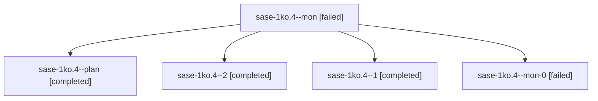

# Session: sase-1ko.4

[Agent Hoods](../README.md) / [bbugyi200](../users/bbugyi200/README.md) / [apollo](../users/bbugyi200/machines/apollo/README.md) / [sase-1ko](../users/bbugyi200/machines/apollo/hoods/sase-1ko/README.md) / sase-1ko.4

Owner: `bbugyi200.apollo` · Hood: `sase-1ko` · Members: 5 · Bead: [sase-1ko.4](https://github.com/sase-org/sase--beads/blob/main/pages/sase-1ko/sase-1ko.4.md)

## Lineage

The diagram is an optional enhancement; the ordered table below contains the same lineage in accessible text.

| Role | Agent | State | Model / provider | Timing | Commits | Prompt | Chat |
|---|---|---|---|---|---:|---|---|
| mon | sase-1ko.4--mon | failed | grok-4.6 / grok | 2026-10-14T02:39:37.225059+00:00 → 2026-10-14T03:40:29.697792+00:00 | 0 | — | [Chat](../agents/bbugyi200.apollo.sase-1ko.4--mon/chat.md) |
| plan | sase-1ko.4--plan | completed | grok-4.6 / grok | 2026-10-14T01:50:16.164640+00:00 → 2026-10-14T02:40:40.541548+00:00 | 0 | [Prompt](../agents/bbugyi200.apollo.sase-1ko.4--plan/prompt.md) | [Chat](../agents/bbugyi200.apollo.sase-1ko.4--plan/chat.md) |
| 2 | sase-1ko.4--2 | completed | grok-4.6 / grok | 2026-10-14T04:25:23.027211+00:00 → 2026-10-14T04:29:05.746606+00:00 | 0 | [Prompt](../agents/bbugyi200.apollo.sase-1ko.4--2/prompt.md) | [Chat](../agents/bbugyi200.apollo.sase-1ko.4--2/chat.md) |
| 1 | sase-1ko.4--1 | completed | grok-4.6 / grok | 2026-10-14T03:40:29.576479+00:00 → 2026-10-14T03:58:18.827327+00:00 | 0 | [Prompt](../agents/bbugyi200.apollo.sase-1ko.4--1/prompt.md) | [Chat](../agents/bbugyi200.apollo.sase-1ko.4--1/chat.md) |
| mon-0 | sase-1ko.4--mon-0 | failed | grok-4.6 / grok | 2026-10-14T03:57:04.430728+00:00 → 2026-10-14T04:25:23.555070+00:00 | [1](../agents/bbugyi200.apollo.sase-1ko.4--mon-0/README.md#commits) | — | [Chat](../agents/bbugyi200.apollo.sase-1ko.4--mon-0/chat.md) |

## Commits

| Role | Repo | Commit | Subject | Committed |
|---|---|---|---|---|
| mon-0 | sase | [`e79a89d`](https://github.com/sase-org/sase/commit/e79a89d755a1f91cb032bd2199709994ab9d5d9d) | feat(instructions): add handoff-aware declaration readout | 2026-10-14 00:20:55 EDT |

## Neighbors

| Agent | Relation | State |
|---|---|---|
| [sase-1ko.1](../agents/bbugyi200.apollo.sase-1ko.1/README.md) | sase-1ko hood | completed |
| [sase-1ko.10](bbugyi200.apollo.sase-1ko.10.md) (session · 4) | sase-1ko hood | active 1, completed 2, failed 1 |
| [sase-1ko.2](../agents/bbugyi200.apollo.sase-1ko.2/README.md) | sase-1ko hood | completed |
| [sase-1ko.3](../agents/bbugyi200.apollo.sase-1ko.3/README.md) | sase-1ko hood | completed |
| [sase-1ko.5](../agents/bbugyi200.apollo.sase-1ko.5/README.md) | sase-1ko hood | completed |
| [sase-1ko.6](../agents/bbugyi200.apollo.sase-1ko.6/README.md) | sase-1ko hood | completed |
| [sase-1ko.7](bbugyi200.apollo.sase-1ko.7.md) (session · 8) | sase-1ko hood | active 1, completed 4, failed 3 |
| [sase-1ko.7](../agents/bbugyi200.apollo.sase-1ko.7/README.md) | sase-1ko hood | completed |
| [sase-1ko.8](../agents/bbugyi200.apollo.sase-1ko.8/README.md) | sase-1ko hood | completed |
| [sase-1ko.9](bbugyi200.apollo.sase-1ko.9.md) (session · 3) | sase-1ko hood | completed 2, failed 1 |
| [sase-1ko.land](../agents/bbugyi200.apollo.sase-1ko.land/README.md) | sase-1ko hood | waiting |
