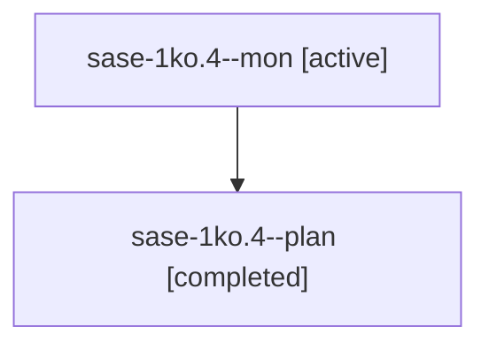

# Session: sase-1ko.4

[Agent Hoods](../README.md) / [bbugyi200](../users/bbugyi200/README.md) / [apollo](../users/bbugyi200/machines/apollo/README.md) / [sase-1ko](../users/bbugyi200/machines/apollo/hoods/sase-1ko/README.md) / sase-1ko.4

Owner: `bbugyi200.apollo` · Hood: `sase-1ko` · Members: 2 · Bead: [sase-1ko.4](https://github.com/sase-org/sase--beads/blob/main/pages/sase-1ko/sase-1ko.4.md)

## Lineage

The diagram is an optional enhancement; the ordered table below contains the same lineage in accessible text.

| Role | Agent | State | Model / provider | Timing | Commits | Prompt | Chat |
|---|---|---|---|---|---:|---|---|
| mon | sase-1ko.4--mon | active | grok-4.6 / grok | 2026-10-14T02:39:37.225059+00:00 | 0 | — | — |
| plan | sase-1ko.4--plan | completed | grok-4.6 / grok | 2026-10-14T01:50:16.164640+00:00 → 2026-10-14T02:40:40.541548+00:00 | 0 | [Prompt](../agents/bbugyi200.apollo.sase-1ko.4--plan/prompt.md) | [Chat](../agents/bbugyi200.apollo.sase-1ko.4--plan/chat.md) |

## Neighbors

| Agent | Relation | State |
|---|---|---|
| [sase-1ko.1](../agents/bbugyi200.apollo.sase-1ko.1/README.md) | sase-1ko hood | completed |
| [sase-1ko.10](../agents/bbugyi200.apollo.sase-1ko.10/README.md) | sase-1ko hood | waiting |
| [sase-1ko.2](../agents/bbugyi200.apollo.sase-1ko.2/README.md) | sase-1ko hood | completed |
| [sase-1ko.3](../agents/bbugyi200.apollo.sase-1ko.3/README.md) | sase-1ko hood | completed |
| [sase-1ko.5](../agents/bbugyi200.apollo.sase-1ko.5/README.md) | sase-1ko hood | completed |
| [sase-1ko.6](../agents/bbugyi200.apollo.sase-1ko.6/README.md) | sase-1ko hood | active |
| [sase-1ko.7](../agents/bbugyi200.apollo.sase-1ko.7/README.md) | sase-1ko hood | waiting |
| [sase-1ko.8](../agents/bbugyi200.apollo.sase-1ko.8/README.md) | sase-1ko hood | waiting |
| [sase-1ko.9](../agents/bbugyi200.apollo.sase-1ko.9/README.md) | sase-1ko hood | waiting |
| [sase-1ko.land](../agents/bbugyi200.apollo.sase-1ko.land/README.md) | sase-1ko hood | waiting |
