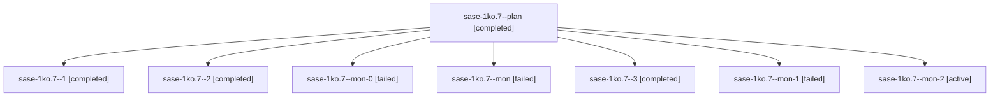

# Session: sase-1ko.7

[Agent Hoods](../README.md) / [bbugyi200](../users/bbugyi200/README.md) / [apollo](../users/bbugyi200/machines/apollo/README.md) / [sase-1ko](../users/bbugyi200/machines/apollo/hoods/sase-1ko/README.md) / sase-1ko.7

Owner: `bbugyi200.apollo` · Hood: `sase-1ko` · Members: 8 · Bead: [sase-1ko.7](https://github.com/sase-org/sase--beads/blob/main/pages/sase-1ko/sase-1ko.7.md)

## Lineage

The diagram is an optional enhancement; the ordered table below contains the same lineage in accessible text.

| Role | Agent | State | Model / provider | Timing | Commits | Prompt | Chat |
|---|---|---|---|---|---:|---|---|
| plan | sase-1ko.7--plan | completed | grok-4.6 / grok | 2026-10-14T03:27:58.387122+00:00 → 2026-10-14T04:14:18.231733+00:00 | 0 | [Prompt](../agents/bbugyi200.apollo.sase-1ko.7--plan/prompt.md) | [Chat](../agents/bbugyi200.apollo.sase-1ko.7--plan/chat.md) |
| 1 | sase-1ko.7--1 | completed | grok-4.6 / grok | 2026-10-14T05:14:00.062793+00:00 → 2026-10-14T05:23:39.816568+00:00 | 0 | [Prompt](../agents/bbugyi200.apollo.sase-1ko.7--1/prompt.md) | [Chat](../agents/bbugyi200.apollo.sase-1ko.7--1/chat.md) |
| 2 | sase-1ko.7--2 | completed | grok-4.6 / grok | 2026-10-14T06:43:33.698977+00:00 → 2026-10-14T06:58:39.365827+00:00 | 0 | [Prompt](../agents/bbugyi200.apollo.sase-1ko.7--2/prompt.md) | [Chat](../agents/bbugyi200.apollo.sase-1ko.7--2/chat.md) |
| mon-0 | sase-1ko.7--mon-0 | failed | grok-4.6 / grok | 2026-10-14T05:22:16.803490+00:00 → 2026-10-14T06:43:33.918500+00:00 | 0 | — | [Chat](../agents/bbugyi200.apollo.sase-1ko.7--mon-0/chat.md) |
| mon | sase-1ko.7--mon | failed | grok-4.6 / grok | 2026-10-14T04:12:54.474577+00:00 → 2026-10-14T05:14:00.250409+00:00 | 0 | — | [Chat](../agents/bbugyi200.apollo.sase-1ko.7--mon/chat.md) |
| 3 | sase-1ko.7--3 | completed | grok-4.6 / grok | 2026-10-14T08:14:13.864311+00:00 → 2026-10-14T08:29:32.375303+00:00 | 0 | [Prompt](../agents/bbugyi200.apollo.sase-1ko.7--3/prompt.md) | [Chat](../agents/bbugyi200.apollo.sase-1ko.7--3/chat.md) |
| mon-1 | sase-1ko.7--mon-1 | failed | grok-4.6 / grok | 2026-10-14T06:57:04.620413+00:00 → 2026-10-14T08:14:14.258229+00:00 | 0 | — | [Chat](../agents/bbugyi200.apollo.sase-1ko.7--mon-1/chat.md) |
| mon-2 | sase-1ko.7--mon-2 | active | grok-4.6 / grok | 2026-10-14T08:28:11.463817+00:00 | 0 | — | — |

## Neighbors

| Agent | Relation | State |
|---|---|---|
| [sase-1ko.1](../agents/bbugyi200.apollo.sase-1ko.1/README.md) | sase-1ko hood | completed |
| [sase-1ko.10](../agents/bbugyi200.apollo.sase-1ko.10/README.md) | sase-1ko hood | waiting |
| [sase-1ko.2](../agents/bbugyi200.apollo.sase-1ko.2/README.md) | sase-1ko hood | completed |
| [sase-1ko.3](../agents/bbugyi200.apollo.sase-1ko.3/README.md) | sase-1ko hood | completed |
| [sase-1ko.4](bbugyi200.apollo.sase-1ko.4.md) (session · 5) | sase-1ko hood | completed 3, failed 2 |
| [sase-1ko.5](../agents/bbugyi200.apollo.sase-1ko.5/README.md) | sase-1ko hood | completed |
| [sase-1ko.6](../agents/bbugyi200.apollo.sase-1ko.6/README.md) | sase-1ko hood | completed |
| [sase-1ko.8](../agents/bbugyi200.apollo.sase-1ko.8/README.md) | sase-1ko hood | completed |
| [sase-1ko.9](bbugyi200.apollo.sase-1ko.9.md) (session · 3) | sase-1ko hood | active 1, completed 1, failed 1 |
| [sase-1ko.land](../agents/bbugyi200.apollo.sase-1ko.land/README.md) | sase-1ko hood | waiting |
