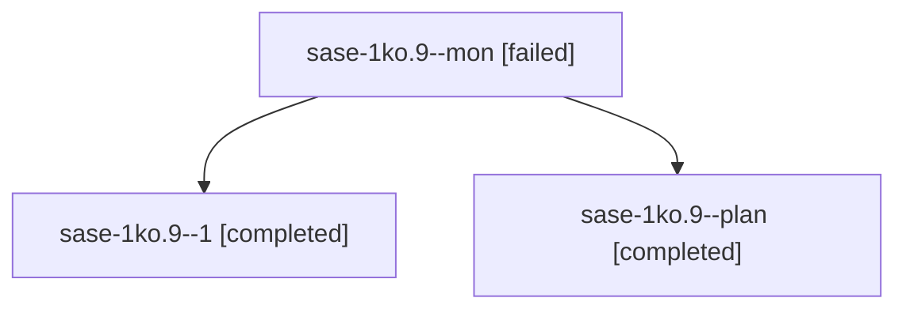

# Session: sase-1ko.9

[Agent Hoods](../README.md) / [bbugyi200](../users/bbugyi200/README.md) / [apollo](../users/bbugyi200/machines/apollo/README.md) / [sase-1ko](../users/bbugyi200/machines/apollo/hoods/sase-1ko/README.md) / sase-1ko.9

Owner: `bbugyi200.apollo` · Hood: `sase-1ko` · Members: 3 · Bead: [sase-1ko.9](https://github.com/sase-org/sase--beads/blob/main/pages/sase-1ko/sase-1ko.9.md)

## Lineage

The diagram is an optional enhancement; the ordered table below contains the same lineage in accessible text.

| Role | Agent | State | Model / provider | Timing | Commits | Prompt | Chat |
|---|---|---|---|---|---:|---|---|
| mon | sase-1ko.9--mon | failed | gpt-6-luna / codex | 2026-10-14T04:43:01.504484+00:00 → 2026-10-14T04:49:27.053236+00:00 | 0 | — | [Chat](../agents/bbugyi200.apollo.sase-1ko.9--mon/chat.md) |
| 1 | sase-1ko.9--1 | completed | gpt-6-luna / codex | 2026-10-14T04:49:26.822325+00:00 → 2026-10-14T08:50:01.610791+00:00 | [1](../agents/bbugyi200.apollo.sase-1ko.9--1/README.md#commits) | [Prompt](../agents/bbugyi200.apollo.sase-1ko.9--1/prompt.md) | [Chat](../agents/bbugyi200.apollo.sase-1ko.9--1/chat.md) |
| plan | sase-1ko.9--plan | completed | gpt-6-luna / codex | 2026-10-14T03:28:03.916969+00:00 → 2026-10-14T04:44:11.622408+00:00 | 0 | [Prompt](../agents/bbugyi200.apollo.sase-1ko.9--plan/prompt.md) | [Chat](../agents/bbugyi200.apollo.sase-1ko.9--plan/chat.md) |

## Commits

| Role | Repo | Commit | Subject | Committed |
|---|---|---|---|---|
| 1 | sase | [`8847d07`](https://github.com/sase-org/sase/commit/8847d07a086b9e930f1a787425ec4c3272ea6824) | feat(instructions): add Grok and Muse explicit delivery | 2026-10-14 04:42:35 EDT |

## Neighbors

| Agent | Relation | State |
|---|---|---|
| [sase-1ko.1](../agents/bbugyi200.apollo.sase-1ko.1/README.md) | sase-1ko hood | completed |
| [sase-1ko.10](../agents/bbugyi200.apollo.sase-1ko.10/README.md) | sase-1ko hood | waiting |
| [sase-1ko.2](../agents/bbugyi200.apollo.sase-1ko.2/README.md) | sase-1ko hood | completed |
| [sase-1ko.3](../agents/bbugyi200.apollo.sase-1ko.3/README.md) | sase-1ko hood | completed |
| [sase-1ko.4](bbugyi200.apollo.sase-1ko.4.md) (session · 5) | sase-1ko hood | completed 3, failed 2 |
| [sase-1ko.5](../agents/bbugyi200.apollo.sase-1ko.5/README.md) | sase-1ko hood | completed |
| [sase-1ko.6](../agents/bbugyi200.apollo.sase-1ko.6/README.md) | sase-1ko hood | completed |
| [sase-1ko.7](bbugyi200.apollo.sase-1ko.7.md) (session · 8) | sase-1ko hood | active 1, completed 4, failed 3 |
| [sase-1ko.7](../agents/bbugyi200.apollo.sase-1ko.7/README.md) | sase-1ko hood | active |
| [sase-1ko.8](../agents/bbugyi200.apollo.sase-1ko.8/README.md) | sase-1ko hood | completed |
| [sase-1ko.land](../agents/bbugyi200.apollo.sase-1ko.land/README.md) | sase-1ko hood | waiting |
