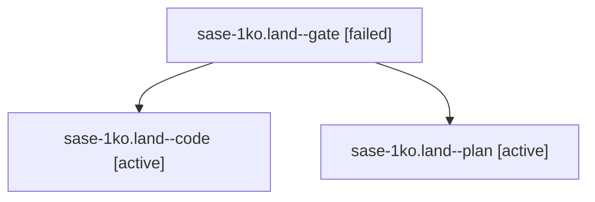

# Session: sase-1ko.land

[Agent Hoods](../README.md) / [bbugyi200](../users/bbugyi200/README.md) / [apollo](../users/bbugyi200/machines/apollo/README.md) / [sase-1ko](../users/bbugyi200/machines/apollo/hoods/sase-1ko/README.md) / sase-1ko.land

Owner: `bbugyi200.apollo` · Hood: `sase-1ko` · Members: 3 · Bead: [sase-1ko](https://github.com/sase-org/sase--beads/blob/main/pages/sase-1ko/README.md)

## Lineage

The diagram is an optional enhancement; the ordered table below contains the same lineage in accessible text.

| Role | Agent | State | Model / provider | Timing | Commits | Prompt | Chat |
|---|---|---|---|---|---:|---|---|
| gate | sase-1ko.land--gate | failed | opus / claude | 2026-10-14T14:07:31.239152+00:00 → 2026-10-14T14:07:47.525773+00:00 | 0 | — | [Chat](../agents/bbugyi200.apollo.sase-1ko.land--gate/chat.md) |
| code | sase-1ko.land--code | active | grok-4.6 / grok | 2026-10-14T14:08:05.243278+00:00 | 0 | — | — |
| plan | sase-1ko.land--plan | active | opus / claude | 2026-10-14T13:25:39.483173+00:00 | 0 | [Prompt](../agents/bbugyi200.apollo.sase-1ko.land--plan/prompt.md) | [Chat](../agents/bbugyi200.apollo.sase-1ko.land--plan/chat.md) |

## Neighbors

| Agent | Relation | State |
|---|---|---|
| [sase-1ko.1](../agents/bbugyi200.apollo.sase-1ko.1/README.md) | sase-1ko hood | completed |
| [sase-1ko.10](bbugyi200.apollo.sase-1ko.10.md) (session · 5) | sase-1ko hood | completed 3, failed 2 |
| [sase-1ko.2](../agents/bbugyi200.apollo.sase-1ko.2/README.md) | sase-1ko hood | completed |
| [sase-1ko.3](../agents/bbugyi200.apollo.sase-1ko.3/README.md) | sase-1ko hood | completed |
| [sase-1ko.4](bbugyi200.apollo.sase-1ko.4.md) (session · 5) | sase-1ko hood | completed 3, failed 2 |
| [sase-1ko.5](../agents/bbugyi200.apollo.sase-1ko.5/README.md) | sase-1ko hood | completed |
| [sase-1ko.6](../agents/bbugyi200.apollo.sase-1ko.6/README.md) | sase-1ko hood | completed |
| [sase-1ko.7](bbugyi200.apollo.sase-1ko.7.md) (session · 8) | sase-1ko hood | active 1, completed 4, failed 3 |
| [sase-1ko.7](../agents/bbugyi200.apollo.sase-1ko.7/README.md) | sase-1ko hood | completed |
| [sase-1ko.8](../agents/bbugyi200.apollo.sase-1ko.8/README.md) | sase-1ko hood | completed |
| [sase-1ko.9](bbugyi200.apollo.sase-1ko.9.md) (session · 3) | sase-1ko hood | completed 2, failed 1 |
