# Session: sase-1m3.11

[Agent Hoods](../README.md) / [bbugyi200](../users/bbugyi200/README.md) / [apollo](../users/bbugyi200/machines/apollo/README.md) / [sase-1m3](../users/bbugyi200/machines/apollo/hoods/sase-1m3/README.md) / sase-1m3.11

Owner: `bbugyi200.apollo` · Hood: `sase-1m3` · Members: 15 · Bead: [sase-1m3.11](https://github.com/sase-org/sase--beads/blob/main/pages/sase-1m3/sase-1m3.11.md)

## Lineage

```mermaid
flowchart TD
  n0["sase-1m3.11--3 [completed]"]
  n1["sase-1m3.11--plan [completed]"]
  n0 --> n1
  n2["sase-1m3.11--2 [completed]"]
  n0 --> n2
  n3["sase-1m3.11--mon-4 [failed]"]
  n0 --> n3
  n4["sase-1m3.11--mon-3 [failed]"]
  n0 --> n4
  n5["sase-1m3.11--mon-0 [failed]"]
  n0 --> n5
  n6["sase-1m3.11--6 [completed]"]
  n0 --> n6
  n7["sase-1m3.11--code [completed]"]
  n0 --> n7
  n8["sase-1m3.11--4 [completed]"]
  n0 --> n8
  n9["sase-1m3.11--mon [failed]"]
  n0 --> n9
  n10["sase-1m3.11--1 [completed]"]
  n0 --> n10
  n11["sase-1m3.11--mon-2 [failed]"]
  n0 --> n11
  n12["sase-1m3.11--gate [failed]"]
  n0 --> n12
  n13["sase-1m3.11--mon-1 [failed]"]
  n0 --> n13
  n14["sase-1m3.11--5 [completed]"]
  n0 --> n14
```

The diagram is an optional enhancement; the ordered table below contains the same lineage in accessible text.

| Role | Agent | State | Model / provider | Timing | Commits | Prompt | Chat |
|---|---|---|---|---|---:|---|---|
| 3 | sase-1m3.11--3 | completed | grok-4.6 / grok | 2026-10-19T14:39:30.473268+00:00 → 2026-10-19T14:45:43.775923+00:00 | 0 | [Prompt](../agents/bbugyi200.apollo.sase-1m3.11--3/prompt.md) | [Chat](../agents/bbugyi200.apollo.sase-1m3.11--3/chat.md) |
| plan | sase-1m3.11--plan | completed | gpt-6-astra / codex | 2026-10-19T12:56:41.882535+00:00 → 2026-10-19T14:09:19.643388+00:00 | 0 | [Prompt](../agents/bbugyi200.apollo.sase-1m3.11--plan/prompt.md) | [Chat](../agents/bbugyi200.apollo.sase-1m3.11--plan/chat.md) |
| 2 | sase-1m3.11--2 | completed | grok-4.6 / grok | 2026-10-19T14:27:29.351784+00:00 → 2026-10-19T14:37:20.976269+00:00 | 0 | [Prompt](../agents/bbugyi200.apollo.sase-1m3.11--2/prompt.md) | [Chat](../agents/bbugyi200.apollo.sase-1m3.11--2/chat.md) |
| mon-4 | sase-1m3.11--mon-4 | failed | grok-4.6 / grok | 2026-10-19T16:41:24.441608+00:00 → 2026-10-19T17:13:52.971558+00:00 | [1](../agents/bbugyi200.apollo.sase-1m3.11--mon-4/README.md#commits) | — | [Chat](../agents/bbugyi200.apollo.sase-1m3.11--mon-4/chat.md) |
| mon-3 | sase-1m3.11--mon-3 | failed | grok-4.6 / grok | 2026-10-19T15:31:53.132706+00:00 → 2026-10-19T16:33:09.685132+00:00 | 0 | — | [Chat](../agents/bbugyi200.apollo.sase-1m3.11--mon-3/chat.md) |
| mon-0 | sase-1m3.11--mon-0 | failed | grok-4.6 / grok | 2026-10-19T14:24:11.588495+00:00 → 2026-10-19T14:27:29.056117+00:00 | 0 | — | [Chat](../agents/bbugyi200.apollo.sase-1m3.11--mon-0/chat.md) |
| 6 | sase-1m3.11--6 | completed | grok-4.6 / grok | 2026-10-19T17:13:52.806994+00:00 → 2026-10-19T17:19:54.909068+00:00 | 0 | [Prompt](../agents/bbugyi200.apollo.sase-1m3.11--6/prompt.md) | [Chat](../agents/bbugyi200.apollo.sase-1m3.11--6/chat.md) |
| code | sase-1m3.11--code | completed | grok-4.6 / grok | 2026-10-19T13:06:24.729853+00:00 → 2026-10-19T14:09:19.643388+00:00 | 0 | — | [Chat](../agents/bbugyi200.apollo.sase-1m3.11--code/chat.md) |
| 4 | sase-1m3.11--4 | completed | grok-4.6 / grok | 2026-10-19T15:25:12.030367+00:00 → 2026-10-19T15:33:20.432088+00:00 | 0 | [Prompt](../agents/bbugyi200.apollo.sase-1m3.11--4/prompt.md) | [Chat](../agents/bbugyi200.apollo.sase-1m3.11--4/chat.md) |
| mon | sase-1m3.11--mon | failed | grok-4.6 / grok | 2026-10-19T14:07:10.288738+00:00 → 2026-10-19T14:15:15.149565+00:00 | 0 | — | [Chat](../agents/bbugyi200.apollo.sase-1m3.11--mon/chat.md) |
| 1 | sase-1m3.11--1 | completed | grok-4.6 / grok | 2026-10-19T14:15:47.121328+00:00 → 2026-10-19T14:25:38.754902+00:00 | 0 | [Prompt](../agents/bbugyi200.apollo.sase-1m3.11--1/prompt.md) | [Chat](../agents/bbugyi200.apollo.sase-1m3.11--1/chat.md) |
| mon-2 | sase-1m3.11--mon-2 | failed | grok-4.6 / grok | 2026-10-19T14:44:18.774535+00:00 → 2026-10-19T15:25:12.056732+00:00 | 0 | — | [Chat](../agents/bbugyi200.apollo.sase-1m3.11--mon-2/chat.md) |
| gate | sase-1m3.11--gate | failed | gpt-6-astra / codex | 2026-10-19T13:05:32.547596+00:00 → 2026-10-19T13:05:51.939267+00:00 | 0 | — | [Chat](../agents/bbugyi200.apollo.sase-1m3.11--gate/chat.md) |
| mon-1 | sase-1m3.11--mon-1 | failed | grok-4.6 / grok | 2026-10-19T14:35:52.624692+00:00 → 2026-10-19T14:39:30.498944+00:00 | 0 | — | [Chat](../agents/bbugyi200.apollo.sase-1m3.11--mon-1/chat.md) |
| 5 | sase-1m3.11--5 | completed | grok-4.6 / grok | 2026-10-19T16:33:09.695892+00:00 → 2026-10-19T16:42:50.738666+00:00 | 0 | [Prompt](../agents/bbugyi200.apollo.sase-1m3.11--5/prompt.md) | [Chat](../agents/bbugyi200.apollo.sase-1m3.11--5/chat.md) |

## Commits

| Role | Repo | Commit | Subject | Committed |
|---|---|---|---|---|
| mon-4 | sase | [`0f2052b`](https://github.com/sase-org/sase/commit/0f2052be6a375357e7918fdea02d68032eae9326) | feat(tui): migrate Statistics Projects tab to shared report | 2026-10-19 13:09:08 EDT |

## Neighbors

| Agent | Relation | State |
|---|---|---|
| [sase-1m3.1](../agents/bbugyi200.apollo.sase-1m3.1/README.md) | sase-1m3 hood | completed |
| [sase-1m3.10](../agents/bbugyi200.apollo.sase-1m3.10/README.md) | sase-1m3 hood | completed |
| [sase-1m3.12](bbugyi200.apollo.sase-1m3.12.md) (session · 3) | sase-1m3 hood | active 1, completed 1, failed 1 |
| [sase-1m3.2](../agents/bbugyi200.apollo.sase-1m3.2/README.md) | sase-1m3 hood | completed |
| [sase-1m3.3](../agents/bbugyi200.apollo.sase-1m3.3/README.md) | sase-1m3 hood | completed |
| [sase-1m3.4](bbugyi200.apollo.sase-1m3.4.md) (session · 3) | sase-1m3 hood | failed 3 |
| [sase-1m3.4.1.1](bbugyi200.apollo.sase-1m3.4.1.1.md) (session · 3) | sase-1m3 hood | active 3 |
| [sase-1m3.4.1.2](../agents/bbugyi200.apollo.sase-1m3.4.1.2/README.md) | sase-1m3 hood | active |
| [sase-1m3.4.1.3](../agents/bbugyi200.apollo.sase-1m3.4.1.3/README.md) | sase-1m3 hood | active |
| [sase-1m3.4.1.4](../agents/bbugyi200.apollo.sase-1m3.4.1.4/README.md) | sase-1m3 hood | active |
| [sase-1m3.4.1.land](bbugyi200.apollo.sase-1m3.4.1.land.md) (session · 3) | sase-1m3 hood | active 2, completed 1 |
| [sase-1m3.5](../agents/bbugyi200.apollo.sase-1m3.5/README.md) | sase-1m3 hood | completed |
| [sase-1m3.6](../agents/bbugyi200.apollo.sase-1m3.6/README.md) | sase-1m3 hood | completed |
| [sase-1m3.7](bbugyi200.apollo.sase-1m3.7.md) (session · 3) | sase-1m3 hood | failed 3 |
| [sase-1m3.7.1.1](../agents/bbugyi200.apollo.sase-1m3.7.1.1/README.md) | sase-1m3 hood | completed |
| [sase-1m3.7.1.2](bbugyi200.apollo.sase-1m3.7.1.2.md) (session · 5) | sase-1m3 hood | active 1, completed 2, failed 2 |
| [sase-1m3.7.1.2](../agents/bbugyi200.apollo.sase-1m3.7.1.2/README.md) | sase-1m3 hood | completed |
| [sase-1m3.7.1.3](../agents/bbugyi200.apollo.sase-1m3.7.1.3/README.md) | sase-1m3 hood | completed |
| [sase-1m3.7.1.4](../agents/bbugyi200.apollo.sase-1m3.7.1.4/README.md) | sase-1m3 hood | completed |
| [sase-1m3.7.1.5](bbugyi200.apollo.sase-1m3.7.1.5.md) (session · 13) | sase-1m3 hood | completed 7, failed 6 |
| [sase-1m3.7.1.5](../agents/bbugyi200.apollo.sase-1m3.7.1.5/README.md) | sase-1m3 hood | waiting |
| [sase-1m3.7.1.land](bbugyi200.apollo.sase-1m3.7.1.land.md) (session · 7) | sase-1m3 hood | completed 4, failed 3 |
| [sase-1m3.8](bbugyi200.apollo.sase-1m3.8.md) (session · 2) | sase-1m3 hood | completed 1, failed 1 |
| [sase-1m3.8](../agents/bbugyi200.apollo.sase-1m3.8/README.md) | sase-1m3 hood | completed |
| [sase-1m3.9](bbugyi200.apollo.sase-1m3.9.md) (session · 3) | sase-1m3 hood | completed 2, failed 1 |
| [sase-1m3.land](../agents/bbugyi200.apollo.sase-1m3.land/README.md) | sase-1m3 hood | waiting |
