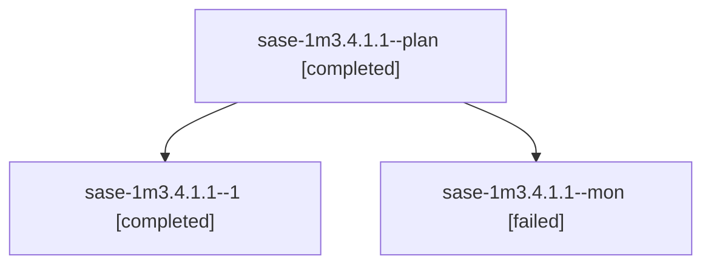

# Session: sase-1m3.4.1.1

[Agent Hoods](../README.md) / [bbugyi200](../users/bbugyi200/README.md) / [apollo](../users/bbugyi200/machines/apollo/README.md) / [sase-1m3](../users/bbugyi200/machines/apollo/hoods/sase-1m3/README.md) / sase-1m3.4.1.1

Owner: `bbugyi200.apollo` · Hood: `sase-1m3` · Members: 3 · Bead: [sase-1m3.4.1.1](https://github.com/sase-org/sase--beads/blob/main/pages/sase-1m3/sase-1m3.4.1.1.md)

## Lineage

The diagram is an optional enhancement; the ordered table below contains the same lineage in accessible text.

| Role | Agent | State | Model / provider | Timing | Commits | Prompt | Chat |
|---|---|---|---|---|---:|---|---|
| plan | sase-1m3.4.1.1--plan | completed | gpt-6-luna / codex | 2026-10-17T02:54:09.650497+00:00 → 2026-10-17T03:19:15.078314+00:00 | 0 | [Prompt](../agents/bbugyi200.apollo.sase-1m3.4.1.1--plan/prompt.md) | [Chat](../agents/bbugyi200.apollo.sase-1m3.4.1.1--plan/chat.md) |
| 1 | sase-1m3.4.1.1--1 | completed | gpt-6-luna / codex | 2026-10-17T03:23:33.274603+00:00 → 2026-10-17T03:36:56.152939+00:00 | 0 | [Prompt](../agents/bbugyi200.apollo.sase-1m3.4.1.1--1/prompt.md) | [Chat](../agents/bbugyi200.apollo.sase-1m3.4.1.1--1/chat.md) |
| mon | sase-1m3.4.1.1--mon | failed | gpt-6-luna / codex | 2026-10-17T03:18:12.598264+00:00 → 2026-10-17T03:23:33.459996+00:00 | 0 | — | [Chat](../agents/bbugyi200.apollo.sase-1m3.4.1.1--mon/chat.md) |

## Neighbors

| Agent | Relation | State |
|---|---|---|
| [sase-1m3.4](bbugyi200.apollo.sase-1m3.4.md) (session · 3) | ancestor | failed 3 |
| [sase-1m3.4.1.2](../agents/bbugyi200.apollo.sase-1m3.4.1.2/README.md) | sase-1m3.4.1 hood | completed |
| [sase-1m3.4.1.3](../agents/bbugyi200.apollo.sase-1m3.4.1.3/README.md) | sase-1m3.4.1 hood | completed |
| [sase-1m3.4.1.4](../agents/bbugyi200.apollo.sase-1m3.4.1.4/README.md) | sase-1m3.4.1 hood | completed |
| [sase-1m3.4.1.land](bbugyi200.apollo.sase-1m3.4.1.land.md) (session · 3) | sase-1m3.4.1 hood | completed 2, failed 1 |
| [sase-1m3.1](../agents/bbugyi200.apollo.sase-1m3.1/README.md) | sase-1m3 hood | completed |
| [sase-1m3.10](../agents/bbugyi200.apollo.sase-1m3.10/README.md) | sase-1m3 hood | waiting |
| [sase-1m3.11](../agents/bbugyi200.apollo.sase-1m3.11/README.md) | sase-1m3 hood | waiting |
| [sase-1m3.12](../agents/bbugyi200.apollo.sase-1m3.12/README.md) | sase-1m3 hood | waiting |
| [sase-1m3.2](../agents/bbugyi200.apollo.sase-1m3.2/README.md) | sase-1m3 hood | completed |
| [sase-1m3.3](../agents/bbugyi200.apollo.sase-1m3.3/README.md) | sase-1m3 hood | active |
| [sase-1m3.5](../agents/bbugyi200.apollo.sase-1m3.5/README.md) | sase-1m3 hood | active |
| [sase-1m3.6](../agents/bbugyi200.apollo.sase-1m3.6/README.md) | sase-1m3 hood | failed |
| [sase-1m3.7](bbugyi200.apollo.sase-1m3.7.md) (session · 3) | sase-1m3 hood | failed 3 |
| [sase-1m3.7.1.1](../agents/bbugyi200.apollo.sase-1m3.7.1.1/README.md) | sase-1m3 hood | failed |
| [sase-1m3.7.1.2](../agents/bbugyi200.apollo.sase-1m3.7.1.2/README.md) | sase-1m3 hood | waiting |
| [sase-1m3.7.1.3](../agents/bbugyi200.apollo.sase-1m3.7.1.3/README.md) | sase-1m3 hood | waiting |
| [sase-1m3.7.1.4](../agents/bbugyi200.apollo.sase-1m3.7.1.4/README.md) | sase-1m3 hood | waiting |
| [sase-1m3.7.1.5](../agents/bbugyi200.apollo.sase-1m3.7.1.5/README.md) | sase-1m3 hood | waiting |
| [sase-1m3.7.1.land](../agents/bbugyi200.apollo.sase-1m3.7.1.land/README.md) | sase-1m3 hood | waiting |
| [sase-1m3.8](../agents/bbugyi200.apollo.sase-1m3.8/README.md) | sase-1m3 hood | waiting |
| [sase-1m3.9](../agents/bbugyi200.apollo.sase-1m3.9/README.md) | sase-1m3 hood | waiting |
| [sase-1m3.land](../agents/bbugyi200.apollo.sase-1m3.land/README.md) | sase-1m3 hood | waiting |
