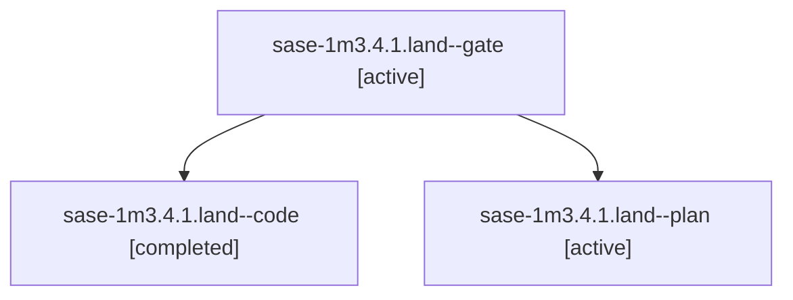

# Session: sase-1m3.4.1.land

[Agent Hoods](../README.md) / [bbugyi200](../users/bbugyi200/README.md) / [apollo](../users/bbugyi200/machines/apollo/README.md) / [sase-1m3](../users/bbugyi200/machines/apollo/hoods/sase-1m3/README.md) / sase-1m3.4.1.land

Owner: `bbugyi200.apollo` · Hood: `sase-1m3` · Members: 3 · Bead: [sase-1m3.4.1](https://github.com/sase-org/sase--beads/blob/main/pages/sase-1m3/sase-1m3.4.1.md)

## Lineage



The diagram is an optional enhancement; the ordered table below contains the same lineage in accessible text.

| Role | Agent | State | Model / provider | Timing | Commits | Prompt | Chat |
|---|---|---|---|---|---:|---|---|
| <a id="member-gate"></a>gate | sase-1m3.4.1.land--gate | active | gpt-6-astra / codex | 2026-10-17T05:53:34.682855+00:00 | 0 | — | [Chat](../agents/bbugyi200.apollo.sase-1m3.4.1.land--gate/chat.md) |
| <a id="member-code"></a>code | sase-1m3.4.1.land--code | completed | grok-4.6 / grok | 2026-10-17T05:54:21.258372+00:00 → 2026-10-17T08:24:07.761859+00:00 | 0 | — | [Chat](../agents/bbugyi200.apollo.sase-1m3.4.1.land--code/chat.md) |
| <a id="member-plan"></a>plan | sase-1m3.4.1.land--plan | active | gpt-6-astra / codex | 2026-10-17T05:41:59.618625+00:00 | 0 | [Prompt](../agents/bbugyi200.apollo.sase-1m3.4.1.land--plan/prompt.md) | [Chat](../agents/bbugyi200.apollo.sase-1m3.4.1.land--plan/chat.md) |

## Variables

| Role | Variable | Value |
|---|---|---|
| plan | `artifacts` | \[{kind: file, label: sase-1m3.4.1.2 deferred read\_blobs source at be2bfbee, path: /home/bryan/.sase/artifacts/agents/gh\_sase-org\_\_sase/20261016221649/blobs-51c10778d2db.rs, ref: file:explicit:e8cdcc9… |

#### artifacts

**Role:** `plan`

```yaml
- kind: file
  label: sase-1m3.4.1.2 deferred read_blobs source at be2bfbee
  path: /home/bryan/.sase/artifacts/agents/gh_sase-org__sase/20261016221649/blobs-51c10778d2db.rs
  ref: file:explicit:e8cdcc93ea565e0cc650ad8d
  source_path: /home/bryan/.local/state/sase/workspaces/sase-org/sase/sase_10/sase/repos/linked/sase-core/crates/sase_core/src/file_history/blobs.rs
- kind: file
  label: sase-1m3.4.1.2 deferred batched_diff_tree source at be2bfbee
  path: /home/bryan/.sase/artifacts/agents/gh_sase-org__sase/20261016221649/causes-891467241457.rs
  ref: file:explicit:8ed243df05c3e11469a2e8d8
  source_path: /home/bryan/.local/state/sase/workspaces/sase-org/sase/sase_10/sase/repos/linked/sase-core/crates/sase_core/src/memory_history/causes.rs
```

Values are truncated for display; see each member's agent meta.json for the full values.

## Neighbors

| Agent | Relation | State |
|---|---|---|
| [sase-1m3.4](bbugyi200.apollo.sase-1m3.4.md) (session · 3) | ancestor | failed 3 |
| [sase-1m3.4.1.1](bbugyi200.apollo.sase-1m3.4.1.1.md) (session · 3) | sase-1m3.4.1 hood | active 3 |
| [sase-1m3.4.1.2](../agents/bbugyi200.apollo.sase-1m3.4.1.2/README.md) | sase-1m3.4.1 hood | active |
| [sase-1m3.4.1.3](../agents/bbugyi200.apollo.sase-1m3.4.1.3/README.md) | sase-1m3.4.1 hood | active |
| [sase-1m3.4.1.4](../agents/bbugyi200.apollo.sase-1m3.4.1.4/README.md) | sase-1m3.4.1 hood | active |
| [sase-1m3.1](../agents/bbugyi200.apollo.sase-1m3.1/README.md) | sase-1m3 hood | completed |
| [sase-1m3.10](../agents/bbugyi200.apollo.sase-1m3.10/README.md) | sase-1m3 hood | waiting |
| [sase-1m3.11](../agents/bbugyi200.apollo.sase-1m3.11/README.md) | sase-1m3 hood | waiting |
| [sase-1m3.12](../agents/bbugyi200.apollo.sase-1m3.12/README.md) | sase-1m3 hood | waiting |
| [sase-1m3.2](../agents/bbugyi200.apollo.sase-1m3.2/README.md) | sase-1m3 hood | completed |
| [sase-1m3.3](../agents/bbugyi200.apollo.sase-1m3.3/README.md) | sase-1m3 hood | completed |
| [sase-1m3.5](../agents/bbugyi200.apollo.sase-1m3.5/README.md) | sase-1m3 hood | completed |
| [sase-1m3.6](../agents/bbugyi200.apollo.sase-1m3.6/README.md) | sase-1m3 hood | completed |
| [sase-1m3.7](bbugyi200.apollo.sase-1m3.7.md) (session · 3) | sase-1m3 hood | failed 3 |
| [sase-1m3.7.1.1](../agents/bbugyi200.apollo.sase-1m3.7.1.1/README.md) | sase-1m3 hood | completed |
| [sase-1m3.7.1.2](bbugyi200.apollo.sase-1m3.7.1.2.md) (session · 5) | sase-1m3 hood | active 1, completed 2, failed 2 |
| [sase-1m3.7.1.3](../agents/bbugyi200.apollo.sase-1m3.7.1.3/README.md) | sase-1m3 hood | completed |
| [sase-1m3.7.1.4](../agents/bbugyi200.apollo.sase-1m3.7.1.4/README.md) | sase-1m3 hood | waiting |
| [sase-1m3.7.1.5](../agents/bbugyi200.apollo.sase-1m3.7.1.5/README.md) | sase-1m3 hood | waiting |
| [sase-1m3.7.1.land](../agents/bbugyi200.apollo.sase-1m3.7.1.land/README.md) | sase-1m3 hood | waiting |
| [sase-1m3.8](bbugyi200.apollo.sase-1m3.8.md) (session · 2) | sase-1m3 hood | completed 1, failed 1 |
| [sase-1m3.9](../agents/bbugyi200.apollo.sase-1m3.9/README.md) | sase-1m3 hood | waiting |
| [sase-1m3.land](../agents/bbugyi200.apollo.sase-1m3.land/README.md) | sase-1m3 hood | waiting |
