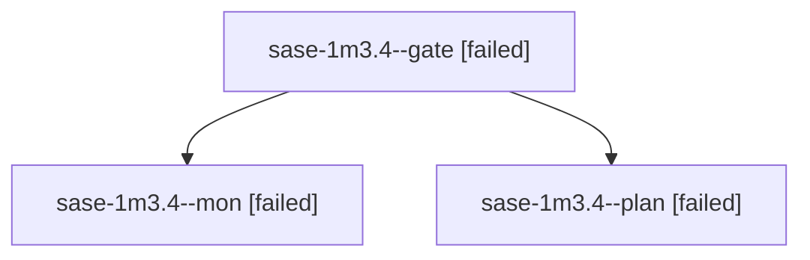

# Session: sase-1m3.4

[Agent Hoods](../README.md) / [bbugyi200](../users/bbugyi200/README.md) / [apollo](../users/bbugyi200/machines/apollo/README.md) / [sase-1m3](../users/bbugyi200/machines/apollo/hoods/sase-1m3/README.md) / sase-1m3.4

Owner: `bbugyi200.apollo` · Hood: `sase-1m3` · Members: 3 · Bead: [sase-1m3.4](https://github.com/sase-org/sase--beads/blob/main/pages/sase-1m3/sase-1m3.4.md)

## Lineage

The diagram is an optional enhancement; the ordered table below contains the same lineage in accessible text.

| Role | Agent | State | Model / provider | Timing | Commits | Prompt | Chat |
|---|---|---|---|---|---:|---|---|
| gate | sase-1m3.4--gate | failed | gpt-6-astra / codex | 2026-10-17T02:15:31.646157+00:00 → 2026-10-17T02:15:51.924372+00:00 | 0 | — | [Chat](../agents/bbugyi200.apollo.sase-1m3.4--gate/chat.md) |
| mon | sase-1m3.4--mon | failed | gpt-6-astra / codex | 2026-10-17T02:15:50.838878+00:00 → 2026-10-17T02:17:25.627285+00:00 | 0 | — | [Chat](../agents/bbugyi200.apollo.sase-1m3.4--mon/chat.md) |
| plan | sase-1m3.4--plan | failed | gpt-6-astra / codex | 2026-10-17T02:07:05.794199+00:00 → 2026-10-17T02:16:15.432178+00:00 | 0 | [Prompt](../agents/bbugyi200.apollo.sase-1m3.4--plan/prompt.md) | [Chat](../agents/bbugyi200.apollo.sase-1m3.4--plan/chat.md) |

## Neighbors

| Agent | Relation | State |
|---|---|---|
| [sase-1m3.4.1.1](bbugyi200.apollo.sase-1m3.4.1.1.md) (session · 3) | descendant | active 3 |
| [sase-1m3.4.1.2](../agents/bbugyi200.apollo.sase-1m3.4.1.2/README.md) | descendant | active |
| [sase-1m3.4.1.3](../agents/bbugyi200.apollo.sase-1m3.4.1.3/README.md) | descendant | active |
| [sase-1m3.4.1.4](../agents/bbugyi200.apollo.sase-1m3.4.1.4/README.md) | descendant | active |
| [sase-1m3.4.1.land](bbugyi200.apollo.sase-1m3.4.1.land.md) (session · 3) | descendant | active 2, completed 1 |
| [sase-1m3.1](../agents/bbugyi200.apollo.sase-1m3.1/README.md) | sase-1m3 hood | completed |
| [sase-1m3.10](../agents/bbugyi200.apollo.sase-1m3.10/README.md) | sase-1m3 hood | waiting |
| [sase-1m3.11](../agents/bbugyi200.apollo.sase-1m3.11/README.md) | sase-1m3 hood | waiting |
| [sase-1m3.12](../agents/bbugyi200.apollo.sase-1m3.12/README.md) | sase-1m3 hood | waiting |
| [sase-1m3.2](../agents/bbugyi200.apollo.sase-1m3.2/README.md) | sase-1m3 hood | completed |
| [sase-1m3.3](../agents/bbugyi200.apollo.sase-1m3.3/README.md) | sase-1m3 hood | completed |
| [sase-1m3.5](../agents/bbugyi200.apollo.sase-1m3.5/README.md) | sase-1m3 hood | completed |
| [sase-1m3.6](../agents/bbugyi200.apollo.sase-1m3.6/README.md) | sase-1m3 hood | completed |
| [sase-1m3.7](bbugyi200.apollo.sase-1m3.7.md) (session · 3) | sase-1m3 hood | failed 3 |
| [sase-1m3.7.1.1](../agents/bbugyi200.apollo.sase-1m3.7.1.1/README.md) | sase-1m3 hood | completed |
| [sase-1m3.7.1.2](bbugyi200.apollo.sase-1m3.7.1.2.md) (session · 5) | sase-1m3 hood | active 1, completed 2, failed 2 |
| [sase-1m3.7.1.3](../agents/bbugyi200.apollo.sase-1m3.7.1.3/README.md) | sase-1m3 hood | completed |
| [sase-1m3.7.1.4](../agents/bbugyi200.apollo.sase-1m3.7.1.4/README.md) | sase-1m3 hood | waiting |
| [sase-1m3.7.1.5](../agents/bbugyi200.apollo.sase-1m3.7.1.5/README.md) | sase-1m3 hood | waiting |
| [sase-1m3.7.1.land](../agents/bbugyi200.apollo.sase-1m3.7.1.land/README.md) | sase-1m3 hood | waiting |
| [sase-1m3.8](bbugyi200.apollo.sase-1m3.8.md) (session · 2) | sase-1m3 hood | completed 1, failed 1 |
| [sase-1m3.9](../agents/bbugyi200.apollo.sase-1m3.9/README.md) | sase-1m3 hood | waiting |
| [sase-1m3.land](../agents/bbugyi200.apollo.sase-1m3.land/README.md) | sase-1m3 hood | waiting |
