# Session: sase-1m3.7.1.5

[Agent Hoods](../README.md) / [bbugyi200](../users/bbugyi200/README.md) / [apollo](../users/bbugyi200/machines/apollo/README.md) / [sase-1m3](../users/bbugyi200/machines/apollo/hoods/sase-1m3/README.md) / sase-1m3.7.1.5

Owner: `bbugyi200.apollo` · Hood: `sase-1m3` · Members: 13 · Bead: [sase-1m3.7.1.5](https://github.com/sase-org/sase--beads/blob/main/pages/sase-1m3/sase-1m3.7.1.5.md)

## Lineage

```mermaid
flowchart TD
  n0["sase-1m3.7.1.5--mon-3 [failed]"]
  n1["sase-1m3.7.1.5--4 [completed]"]
  n0 --> n1
  n2["sase-1m3.7.1.5--6 [completed]"]
  n0 --> n2
  n3["sase-1m3.7.1.5--5 [completed]"]
  n0 --> n3
  n4["sase-1m3.7.1.5--3 [completed]"]
  n0 --> n4
  n5["sase-1m3.7.1.5--mon-1 [failed]"]
  n0 --> n5
  n6["sase-1m3.7.1.5--1 [completed]"]
  n0 --> n6
  n7["sase-1m3.7.1.5--mon-4 [failed]"]
  n0 --> n7
  n8["sase-1m3.7.1.5--mon-2 [failed]"]
  n0 --> n8
  n9["sase-1m3.7.1.5--mon-0 [failed]"]
  n0 --> n9
  n10["sase-1m3.7.1.5--2 [completed]"]
  n0 --> n10
  n11["sase-1m3.7.1.5--plan [completed]"]
  n0 --> n11
  n12["sase-1m3.7.1.5--mon [failed]"]
  n0 --> n12
```



The diagram is an optional enhancement; the ordered table below contains the same lineage in accessible text.

| Role | Agent | State | Model / provider | Timing | Commits | Prompt | Chat |
|---|---|---|---|---|---:|---|---|
| <a id="member-mon-3"></a>mon-3 | sase-1m3.7.1.5--mon-3 | failed | gpt-6-astra / codex | 2026-10-18T20:00:14.649812+00:00 → 2026-10-18T20:02:30.650786+00:00 | 0 | — | [Chat](../agents/bbugyi200.apollo.sase-1m3.7.1.5--mon-3/chat.md) |
| <a id="member-4"></a>4 | sase-1m3.7.1.5--4 | completed | gpt-6-astra / codex | 2026-10-18T17:54:12.307622+00:00 → 2026-10-18T20:01:21.076709+00:00 | 0 | [Prompt](../agents/bbugyi200.apollo.sase-1m3.7.1.5--4/prompt.md) | [Chat](../agents/bbugyi200.apollo.sase-1m3.7.1.5--4/chat.md) |
| <a id="member-6"></a>6 | sase-1m3.7.1.5--6 | completed | gpt-6-astra / codex | 2026-10-18T21:58:38.309590+00:00 → 2026-10-18T22:25:48.403331+00:00 | [1](../agents/bbugyi200.apollo.sase-1m3.7.1.5--6/README.md#commits) | [Prompt](../agents/bbugyi200.apollo.sase-1m3.7.1.5--6/prompt.md) | [Chat](../agents/bbugyi200.apollo.sase-1m3.7.1.5--6/chat.md) |
| <a id="member-5"></a>5 | sase-1m3.7.1.5--5 | completed | gpt-6-astra / codex | 2026-10-18T20:02:30.374340+00:00 → 2026-10-18T20:49:18.438246+00:00 | 0 | [Prompt](../agents/bbugyi200.apollo.sase-1m3.7.1.5--5/prompt.md) | [Chat](../agents/bbugyi200.apollo.sase-1m3.7.1.5--5/chat.md) |
| <a id="member-3"></a>3 | sase-1m3.7.1.5--3 | completed | gpt-6-astra / codex | 2026-10-18T17:01:52.266933+00:00 → 2026-10-18T17:09:55.899295+00:00 | 0 | [Prompt](../agents/bbugyi200.apollo.sase-1m3.7.1.5--3/prompt.md) | [Chat](../agents/bbugyi200.apollo.sase-1m3.7.1.5--3/chat.md) |
| <a id="member-mon-1"></a>mon-1 | sase-1m3.7.1.5--mon-1 | failed | gpt-6-astra / codex | 2026-10-18T16:54:40.145373+00:00 → 2026-10-18T17:01:43.471661+00:00 | 0 | — | [Chat](../agents/bbugyi200.apollo.sase-1m3.7.1.5--mon-1/chat.md) |
| <a id="member-1"></a>1 | sase-1m3.7.1.5--1 | completed | gpt-6-astra / codex | 2026-10-18T15:42:09.280595+00:00 → 2026-10-18T15:46:29.267680+00:00 | 0 | [Prompt](../agents/bbugyi200.apollo.sase-1m3.7.1.5--1/prompt.md) | [Chat](../agents/bbugyi200.apollo.sase-1m3.7.1.5--1/chat.md) |
| <a id="member-mon-4"></a>mon-4 | sase-1m3.7.1.5--mon-4 | failed | gpt-6-astra / codex | 2026-10-18T20:47:52.506959+00:00 → 2026-10-18T21:58:38.591153+00:00 | 0 | — | [Chat](../agents/bbugyi200.apollo.sase-1m3.7.1.5--mon-4/chat.md) |
| <a id="member-mon-2"></a>mon-2 | sase-1m3.7.1.5--mon-2 | failed | gpt-6-astra / codex | 2026-10-18T17:08:25.399450+00:00 → 2026-10-18T17:54:12.402833+00:00 | 0 | — | [Chat](../agents/bbugyi200.apollo.sase-1m3.7.1.5--mon-2/chat.md) |
| <a id="member-mon-0"></a>mon-0 | sase-1m3.7.1.5--mon-0 | failed | gpt-6-astra / codex | 2026-10-18T15:45:25.960956+00:00 → 2026-10-18T16:41:16.651625+00:00 | 0 | — | [Chat](../agents/bbugyi200.apollo.sase-1m3.7.1.5--mon-0/chat.md) |
| <a id="member-2"></a>2 | sase-1m3.7.1.5--2 | completed | gpt-6-astra / codex | 2026-10-18T16:41:16.125120+00:00 → 2026-10-18T16:56:03.812737+00:00 | 0 | [Prompt](../agents/bbugyi200.apollo.sase-1m3.7.1.5--2/prompt.md) | [Chat](../agents/bbugyi200.apollo.sase-1m3.7.1.5--2/chat.md) |
| <a id="member-plan"></a>plan | sase-1m3.7.1.5--plan | completed | gpt-6-astra / codex | 2026-10-18T15:30:55.595507+00:00 → 2026-10-18T15:40:49.660356+00:00 | 0 | [Prompt](../agents/bbugyi200.apollo.sase-1m3.7.1.5--plan/prompt.md) | [Chat](../agents/bbugyi200.apollo.sase-1m3.7.1.5--plan/chat.md) |
| <a id="member-mon"></a>mon | sase-1m3.7.1.5--mon | failed | gpt-6-astra / codex | 2026-10-18T15:39:47.218394+00:00 → 2026-10-18T15:42:08.310532+00:00 | 0 | — | [Chat](../agents/bbugyi200.apollo.sase-1m3.7.1.5--mon/chat.md) |

## Commits

| Role | Repo | Commit | Subject | Committed |
|---|---|---|---|---|
| 6 | sase | [`5fe54b5`](https://github.com/sase-org/sase/commit/5fe54b59745c9351702b8df667eb99fc927e8911) | feat(stats): advance core pin for measured SLOC snapshots | 2026-10-18 18:20:26 EDT |

## Variables

| Role | Variable | Value |
|---|---|---|
| 2 | `artifacts` | \[{bead: sase-1m3.7.1.5, kind: file, label: Project statistics tokei dependency gate, path: /home/bryan/.sase/artifacts/agents/gh\_sase-org\_\_sase/20261018124016/gate-evidence-1e15c0b2ab75.json, ref: fi… |
| 4 | `artifacts` | \[{bead: sase-1m3.7.1.5, kind: file, label: Correction to project statistics clean-build timing evidence, path: /home/bryan/.sase/artifacts/agents/gh\_sase-org\_\_sase/20261018135312/gate-isolation-corre… |
| 6 | `artifacts` | \[{bead: sase-1m3.7.1.5, kind: markdown, label: Project statistics tokei gate and performance report, path: /home/bryan/.sase/artifacts/agents/gh\_sase-org\_\_sase/20261018175738/final-report-bc6033857c8… |

#### artifacts

**Role:** `2`

```yaml
- bead: sase-1m3.7.1.5
  kind: file
  label: Project statistics tokei dependency gate
  path: /home/bryan/.sase/artifacts/agents/gh_sase-org__sase/20261018124016/gate-evidence-1e15c0b2ab75.json
  ref: file:explicit:6779f88bc85f208e69e02940
  source_path: /home/bryan/.local/state/sase/workspaces/sase-org/sase/sase_10/sase/repos/linked/sase-core/.git/project-stats-measurement/gate-evidence.json
```

#### artifacts

**Role:** `4`

```yaml
- bead: sase-1m3.7.1.5
  kind: file
  label: Correction to project statistics clean-build timing evidence
  path: /home/bryan/.sase/artifacts/agents/gh_sase-org__sase/20261018135312/gate-isolation-correction-0b794808d1a7.json
  ref: file:explicit:ea24bb0b3953dc8daa075f39
  source_path: /home/bryan/.local/state/sase/workspaces/sase-org/sase/sase_10/sase/repos/linked/sase-core/.git/project-stats-measurement/gate-isolation-correction.json
```

#### artifacts

**Role:** `6`

```yaml
- bead: sase-1m3.7.1.5
  kind: markdown
  label: Project statistics tokei gate and performance report
  path: /home/bryan/.sase/artifacts/agents/gh_sase-org__sase/20261018175738/final-report-bc6033857c86.md
  ref: file:explicit:f8fc12f54cb3f9b647451035
  source_path: /home/bryan/.local/state/sase/workspaces/sase-org/sase/sase_10/sase/repos/linked/sase-core/.git/project-stats-measurement/final-report.md
- bead: sase-1m3.7.1.5
  kind: file
  label: Project statistics reproducible measurement evidence
  path: /home/bryan/.sase/artifacts/agents/gh_sase-org__sase/20261018175738/project-stats-evidence.tar-4c3bc94d67c6.gz
  ref: file:explicit:cf0a3ec863e10c52c0785b78
  source_path: /home/bryan/.local/state/sase/workspaces/sase-org/sase/sase_10/sase/repos/linked/sase-core/.git/project-stats-measurement/project-stats-evidence.tar.gz
```

Values are truncated for display; see each member's agent meta.json for the full values.

## Neighbors

| Agent | Relation | State |
|---|---|---|
| [sase-1m3.7](bbugyi200.apollo.sase-1m3.7.md) (session · 3) | ancestor | failed 3 |
| [sase-1m3.7.1.1](../agents/bbugyi200.apollo.sase-1m3.7.1.1/README.md) | sase-1m3.7.1 hood | completed |
| [sase-1m3.7.1.2](bbugyi200.apollo.sase-1m3.7.1.2.md) (session · 5) | sase-1m3.7.1 hood | active 1, completed 2, failed 2 |
| [sase-1m3.7.1.2](../agents/bbugyi200.apollo.sase-1m3.7.1.2/README.md) | sase-1m3.7.1 hood | completed |
| [sase-1m3.7.1.3](../agents/bbugyi200.apollo.sase-1m3.7.1.3/README.md) | sase-1m3.7.1 hood | completed |
| [sase-1m3.7.1.4](../agents/bbugyi200.apollo.sase-1m3.7.1.4/README.md) | sase-1m3.7.1 hood | completed |
| [sase-1m3.7.1.land](bbugyi200.apollo.sase-1m3.7.1.land.md) (session · 7) | sase-1m3.7.1 hood | completed 4, failed 3 |
| [sase-1m3.1](../agents/bbugyi200.apollo.sase-1m3.1/README.md) | sase-1m3 hood | completed |
| [sase-1m3.10](../agents/bbugyi200.apollo.sase-1m3.10/README.md) | sase-1m3 hood | waiting |
| [sase-1m3.11](../agents/bbugyi200.apollo.sase-1m3.11/README.md) | sase-1m3 hood | waiting |
| [sase-1m3.12](../agents/bbugyi200.apollo.sase-1m3.12/README.md) | sase-1m3 hood | waiting |
| [sase-1m3.2](../agents/bbugyi200.apollo.sase-1m3.2/README.md) | sase-1m3 hood | completed |
| [sase-1m3.3](../agents/bbugyi200.apollo.sase-1m3.3/README.md) | sase-1m3 hood | completed |
| [sase-1m3.4](bbugyi200.apollo.sase-1m3.4.md) (session · 3) | sase-1m3 hood | failed 3 |
| [sase-1m3.4.1.1](bbugyi200.apollo.sase-1m3.4.1.1.md) (session · 3) | sase-1m3 hood | active 3 |
| [sase-1m3.4.1.2](../agents/bbugyi200.apollo.sase-1m3.4.1.2/README.md) | sase-1m3 hood | active |
| [sase-1m3.4.1.3](../agents/bbugyi200.apollo.sase-1m3.4.1.3/README.md) | sase-1m3 hood | active |
| [sase-1m3.4.1.4](../agents/bbugyi200.apollo.sase-1m3.4.1.4/README.md) | sase-1m3 hood | active |
| [sase-1m3.4.1.land](bbugyi200.apollo.sase-1m3.4.1.land.md) (session · 3) | sase-1m3 hood | active 2, completed 1 |
| [sase-1m3.5](../agents/bbugyi200.apollo.sase-1m3.5/README.md) | sase-1m3 hood | completed |
| [sase-1m3.6](../agents/bbugyi200.apollo.sase-1m3.6/README.md) | sase-1m3 hood | completed |
| [sase-1m3.8](bbugyi200.apollo.sase-1m3.8.md) (session · 2) | sase-1m3 hood | completed 1, failed 1 |
| [sase-1m3.8](../agents/bbugyi200.apollo.sase-1m3.8/README.md) | sase-1m3 hood | completed |
| [sase-1m3.9](bbugyi200.apollo.sase-1m3.9.md) (session · 3) | sase-1m3 hood | active 1, completed 1, failed 1 |
| [sase-1m3.land](../agents/bbugyi200.apollo.sase-1m3.land/README.md) | sase-1m3 hood | waiting |
