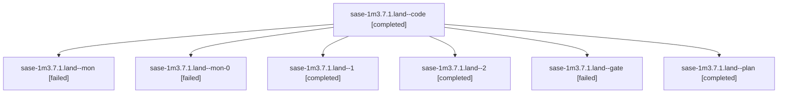

# Session: sase-1m3.7.1.land

[Agent Hoods](../README.md) / [bbugyi200](../users/bbugyi200/README.md) / [apollo](../users/bbugyi200/machines/apollo/README.md) / [sase-1m3](../users/bbugyi200/machines/apollo/hoods/sase-1m3/README.md) / sase-1m3.7.1.land

Owner: `bbugyi200.apollo` · Hood: `sase-1m3` · Members: 7 · Bead: [sase-1m3.7.1](https://github.com/sase-org/sase--beads/blob/main/pages/sase-1m3/sase-1m3.7.1.md)

## Lineage

The diagram is an optional enhancement; the ordered table below contains the same lineage in accessible text.

| Role | Agent | State | Model / provider | Timing | Commits | Prompt | Chat |
|---|---|---|---|---|---:|---|---|
| code | sase-1m3.7.1.land--code | completed | gpt-6-luna / codex | 2026-10-18T22:55:04.481754+00:00 → 2026-10-18T23:28:02.670992+00:00 | 0 | — | [Chat](../agents/bbugyi200.apollo.sase-1m3.7.1.land--code/chat.md) |
| mon | sase-1m3.7.1.land--mon | failed | gpt-6-luna / codex | 2026-10-18T23:26:01.709179+00:00 → 2026-10-18T23:40:29.505466+00:00 | 0 | — | [Chat](../agents/bbugyi200.apollo.sase-1m3.7.1.land--mon/chat.md) |
| mon-0 | sase-1m3.7.1.land--mon-0 | failed | gpt-6-luna / codex | 2026-10-18T23:43:42.844657+00:00 → 2026-10-19T00:18:05.306439+00:00 | 0 | — | [Chat](../agents/bbugyi200.apollo.sase-1m3.7.1.land--mon-0/chat.md) |
| 1 | sase-1m3.7.1.land--1 | completed | gpt-6-luna / codex | 2026-10-18T23:40:29.142586+00:00 → 2026-10-18T23:44:59.794297+00:00 | 0 | [Prompt](../agents/bbugyi200.apollo.sase-1m3.7.1.land--1/prompt.md) | [Chat](../agents/bbugyi200.apollo.sase-1m3.7.1.land--1/chat.md) |
| 2 | sase-1m3.7.1.land--2 | completed | gpt-6-luna / codex | 2026-10-19T00:18:06.908836+00:00 → 2026-10-19T01:41:04.042036+00:00 | [1](../agents/bbugyi200.apollo.sase-1m3.7.1.land--2/README.md#commits) | [Prompt](../agents/bbugyi200.apollo.sase-1m3.7.1.land--2/prompt.md) | [Chat](../agents/bbugyi200.apollo.sase-1m3.7.1.land--2/chat.md) |
| gate | sase-1m3.7.1.land--gate | failed | opus / claude | 2026-10-18T22:54:13.918718+00:00 → 2026-10-18T22:54:33.235737+00:00 | 0 | — | [Chat](../agents/bbugyi200.apollo.sase-1m3.7.1.land--gate/chat.md) |
| plan | sase-1m3.7.1.land--plan | completed | opus / claude | 2026-10-18T22:26:19.389114+00:00 → 2026-10-18T23:28:02.670992+00:00 | 0 | [Prompt](../agents/bbugyi200.apollo.sase-1m3.7.1.land--plan/prompt.md) | [Chat](../agents/bbugyi200.apollo.sase-1m3.7.1.land--plan/chat.md) |

## Commits

| Role | Repo | Commit | Subject | Committed |
|---|---|---|---|---|
| 2 | sase | [`dd963c0`](https://github.com/sase-org/sase/commit/dd963c0fa64ab25beeaf84ac8e9d073bbb518c91) | fix(stats): align project code counter with SLOC | 2026-10-18 21:32:50 EDT |

## Neighbors

| Agent | Relation | State |
|---|---|---|
| [sase-1m3.7](bbugyi200.apollo.sase-1m3.7.md) (session · 3) | ancestor | failed 3 |
| [sase-1m3.7.1.1](../agents/bbugyi200.apollo.sase-1m3.7.1.1/README.md) | sase-1m3.7.1 hood | completed |
| [sase-1m3.7.1.2](bbugyi200.apollo.sase-1m3.7.1.2.md) (session · 5) | sase-1m3.7.1 hood | active 1, completed 2, failed 2 |
| [sase-1m3.7.1.2](../agents/bbugyi200.apollo.sase-1m3.7.1.2/README.md) | sase-1m3.7.1 hood | completed |
| [sase-1m3.7.1.3](../agents/bbugyi200.apollo.sase-1m3.7.1.3/README.md) | sase-1m3.7.1 hood | completed |
| [sase-1m3.7.1.4](../agents/bbugyi200.apollo.sase-1m3.7.1.4/README.md) | sase-1m3.7.1 hood | completed |
| [sase-1m3.7.1.5](bbugyi200.apollo.sase-1m3.7.1.5.md) (session · 13) | sase-1m3.7.1 hood | completed 7, failed 6 |
| [sase-1m3.7.1.5](../agents/bbugyi200.apollo.sase-1m3.7.1.5/README.md) | sase-1m3.7.1 hood | waiting |
| [sase-1m3.1](../agents/bbugyi200.apollo.sase-1m3.1/README.md) | sase-1m3 hood | completed |
| [sase-1m3.10](../agents/bbugyi200.apollo.sase-1m3.10/README.md) | sase-1m3 hood | completed |
| [sase-1m3.11](bbugyi200.apollo.sase-1m3.11.md) (session · 15) | sase-1m3 hood | completed 8, failed 7 |
| [sase-1m3.12](bbugyi200.apollo.sase-1m3.12.md) (session · 3) | sase-1m3 hood | active 1, completed 1, failed 1 |
| [sase-1m3.2](../agents/bbugyi200.apollo.sase-1m3.2/README.md) | sase-1m3 hood | completed |
| [sase-1m3.3](../agents/bbugyi200.apollo.sase-1m3.3/README.md) | sase-1m3 hood | completed |
| [sase-1m3.4](bbugyi200.apollo.sase-1m3.4.md) (session · 3) | sase-1m3 hood | failed 3 |
| [sase-1m3.4.1.1](bbugyi200.apollo.sase-1m3.4.1.1.md) (session · 3) | sase-1m3 hood | active 3 |
| [sase-1m3.4.1.2](../agents/bbugyi200.apollo.sase-1m3.4.1.2/README.md) | sase-1m3 hood | active |
| [sase-1m3.4.1.3](../agents/bbugyi200.apollo.sase-1m3.4.1.3/README.md) | sase-1m3 hood | active |
| [sase-1m3.4.1.4](../agents/bbugyi200.apollo.sase-1m3.4.1.4/README.md) | sase-1m3 hood | active |
| [sase-1m3.4.1.land](bbugyi200.apollo.sase-1m3.4.1.land.md) (session · 3) | sase-1m3 hood | active 2, completed 1 |
| [sase-1m3.5](../agents/bbugyi200.apollo.sase-1m3.5/README.md) | sase-1m3 hood | completed |
| [sase-1m3.6](../agents/bbugyi200.apollo.sase-1m3.6/README.md) | sase-1m3 hood | completed |
| [sase-1m3.8](bbugyi200.apollo.sase-1m3.8.md) (session · 2) | sase-1m3 hood | completed 1, failed 1 |
| [sase-1m3.8](../agents/bbugyi200.apollo.sase-1m3.8/README.md) | sase-1m3 hood | completed |
| [sase-1m3.9](bbugyi200.apollo.sase-1m3.9.md) (session · 3) | sase-1m3 hood | completed 2, failed 1 |
| [sase-1m3.land](../agents/bbugyi200.apollo.sase-1m3.land/README.md) | sase-1m3 hood | waiting |
